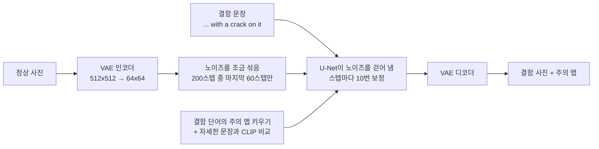
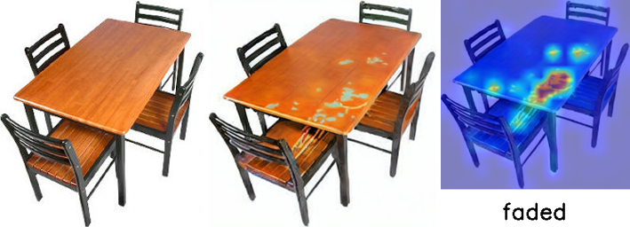
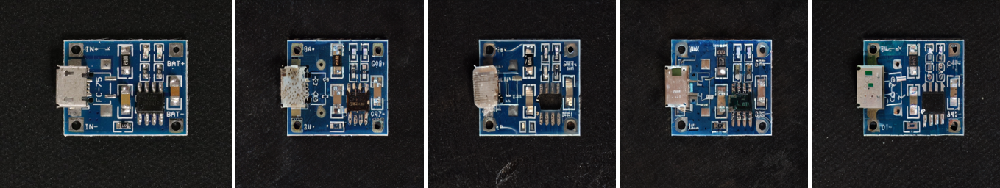
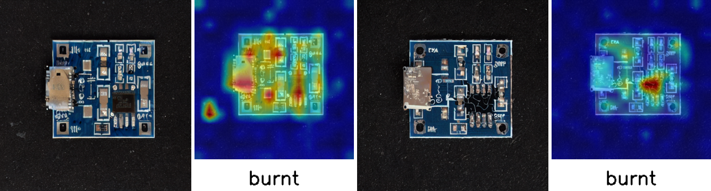

# 8-2. 생성형 AI를 활용한 제조결함 데이터 생성

**정상 사진 1장과 결함을 설명하는 문장**만으로, 추가 학습 없이 결함 사진을 만드는 AnomalyAny(CVPR 2025, EPFL)를 실습했습니다. 원본 코드를 그대로 돌린 뒤, 결과가 왜 그렇게 나왔는지 개인 실험 2개로 확인했습니다.

## 한눈에 보기

| 질문 | 답 (근거) |
|---|---|
| 정상 사진 1장으로 결함을 만들 수 있나? | **물체에 따라 다르다.** 탁자는 상판에 얼룩, 헤이즐넛은 4장 중 2장이 균열, PCB는 `crack` 문장으로 4장 중 0장 |
| 결함은 어디에 생기나? | **결함 단어의 주의(attention)가 몰린 자리.** `faded`의 주의가 몰린 상판 가운데에 얼룩이 생겼다 |
| PCB는 왜 안 됐나? | 문장이 맞지 않았다. "탄 자국", "부품 누락"으로 바꾸니 4장 중 2장이 결함처럼 보였다 (실험 ①) |
| 생성 결과를 AI로 걸러 낼 수 있나? | **자동으로는 못 한다.** PaDiM은 8장 모두 불량으로 봤다. 결함 자리뿐 아니라 다시 그려진 커넥터에도 반응했다 (실험 ②) |

## 실행 흐름

- `init_image_guidance_scale=0.3`이라 200스텝 중 마지막 60스텝만 돈다. 그래서 진행 표시줄이 61/200에서 끝나고, 물체의 모양과 배치는 거의 그대로 남는다.
- 문장은 세 개를 쓴다: 그림을 만드는 `prompt`, 정상 기준 `normal_prompt`, 결함을 자세히 풀어 쓴 `detailed_prompt`.

## 원본 실행 결과 (코랩 Pro A100, 1장 3~4분)

| 물체 / 결함 문장 | 결과 |
|---|---|
| 탁자 / faded (1장) | 모양은 그대로이고 상판에 희끗한 얼룩이 생겼다. "햇빛에 바램"보다는 얼룩에 가깝다 |
| 헤이즐넛 / crack (4장) | 2장은 금이 뚜렷했다. 1장은 배경에 검은 부스러기가 생겼고, 1장은 정상과 거의 같았다 |
| PCB / crack (4장) | 균열은 0장. 커넥터가 망가지거나 바닥이 긁혔고, 4장 모두 인쇄 글자와 배선이 뭉개졌다 |

단어별 주의 맵을 보면 물체 단어(`table`)는 탁자 전체를, 결함 단어(`faded`)는 상판 가운데 좁은 곳을 비춘다. 그 자리에 얼룩이 생겼다.

## 개인 실험

### ① PCB에 맞는 결함 문장 (시드 0, 1 고정)

`crack` 대신 PCB에 실제로 생기는 결함을 문장으로 줬다.

| 문장 | 시드 0 | 시드 1 |
|---|---|---|
| missing component (부품 누락) | 부품 자리가 빈 패드로 바뀜 | 결함이 뚜렷하지 않음 |
| burnt mark (탄 자국) | 결함이 뚜렷하지 않음 | IC 주변이 까맣게 탐 (주의 맵과 같은 자리) |

- 4장 중 2장이 결함처럼 보였다(`crack`은 4장 중 0장). 원본 셀은 시드가 출력되지 않아 같은 시드로 비교하지 못했고 장수가 적어서 단정하지는 않는다.
- 같은 시드끼리는 문장이 달라도 기판 모양이 거의 같았다. 전체 모습은 시드가, 결함이 생기는 자리는 결함 단어의 주의가 정한다.

### ② 6주차 PaDiM으로 채점하기

생성한 결함 사진을 사람 대신 AI가 먼저 걸러 줄 수 있는지 보려고, 6주차와 같은 설정의 PaDiM(VisA pcb4 실제 정상 804장으로 학습)에 넣었다.

| 이미지 | 이상 점수 | 판정 (기준 23.84) |
|---|---|---|
| VisA 테스트 (확인용) | AUROC 0.9824 | 실제 불량을 잘 가려냄 |
| `normal.png` 원본 / 512×512 / VAE 압축·복원만 | 14.69 / 14.58 / 19.18 | 모두 정상 |
| 생성 이미지 8장 (crack 4, missing 2, burnt 2) | 30.38~42.17 | **모두 불량** |

- **예상과 다른 결과**: 눈으로는 결함이 안 보이던 3장도 불량으로 판정됐다.
- 히트맵은 탄 자국(42.17, 최고점)과 바닥 긁힘을 정확히 가리켰지만, 8장 모두 **다시 그려진 USB 커넥터**에도 반응했다.
- VAE 압축·복원만 한 사진(19.18)은 정상이었으니 압축 자체가 원인은 아니고, 디노이징 중에 기판이 다시 그려진 흔적이 원인으로 보인다.
- PaDiM은 "정상과 다른 곳"을 찾을 뿐, 의도한 결함인지 생성 흔적인지는 구분하지 못한다. 자동 선별에는 못 쓰지만, 사람이 어디를 볼지 알려 주는 1차 검사로는 쓸 수 있다.

## 원본 코드에서 걸린 것

| 실제로 겪은 것 | 어떻게 했나 |
|---|---|
| `CLIPFeatureExtractor` import 에러 (코랩 transformers 5.18). transformers만 낮추면 diffusers 0.40과 충돌 | `transformers<5` + `diffusers==0.30.3`으로 맞춤 |
| `%load_ext autoreload` 에러 (Python 3.13에 `imp` 없음) | 개발용 기능이라 주석 처리 |
| 코랩에서 `image_guidance.show()`가 그림을 띄우지 않음 | `display()`로 바꿈 |

| 실행 전에 미리 고친 것 | 어떻게 했나 |
|---|---|
| 설치 셀이 없음 (`pyrallis`, `clip` 필요, 실행해 보니 코랩에 없었음) | 설치 줄 추가 |
| PCB용 `normal.png`가 저장소에 없음 | 원본 노트북 출력에서 꺼내 저장 |

모델 주소 `runwayml/stable-diffusion-v1-5`는 처음에 저장소가 사라진 줄 알고 미러 주소로 바꿨다. 확인해 보니 옛 주소가 새 주소로 자동 연결돼 원본 줄 그대로 돌아가서 되돌렸다. 원본 코드는 그대로 두고, 바꾼 줄은 바로 위에 원본 줄과 이유를 주석으로 남겼다.

## 개인 회고

### 실습을 통해 알게 된 것

공장에서는 불량이 드물어서 결함 사진을 모으기 어렵다. 이번 실습의 AnomalyAny는 정상 사진 1장과 결함을 설명하는 문장만으로, 추가 학습 없이 Stable Diffusion에서 결함이 있는 사진을 만든다. 정상 사진에 노이즈를 조금만 섞어서 출발하기 때문에(200스텝 중 마지막 60스텝만 진행) 물체의 모양과 배치는 거의 그대로 남고, 결함 단어(`faded`, `crack`)가 그림에 강하게 반영되도록 주의(attention) 맵을 키우면서 결함을 그려 넣는다.

단어별 주의 맵을 그려 보니 물체 단어(`table`)는 물체 전체를, 결함 단어(`faded`)는 상판 가운데 좁은 곳을 비췄고, 실제로 그 자리에 얼룩이 생겼다. 결함 단어의 주의 맵이 결함 위치를 알려 주므로, 결함 이미지와 함께 "어디가 불량인지"를 나타내는 마스크도 얻을 수 있겠다고 생각했다. 이상 탐지 모델을 평가하려면 이런 픽셀 단위 정답이 필요하다.

하지만 만든다고 다 쓸 수 있는 것은 아니었다. 헤이즐넛 균열은 4장 중 2장만 그럴듯했고, 나머지는 배경에 엉뚱한 자국이 생기거나 정상과 거의 같았다. 탁자는 "햇빛에 바램"보다 얼룩에 가까웠고, PCB는 균열 대신 커넥터가 망가지거나 글자와 배선이 뭉개졌다. 생성한 결함 데이터는 사람이 보고 골라야 하고, 물체에 맞는 결함 문장을 고르는 것이 중요하다는 것을 알게 됐다.

### 어려웠던 것

주의(attention) 맵을 이해하는 것이 가장 어려웠다. 문장 속 단어 하나가 그림의 어느 자리에 영향을 주는지 나타낸 지도라는 것까지는 알겠는데, 이걸 키우면 왜 그 자리에 결함이 생기는지는 바로 와닿지 않았다. 단어별 주의 맵을 나란히 그려 보고, `faded`의 주의가 몰린 상판 가운데에 실제로 얼룩이 생긴 것을 보고 나서야 이해가 됐다.

생성된 그림이 결함인지 아닌지 판단하는 것도 어려웠다. 탁자의 얼룩은 "햇빛에 바램"이라고 보기 애매했고, PCB의 글자와 배선이 뭉개진 것은 결함인지 생성 과정의 흔적인지 헷갈렸다. 결함 이미지 1장에 3\~4분이 걸려서 여러 장을 만들려면 기다리는 시간이 길었다. 하지만 교수님이 현장에서는 오래 걸리는 작업이 하루 단위로 걸린다고 말씀하셔서, 부담 갖지 않고 그냥 해 봤다.

### 좋았던 점

정상 사진 1장과 문장만으로, 추가 학습 없이 결함 이미지가 나오는 것이 신기했다. 주의 맵으로 결함 단어가 그림의 어디에 영향을 주는지 눈으로 확인할 수 있어서 좋았고, 개인 실험에서 PCB에 맞는 문장(탄 자국)으로 바꾸니 실제 결함처럼 나와서 뿌듯했다. 코랩 Pro의 A100으로 돌려서 1장이 3분 남짓(187\~197초)이면 끝난 것도 좋았다.

### 현장에 쓴다면

드문 불량 사진을 이 방법으로 만들어 불량 데이터를 보충하는 데 쓸 것 같다. 다만 결과가 들쭉날쭉해서 그대로 쓰지 않고 사람이 보고 쓸 만한 것만 고를 것이다. 고르는 일은 생성 결과를 분석하는 AI를 하나 더 두어 도움을 받으면 좋겠다고 생각했는데, 개인 실험에서 PaDiM으로 해 보니 결함이 생긴 자리는 잘 찾았지만 생성 과정에서 다시 그려진 부분까지 불량으로 봤다. 그래서 AI는 "어디가 달라졌는지"를 표시해 주는 1차 검사로 쓰고, 그게 실제 결함처럼 보이는지는 사람이 최종 판단하는 식으로 나눠 쓸 것이다. 결함 문장은 "균열" 같은 일반적인 말보다 그 제품에 실제로 생기는 결함으로 정하고, 시드를 고정해 기록해 두어 좋은 결과를 다시 만들 수 있게 할 것이다.

### 앞으로 해 볼 것

PaDiM이 생성 이미지를 모두 불량으로 본 이유가 커넥터처럼 매번 다시 그려지는 부분 때문이었으니, 마스크(`mask_image`)로 결함을 넣을 자리만 바뀌게 하고 나머지는 정상 사진 그대로 두면 PaDiM이 결함 자리에만 반응하는지 확인해 보고 싶다. 그렇게 되면 생성 이미지를 AI로 걸러 내는 방법이 실제로 쓸 만해질 것 같다.
