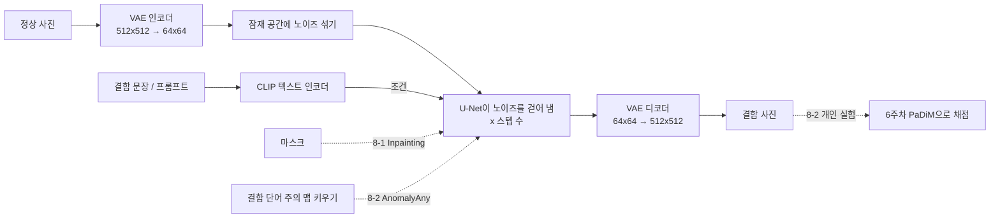
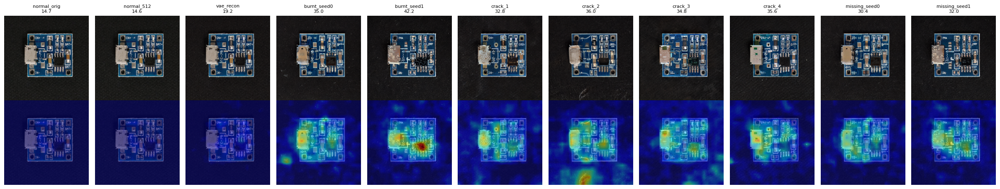
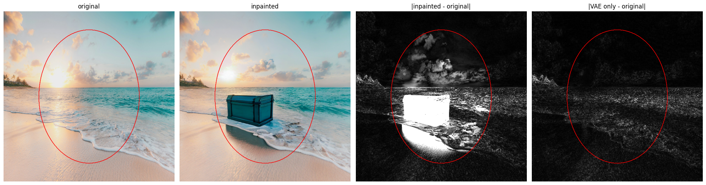

# 8주차. 생성형 AI로 제조 결함 데이터 만들기

공장에는 불량 사진이 드물어서, 불량을 찾는 모델을 학습하거나 시험할 데이터가 부족합니다. 8주차에는 Stable Diffusion으로 **정상 사진에 결함을 그려 넣어 불량 데이터를 만들 수 있는지** 두 가지 방법으로 실습했습니다. 원본 코드를 그대로 돌린 뒤, 결과가 왜 그렇게 나왔는지 개인 실험 6개로 확인했습니다.

| | 8-1. Stable Diffusion 실습 | 8-2. 결함 데이터 생성 (AnomalyAny) |
|---|---|---|
| 방법 | 글로 그림 만들기(Text-to-Image), 마스크 부분만 다시 그리기(Inpainting) | 정상 사진 1장 + 결함 문장 → 결함 단어의 주의(attention)를 키워 결함을 그려 넣음 |
| 대상 | 우주인, 회색 판, 해변 사진 | 탁자(바램), 헤이즐넛(균열), PCB(균열) |
| 개인 실험 | 스텝 수, guidance, 시드 20장, 마스크 밖 변화 | PCB에 맞는 결함 문장, 6주차 PaDiM으로 채점 |
| 자세히 | [8-1 README](../06_생성AI_StableDiffusion/README.md) | [8-2 README](README.md) |

## 실행 흐름

## 핵심 발견

**1. 생성 결과는 들쭉날쭉해서, 여러 장 만들고 골라야 한다.**

| 생성 | 원하는 대로 나온 비율 |
|---|---|
| 8-1 "말을 탄 우주인" (시드 20개) | 말이 나온 그림 10/20 |
| 8-2 헤이즐넛 균열 | 4장 중 2장 |
| 8-2 PCB 균열 (원본 문장 `crack`) | 4장 중 0장 (커넥터 망가짐, 글자 뭉개짐) |
| 8-2 PCB 부품 누락·탄 자국 (개인 실험) | 4장 중 2장 |

같은 모델이라도 시드와 결함 문장에 따라 결과가 크게 달라진다. 결함 문장은 "균열" 같은 일반적인 말보다 **그 제품에 실제로 생기는 결함**으로 정하는 게 나았다.

**2. 숫자 하나로 판단하면 틀린다.**

- 8-1: guidance 20은 색이 깨진 그림인데 **CLIP 점수는 가장 높았다**(35.45). CLIP 점수는 글의 내용이 들어 있는지만 보고, 잘 그렸는지는 보지 않는다.
- 8-2: 6주차 PaDiM(테스트 AUROC 0.9824)으로 생성 이미지를 채점하니 **8장 모두 불량**이었다. 결함 자리뿐 아니라 생성하면서 다시 그려진 USB 커넥터에도 반응했다. PaDiM은 "정상과 다른 곳"을 찾을 뿐, 의도한 결함인지 생성 흔적인지는 구분하지 못한다.

**3. 사진이 바뀌는 원인은 두 가지다. 압축은 조금, 다시 그리기는 크게 바꾼다.**

| 확인한 것 | 결과 |
|---|---|
| 8-1 해변 사진: 마스크 밖 변화 (픽셀 평균 차이) | Inpainting 3.90, **압축·복원만 해도 3.50** → 마스크 밖 변화는 거의 압축 때문 |
| 8-2 PCB 정상 사진: PaDiM 점수 | 원본 14.58 → **압축·복원만 하면 19.18** (기준 23.84 아래, 정상) |
| 8-2 PCB 생성 이미지 8장: PaDiM 점수 | **30.38\~42.17, 모두 불량.** 다시 그려진 USB 커넥터에도 반응 |

- **압축(VAE)**: Stable Diffusion은 사진을 64×64 잠재 공간으로 줄여서 작업하고, 한 칸이 원본 8×8 픽셀을 맡는다. 그래서 그보다 작은 세부(야자수 잎, 파도 무늬)가 조금 바뀐다. 6장 AutoEncoder에서 배운 "압축하면 세부가 사라진다"와 같은 원리다. 하지만 8-2에서 압축만 한 PCB는 여전히 정상으로 판정돼, 판정을 뒤집을 정도는 아니었다.
- **다시 그리기**: 8-2(AnomalyAny)는 마스크 없이 노이즈를 걷어 내면서 기판 전체를 다시 그린다. 그래서 결함 자리 말고도 커넥터, 인쇄 글자, 배선이 바뀌었고, PaDiM 점수를 크게 올린 건 이쪽이다. 8-1의 Inpainting은 마스크 안만 다시 그려서, 마스크 밖에는 압축 흔적만 남았다.
- 둘 다 **마스크로 결함 자리만 바꾸고, 나머지는 원본 픽셀로 되돌리면** 줄일 수 있다.

**4. SlowPaper에서 읽은 CLIP이 두 실습 모두의 부품이다.** CLIP은 Stable Diffusion이 문장을 숫자로 바꾸는 텍스트 인코더이고(8-1·8-2), 8-1에서는 그림을 채점하는 데도 썼다. "누가 무엇을 탄다" 같은 관계를 약하게 담아서 말이 절반만 나왔고(8-1), 결함 단어가 그림의 어디에 반영되는지는 주의 맵으로 확인할 수 있었다(8-2).

## 원본 코드에서 걸린 것

| 실습 | 내용 | 어떻게 했나 |
|---|---|---|
| 8-1 | `stabilityai/stable-diffusion-2-inpainting`이 Hugging Face에서 내려가 401. `try/except` 때문에 에러 없이 이미지만 안 나옴 | 같은 모델의 `sd2-community` 저장소로 주소만 바꿈 |
| 8-1 | `# generator=generator`로 시드가 주석 처리됨 | 원본은 두고 실험 셀에서만 시드 고정 |
| 8-2 | 설치 셀이 없음 (`pyrallis`, `clip` 필요) | 설치 줄 추가 |
| 8-2 | `CLIPFeatureExtractor` import 에러 (transformers 5.18) | `transformers<5` + `diffusers==0.30.3`으로 맞춤 |
| 8-2 | PCB용 `normal.png`가 저장소에 없음 | 원본 노트북 출력에서 꺼내 저장 |

원본 코드는 그대로 두고, 바꾼 줄은 바로 위에 원본 줄과 이유를 주석으로 남겼습니다. 8-2의 `runwayml/stable-diffusion-v1-5`는 처음에 저장소가 사라진 줄 알고 바꿨다가, 옛 주소가 새 주소로 자동 연결되는 것을 확인하고 원본으로 되돌렸습니다.

## 개인 회고

각 실습의 전체 회고는 [8-1 README](../06_생성AI_StableDiffusion/README.md)와 [8-2 README](README.md)에 있습니다.

### 8-1에서 알게 된 것

교수님이 말씀하신 "loss만 보고 판단한 실험은 실패"라는 말이 생성 모델에도 그대로 해당된다는 것을 확인했다. 숫자 하나만 보고 판단하면 안 된다. guidance를 바꿔 가며 CLIP 점수(그림이 프롬프트와 얼마나 맞는지)를 재 보니, 색이 깨지고 뭉개진 guidance 20이 가장 높은 점수(35.45)를 받았다. CLIP 점수는 내용만 보고 품질은 보지 않기 때문이다. 그림을 같이 보지 않았다면 20이 가장 좋다고 착각했을 것이다.

SlowPaper에서 읽은 CLIP을 이번 실습에서 두 번 만났다. 한 번은 Stable Diffusion이 프롬프트를 숫자로 바꾸는 **텍스트 인코더**로, 또 한 번은 생성한 그림이 프롬프트와 얼마나 맞는지 재는 **CLIP 점수**로 썼다. 논문에서 배운 대로 CLIP은 사진과 글을 같은 공간에 놓고 얼마나 가까운지를 보는데, 실험을 해 보니 그 한계도 그대로 드러났다. "우주인", "말", "달" 같은 단어의 뜻은 잘 담지만 "누가 무엇을 탄다" 같은 관계는 약해서 말이 절반만 나왔고(실험 ③), 글의 내용이 들어 있는지만 보고 그림이 잘 그려졌는지는 보지 않아서 망가진 그림에 가장 높은 점수를 줬다(실험 ②). 논문으로만 읽었을 때는 장점이 먼저 보였는데, 직접 써 보니 어디에 약한지까지 알게 됐다.

### 8-2에서 알게 된 것

단어별 주의 맵을 그려 보니 물체 단어(`table`)는 물체 전체를, 결함 단어(`faded`)는 상판 가운데 좁은 곳을 비췄고, 실제로 그 자리에 얼룩이 생겼다. 결함 단어의 주의 맵이 결함 위치를 알려 주므로, 결함 이미지와 함께 "어디가 불량인지"를 나타내는 마스크도 얻을 수 있겠다고 생각했다. 이상 탐지 모델을 평가하려면 이런 픽셀 단위 정답이 필요하다.

하지만 만든다고 다 쓸 수 있는 것은 아니었다. 헤이즐넛 균열은 4장 중 2장만 그럴듯했고, 나머지는 배경에 엉뚱한 자국이 생기거나 정상과 거의 같았다. 탁자는 "햇빛에 바램"보다 얼룩에 가까웠고, PCB는 균열 대신 커넥터가 망가지거나 글자와 배선이 뭉개졌다. 생성한 결함 데이터는 사람이 보고 골라야 하고, 물체에 맞는 결함 문장을 고르는 것이 중요하다는 것을 알게 됐다.

### 어려웠던 것

원본 모델 저장소가 사라졌는데도 `try/except` 때문에 에러 없이 끝나서, 출력 문구를 읽기 전까지는 무엇이 잘못됐는지 몰랐다. 예외 처리가 있는 코드는 결과가 정말 나왔는지 출력까지 확인해야 한다.

주의(attention) 맵을 이해하는 것이 가장 어려웠다. 문장 속 단어 하나가 그림의 어느 자리에 영향을 주는지 나타낸 지도라는 것까지는 알겠는데, 이걸 키우면 왜 그 자리에 결함이 생기는지는 바로 와닿지 않았다. 단어별 주의 맵을 나란히 그려 보고, `faded`의 주의가 몰린 상판 가운데에 실제로 얼룩이 생긴 것을 보고 나서야 이해가 됐다.

생성된 그림이 결함인지 아닌지 판단하는 것도 어려웠다. 탁자의 얼룩은 "햇빛에 바램"이라고 보기 애매했고, PCB의 글자와 배선이 뭉개진 것은 결함인지 생성 과정의 흔적인지 헷갈렸다. 결함 이미지 1장에 3\~4분이 걸려서 여러 장을 만들려면 기다리는 시간이 길었다. 하지만 교수님이 현장에서는 오래 걸리는 작업이 하루 단위로 걸린다고 말씀하셔서, 부담 갖지 않고 그냥 해 봤다.

### 좋았던 점

L4 GPU에서 한 장이 2초 정도라, 설정을 바꿔 가며 여러 장을 그리는 실험을 금방 해 볼 수 있었다.

정상 사진 1장과 문장만으로, 추가 학습 없이 결함 이미지가 나오는 것이 신기했다. 주의 맵으로 결함 단어가 그림의 어디에 영향을 주는지 눈으로 확인할 수 있어서 좋았고, 개인 실험에서 PCB에 맞는 문장(탄 자국)으로 바꾸니 실제 결함처럼 나와서 뿌듯했다. 코랩 Pro의 A100으로 돌려서 1장이 3분 남짓(187\~197초)이면 끝난 것도 좋았다.

### 현장에 쓴다면

드문 불량 사진을 이 방법으로 만들어 불량 데이터를 보충하는 데 쓸 것 같다. 다만 결과가 들쭉날쭉해서 그대로 쓰지 않고 사람이 보고 쓸 만한 것만 고를 것이다. 고르는 일은 생성 결과를 분석하는 AI를 하나 더 두어 도움을 받으면 좋겠다고 생각했는데, 개인 실험에서 PaDiM으로 해 보니 결함이 생긴 자리는 잘 찾았지만 생성 과정에서 다시 그려진 부분까지 불량으로 봤다. 그래서 AI는 "어디가 달라졌는지"를 표시해 주는 1차 검사로 쓰고, 그게 실제 결함처럼 보이는지는 사람이 최종 판단하는 식으로 나눠 쓸 것이다. 결함 문장은 "균열" 같은 일반적인 말보다 그 제품에 실제로 생기는 결함으로 정하고, 시드를 고정해 기록해 두어 좋은 결과를 다시 만들 수 있게 할 것이다. 또 실험 ④처럼 마스크 밖의 세밀한 부분(인쇄 글자, 작은 부품)도 흐려질 수 있어서, 마스크 밖은 원본 픽셀로 되돌려 붙일 것이다.

### 앞으로 해 볼 것

8-1에서 해 보고 싶다고 적었던 "PCB 사진에 결함을 넣고 PaDiM으로 확인하기"는 8-2 개인 실험 ②에서 해 봤다. PaDiM이 생성 이미지를 모두 불량으로 본 이유가 커넥터처럼 매번 다시 그려지는 부분 때문이었으니, 마스크(`mask_image`)로 결함을 넣을 자리만 바뀌게 하고 나머지는 정상 사진 그대로 두면 PaDiM이 결함 자리에만 반응하는지 확인해 보고 싶다. 그렇게 되면 생성 이미지를 AI로 걸러 내는 방법이 실제로 쓸 만해질 것 같다.
