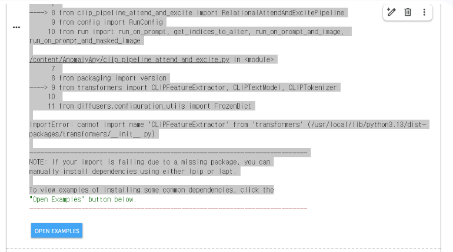
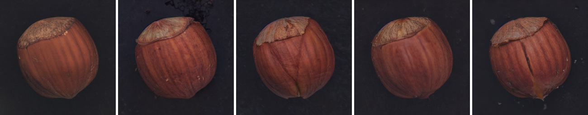
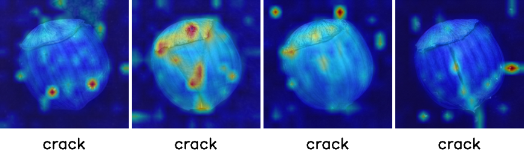
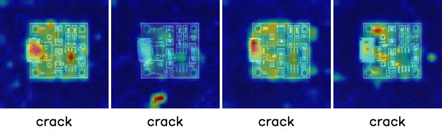
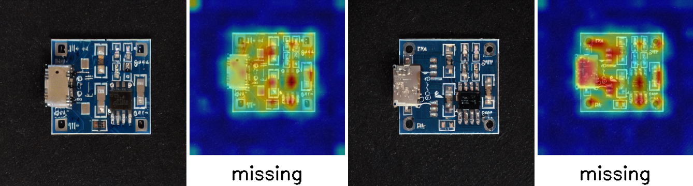

# 생성형 AI를 활용한 제조결함 데이터 생성 실습 — 회고 참고 기록

실습 노트북(`결함데이터생성_직접해보기.ipynb`)을 준비하고 코랩 Pro(A100)에서 돌리면서 막혔던 부분을 시간순으로 모았다. 개인 회고(막혔던 부분과 해결, KPT, AAR)를 쓸 때 참고한다.

## 진행하면서 막혔던 부분과 해결

| # | 막힌 부분 | 원인 | 해결 |
|---|---|---|---|
| 1 | 원본 노트북에 라이브러리 설치 셀이 없음 | 원본은 강사 서버의 conda 환경(`hanwha` 커널)에서 실행한 것이라 필요한 패키지가 이미 깔려 있었다. 저장소 코드를 읽어 보니 `run.py`는 `pyrallis`를, `clip_loss.py`는 OpenAI `clip`을 import하는데, 둘 다 코랩에 없다 | 첫 셀(`git clone`) 아래에 설치 줄을 `# 📄 원본` / `# ☁️ 코랩용`으로 표시해서 넣었다 |
| 2 | Stable Diffusion 모델 주소 `runwayml/stable-diffusion-v1-5`를 쓸 수 없음 | runwayml이 Hugging Face에서 이 저장소를 내렸다. 원본 출력은 강사 서버에 캐시가 남아 있어서 동작했던 것으로 보인다 | 같은 가중치를 옮겨 둔 공식 미러 `stable-diffusion-v1-5/stable-diffusion-v1-5`로 바꿨다 |
| 3 | import 셀에서 `ImportError: cannot import name 'CLIPFeatureExtractor' from 'transformers'` (사진 1) | 코랩 기본 `transformers`가 5.18이라 옛 이름 `CLIPFeatureExtractor`가 빠졌다. 저장소는 `transformers 4.29` / `diffusers 0.21` 기준이다(`env.yml`). `transformers`만 4.x로 내리면 이번엔 `diffusers 0.40`이 요구하는 `huggingface-hub` 1.x와 충돌해서 `get_cached_repo_tree` import 에러가 났다 | 코랩 터미널에서 조합을 시험해, `transformers<5`(4.57.6) + `diffusers==0.30.3`에서 import가 되는 것을 확인했다. 첫 셀 설치 줄에 두 버전을 넣었다 |
| 4 | `%load_ext autoreload`에서 `ModuleNotFoundError` (`from imp import reload`) | 코랩은 Python 3.13인데, 코랩에 깔린 IPython의 autoreload 확장이 3.12부터 없어진 `imp` 모듈을 쓴다 | autoreload는 저장소 코드를 고칠 때 다시 불러오는 개발용 기능이라 결과와 무관하다. 두 줄을 주석 처리했다 |
| 5 | 정상 이미지를 불러오는 셀(`image_guidance.show()`)에 아무것도 안 나옴 | 원본(주피터)에서는 셀 아래에 이미지가 떴지만, 코랩에서는 PIL의 `show()`가 셀 출력으로 이미지를 띄우지 않았다 | `display(image_guidance)`로 바꿨다. 실행 대기열에 이미 들어간 셀은 고쳐도 반영되지 않아서(헤이즐넛 셀도 이미지가 안 나옴), 런타임을 초기화하고 처음부터 다시 실행했다 |
| 6 | PCB 셀이 읽는 `normal.png`가 저장소에 없음 | 강사가 따로 넣어 둔 파일로 보인다. AnomalyAny 저장소에는 `example_web/table.jpg`와 `example_image/000.png`(헤이즐넛)만 있다 | 원본 노트북에 남아 있는 PCB 정상 이미지 출력(768×624)을 꺼내 `normal.png`로 저장하고, 코랩 파일 패널로 올린 뒤 터미널에서 `/content/AnomalyAny/`로 옮겼다. 원래 파일보다 줄어든 사본이다. 런타임을 초기화하면 올린 파일도 지워져서 다시 올려야 했고, 런타임이 막 연결되는 중에 올리면 파일 패널이 아직 준비되지 않아 반영되지 않았다(목록이 뜬 뒤 다시 올림) |
| 7 | 실행 중에 스크린샷과 터미널 입력이 멈춤 | 코랩을 띄운 직장 Chrome 창이 다른 창에 가려져서 탭이 숨김(hidden) 상태가 됐다. 브라우저는 숨은 탭의 화면 그리기와 입력 처리를 늦춘다 | 직장 Chrome 창을 화면에 띄워 두었더니 다시 동작했다 |
| 8 | 진행 표시줄이 `61/200`(30%)에서 멈춘 채 끝남 | 오류가 아니다. `init_image_guidance_scale=0.3`이면 200스텝 중 마지막 60스텝만 돌린다(정상 이미지에 노이즈를 조금만 섞어서 출발). 표시줄의 전체 칸 수만 200으로 잡혀 있다 | 그대로 두었다. 덕분에 A100에서 1장이 3\~4분이면 끝났다(진행 표시줄 기준 스텝당 약 4초, 개인 실험 셀 출력 기준 1장 187\~197초) |

## 실행 결과에서 눈에 띈 것 (코랩 Pro, A100)

런타임을 초기화하고 처음부터 끝까지 한 번에 다시 실행한 결과다(실행 번호 1\~12). 시드는 무작위라 다시 돌리면 그림이 달라진다.

| 물체 / 결함 문장 | 결과 | 해석 |
|---|---|---|
| 탁자 / faded (1장) | 모양은 그대로 두고 상판에 희끗한 하늘색 얼룩이 생겼고, 의자에도 긁힌 자국이 생겼다. `faded`의 주의는 상판 가운데에 몰렸다 | 결함 단어의 주의가 몰린 곳에 결함이 생긴다. 다만 "햇빛에 바램"보다는 얼룩·벗겨짐에 가깝다 |
| 헤이즐넛 / crack (4장) | 2번, 4번은 위에서 아래로 갈라진 금이 뚜렷하다. 1번은 배경에 검은 부스러기가 생겼고, 3번은 거의 그대로다 | 4장 중 쓸 만한 것은 2장. 주의가 배경으로 새면 결함도 배경에 생긴다 → 마스크로 위치를 잡거나 많이 만들어 골라야 한다 |
| PCB / crack (4장) | 기판을 가로지르는 균열은 없었다. 커넥터가 부식된 듯 망가지거나(1·3번), 바닥에 긁힘이 생겼다(2번). 실크 인쇄 글자와 배선이 4장 모두 뭉개졌다 | 같은 문장이라도 물체에 따라 결과가 크게 다르다. PCB에는 부품 누락·납땜 불량처럼 PCB에 맞는 결함 문장이 필요해 보인다 |

## 개인 실험 (원본에 없는 셀, 흐름 11 아래)

나중에 따로 실행했다. 준비 셀(설치·import·모델·생성 함수)과 PCB 정상 이미지 셀만 다시 돌리고 실험 셀을 실행해서, 다른 셀의 출력은 위 결과 그대로다.

| 궁금했던 점 | 방법 | 결과 |
|---|---|---|
| `crack` 대신 PCB에 실제로 생기는 결함을 문장으로 주면 그럴듯해질까? | `missing component`(부품 누락), `burnt mark`(탄 자국) 두 문장 × 시드 0, 1. 결함 단어는 둘 다 8번 토큰. 시드를 고정하고 출력했다 | burnt 시드 1: IC 주변이 까맣게 탄 듯한 자국(주의 맵이 몰린 자리와 같음). missing 시드 0: 황갈색 부품 자리가 빈 패드로 바뀜. 나머지 2장은 결함이 뚜렷하지 않음 → 4장 중 2장이 결함처럼 보임(crack은 원본 셀 4장 중 0장). 같은 시드끼리는 문장이 달라도 기판 모양이 거의 같았다. 1장에 187\~197초 |

- 원본 셀의 시드는 출력되지 않아 같은 시드로 비교하지 못했고 장수도 적어서, 문장 때문이라고 단정하지는 않았다.

