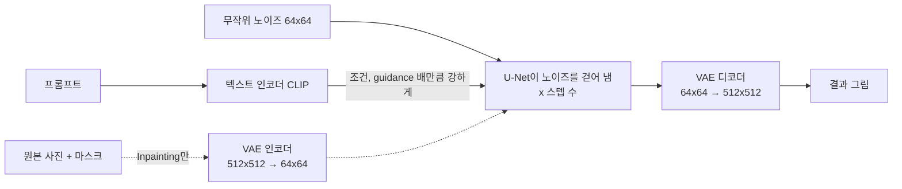
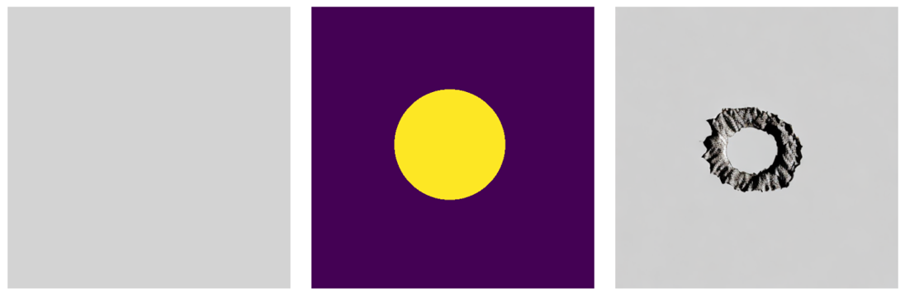
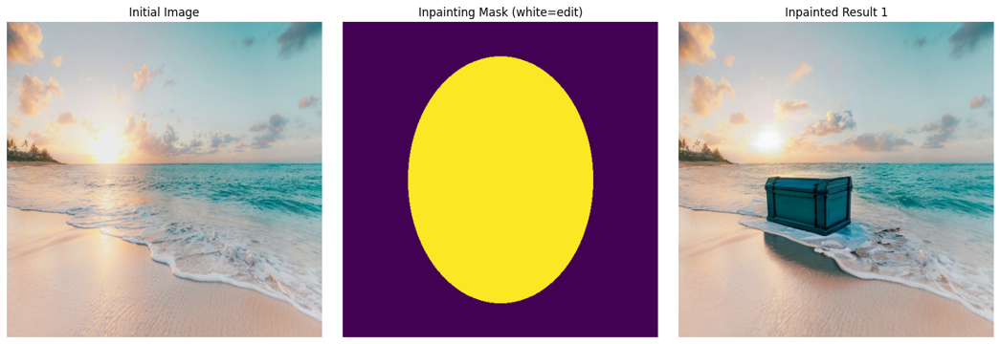
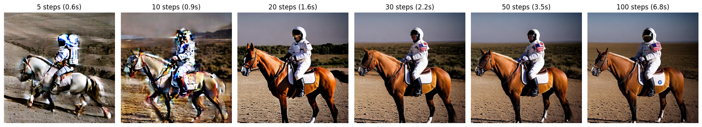
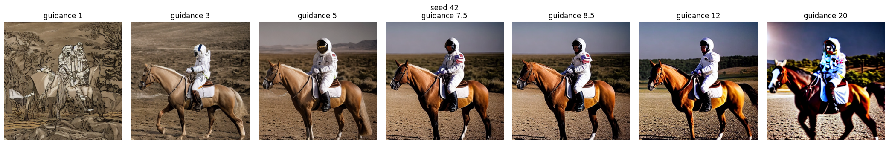
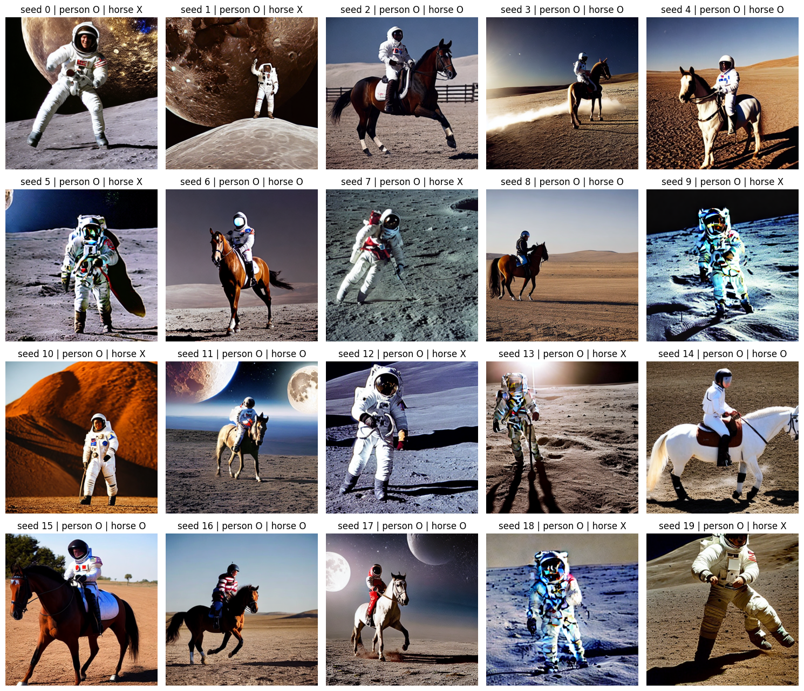

# 8-1. Stable Diffusion 실습

글(프롬프트)로 그림을 만들고(Text-to-Image), 사진의 일부만 다시 그려(Inpainting) **정상 제품 사진에 불량을 넣을 수 있는지** 확인한 실습입니다. 원본 코드를 그대로 돌린 뒤, 결과가 왜 그렇게 나왔는지 개인 실험 4개로 확인했습니다.

실행 환경: Google Colab Pro, L4 GPU, Python 3.13 · 자세한 실행 기록은 `StableDiffusion_실습.ipynb`

## 한눈에 보기

| 질문 | 답 (근거) |
|---|---|
| 스텝은 몇 번이면 충분한가? | **20\~30스텝.** 20스텝부터 구도가 정해지고, 그 뒤로는 시간만 늘어난다 (실험 ①) |
| guidance는 얼마가 좋은가? | **3\~12.** 1은 연필 그림, 20은 색이 깨진다. CLIP 점수는 오히려 20이 가장 높아서, 숫자만 보면 틀린다 (실험 ②) |
| 그림에 말이 빠진 건 우연인가? | **절반 확률.** 시드 20개 중 말은 10장에만 나왔다 (실험 ③) |
| Inpainting은 마스크 안만 바꾸나? | **아니다.** 마스크 밖도 세밀한 부분이 조금 바뀌고, 원인은 VAE 압축이다 (실험 ④) |
| 불량 데이터 생성에 쓸 수 있나? | 쓸 수 있지만, 원하는 그림이 절반만 나올 수 있어 **더 만들고 골라내는 비용**과 **마스크 밖을 원본으로 되돌리는 처리**가 필요하다 |

## 실행 흐름

- 512×512 그림을 64×64 **잠재 공간**에서 계산해서 빠르다(L4에서 30스텝 2.2초). 잠재 공간 한 칸이 원본 8×8 픽셀을 맡는다.
- Inpainting은 마스크의 흰 부분을 프롬프트대로 다시 그린다. 그래서 정상 제품 사진의 원하는 위치에 결함을 넣을 수 있다.

## 원본 실행 결과

| 흐름 | 결과 |
|---|---|
| 3. Text-to-Image (우주인이 달에서 말을 탐) | 우주인과 달은 나왔지만 **말이 빠졌다** |
| 4. Inpainting (회색 판 + 원 마스크 + "원형 자국") | 원 안에만 거친 고리 모양 자국이 생겼다 |
| 5. Inpainting (해변 사진 + 타원 마스크 + "묻힌 보물 상자") | 상자는 생겼지만 묻히지 않고 모래 위에 놓였다 |

마스크가 노란색/보라색으로 보이는 것은 `display_image`에 `cmap='gray'`가 없어서다. 실제 마스크는 흰색(다시 그릴 곳)과 검은색(그대로 둘 곳)이다.

## 개인 실험

교수님이 말씀하신 비교 설계와 믿을 수 있는 수치를 생각해서, AI가 제안한 실험 중 네 가지를 골라 해 봤습니다. 원본 코드는 건드리지 않았고, 실험 셀에는 모두 `[개인 실험]` 표시를 했습니다. 모든 실험에서 시드를 고정해서 비교하려는 값만 바뀌게 했습니다.

### ① 스텝 수: 몇 번이면 충분한가

| 스텝 | 5 | 10 | 20 | 30 | 50 | 100 |
|---|---|---|---|---|---|---|
| 시간 | 0.58초 | 0.90초 | 1.55초 | 2.20초 | 3.50초 | 6.76초 |

원본 실습은 30스텝으로 그림을 만드는데, 이게 적당한지, 더 늘리면 더 좋아지는지 궁금해서 개인적으로 실험해 봤습니다. 같은 그림(시드 고정)으로 스텝 수를 5, 10, 20, 30, 50, 100으로 바꿔 보니 5\~10스텝은 흐릿했습니다. 20스텝부터는 그림 구도가 잘 잡혔고, 그 뒤로는 국기 같은 작은 부분만 바뀌어 비슷비슷했습니다. 대신 시간은 스텝 수에 비례해서 늘어났습니다(30스텝 2.20초, 100스텝 6.76초). 스텝을 많이 늘린다고 그림이 크게 좋아지지는 않고 시간만 오래 걸려서, 무조건 많이 돌리는 게 좋은 것만은 아니라는 것을 알았습니다.

> 📖 이유: 노이즈가 많은 앞쪽 스텝에서 큰 구도가 정해지고, 뒤쪽 스텝에서는 세부만 다듬어진다. 스텝마다 U-Net을 같은 횟수만큼 돌려서 시간은 스텝 수에 비례한다.

### ② guidance_scale: 프롬프트를 얼마나 세게 따르게 할까 (시드 3개 평균 CLIP 점수)

| guidance | 1 | 3 | 5 | 7.5 | 8.5 | 12 | 20 |
|---|---|---|---|---|---|---|---|
| CLIP 점수 | 29.50 ± 0.78 | 31.74 ± 1.73 | 32.23 ± 2.76 | 32.31 ± 2.41 | 32.46 ± 2.80 | 30.17 ± 0.91 | **35.45** ± 0.79 |

guidance 값을 키우면 프롬프트를 더 잘 따를 것 같아서 1, 3, 5, 7.5, 8.5, 12, 20으로 바꿔 가며 실행해 봤습니다. 비교에는 수업 시간(SlowPaper)에 함께 읽은 논문인 CLIP으로 매기는 CLIP 점수(그림이 글과 얼마나 맞는지 점수로 나타낸 것)를 썼고, 이 비교 방법은 AI가 추천해 줬습니다. CLIP은 Stable Diffusion이 프롬프트를 숫자로 바꿀 때 쓰는 텍스트 인코더이기도 합니다. 1은 연필 그림처럼 나왔고, 3\~12는 다 비슷하게 원하는 대로 나왔고, 20은 색이 깨지고 뭉개져서 알아보기 힘들었습니다. 그런데 점수는 20이 가장 높았습니다. 점수만 보면 20이 가장 좋은 그림이지만 실제로는 아니었습니다. CLIP 점수는 "글의 내용이 그림에 들어 있는지"만 보고, 그림이 잘 그려졌는지는 보지 않기 때문입니다. 6장 실습에서 loss만 보고 판단하면 안 됐던 것과 같은 문제여서, 숫자와 그림을 같이 봐야 한다고 생각했습니다.

> 📖 이유 (Classifier-Free Guidance): `예측 = 부정 예측 + guidance × (프롬프트 예측 − 부정 예측)`. guidance가 1이면 끌어당기는 힘이 없고 부정 프롬프트(`cartoon, painting, illustration`)도 계산에서 빠져 그림 같은 결과가 나온다. 너무 크면 값이 모델이 학습한 범위를 벗어나 색이 깨진다.

### ③ 말이 빠진 건 우연인가 (시드 20개, Faster R-CNN으로 말 탐지)

원본 프롬프트는 "말을 탄 우주인"인데 결과 그림에 말이 없었습니다. 모델이 말을 못 그리는 건지, 그냥 운이 나빴던 건지 궁금해서 시드(처음 시작하는 노이즈)를 20개로 바꿔 20장을 그려 봤습니다. 말이 있는지는 물체 탐지 모델(Faster R-CNN)로 판정했고, 그림을 직접 봐도 판정이 맞았습니다. 우주인은 20장 모두 나왔지만 말은 10장, 딱 절반만 나왔습니다. 원본 결과는 운이 나빴던 것이었습니다. 생성 AI는 그때그때 결과가 달라서 한 장만 보고 판단하면 안 된다는 것을 알게 됐습니다.

> 📖 이유: 시드가 처음 노이즈를 정하고, 그 노이즈에서 앞쪽 스텝에 구도가 정해진다. 또 프롬프트를 읽는 CLIP은 단어의 뜻은 잘 담지만 "누가 무엇을 탄다" 같은 관계는 약하게 담는다.

### ④ Inpainting은 마스크 안만 바꾸나 (해변 사진)

| 원본과의 픽셀 평균 차이 (0\~255) | 마스크 안 | 마스크 밖 | 마스크 밖에서 크게(20 이상) 바뀐 픽셀 |
|---|---|---|---|
| Inpainting 결과 | 35.28 | 3.90 | 1.6% |
| VAE로 압축·복원만 (생성 없음) | 5.03 | 3.50 | 1.3% |

Inpainting은 마스크로 칠한 곳만 다시 그린다고 배웠는데, 정말 나머지는 그대로인지 궁금했습니다. 해변 사진에서 원본과 결과가 얼마나 다른지 칠한 곳 안과 밖으로 나눠서 쟀습니다. 새로 그리지 않고 압축했다가 풀기만 한 사진과도 비교해 봤습니다. 칠하지 않은 곳도 야자수나 파도 무늬 같은 세밀한 부분이 조금 바뀌었는데(평균 차이 3.90), 압축했다가 풀기만 한 사진도 거의 똑같이 바뀌었습니다(3.50). 원인은 압축이었습니다. 이 모델은 그림을 가로세로 8분의 1 크기로 줄여서 작업하고 다시 키우는데, 그 과정에서 작은 세부가 뭉개집니다. 6장 AutoEncoder에서 배운 "압축하면 세부가 사라진다"와 같은 원리입니다. 실제 공장 사진에 쓰면 글자나 작은 부품이 흐려질 수 있어서, 칠하지 않은 곳은 원본으로 되돌려야 한다고 생각했습니다.

## 개인 회고

### 실습을 통해 알게 된 것

Stable Diffusion은 무작위 노이즈에서 시작해서, 프롬프트에 맞게 노이즈를 조금씩 걷어 내며 그림을 만든다. 512×512 픽셀을 바로 다루지 않고 64×64로 줄인 잠재 공간에서 계산해서, L4 GPU에서 30스텝 한 장이 2.2초면 됐다.

Inpainting은 사진과 마스크를 같이 넣으면 마스크의 흰 부분만 다시 그린다. 회색 판의 원 안에만 결함 자국이 생기고 바깥은 그대로였다. 정상 제품 사진에 결함 위치를 칠하면 부족한 불량 데이터를 늘릴 수 있겠다는 걸 알게 됐다.

교수님이 말씀하신 "loss만 보고 판단한 실험은 실패"라는 말이 생성 모델에도 그대로 해당된다는 것을 확인했다. 숫자 하나만 보고 판단하면 안 된다. guidance를 바꿔 가며 CLIP 점수(그림이 프롬프트와 얼마나 맞는지)를 재 보니, 색이 깨지고 뭉개진 guidance 20이 가장 높은 점수(35.45)를 받았다. CLIP 점수는 내용만 보고 품질은 보지 않기 때문이다. 그림을 같이 보지 않았다면 20이 가장 좋다고 착각했을 것이다.

SlowPaper에서 읽은 CLIP을 이번 실습에서 두 번 만났다. 한 번은 Stable Diffusion이 프롬프트를 숫자로 바꾸는 **텍스트 인코더**로, 또 한 번은 생성한 그림이 프롬프트와 얼마나 맞는지 재는 **CLIP 점수**로 썼다. 논문에서 배운 대로 CLIP은 사진과 글을 같은 공간에 놓고 얼마나 가까운지를 보는데, 실험을 해 보니 그 한계도 그대로 드러났다. "우주인", "말", "달" 같은 단어의 뜻은 잘 담지만 "누가 무엇을 탄다" 같은 관계는 약해서 말이 절반만 나왔고(실험 ③), 글의 내용이 들어 있는지만 보고 그림이 잘 그려졌는지는 보지 않아서 망가진 그림에 가장 높은 점수를 줬다(실험 ②). 논문으로만 읽었을 때는 장점이 먼저 보였는데, 직접 써 보니 어디에 약한지까지 알게 됐다.

### 어려웠던 것

원본 모델 저장소가 사라졌는데도 `try/except` 때문에 에러 없이 끝나서, 출력 문구를 읽기 전까지는 무엇이 잘못됐는지 몰랐다. 예외 처리가 있는 코드는 결과가 정말 나왔는지 출력까지 확인해야 한다.

### 좋았던 점

L4 GPU에서 한 장이 2초 정도라, 설정을 바꿔 가며 여러 장을 그리는 실험을 금방 해 볼 수 있었다.

### 현장에 쓴다면

정상 제품 사진에 결함을 넣을 위치를 마스크로 칠하고 Inpainting으로 불량 이미지를 만들어, 부족한 불량 데이터를 늘리는 데 쓸 것 같다. 다만 실험 ③처럼 원하는 그림이 절반만 나올 수 있다. 생성은 장당 몇 초면 되지만, 그만큼 더 만들고 쓸 만한 그림을 사람이 골라내는 비용이 든다. 또 실험 ④처럼 마스크 밖의 세밀한 부분(인쇄 글자, 작은 부품)도 흐려질 수 있어서, 마스크 밖은 원본 픽셀로 되돌려 붙일 것이다. 그래서 시드와 설정을 고정해 결과를 재현할 수 있게 하고, 골라내는 비용까지 따져서 쓸지 정할 것이다.

### 앞으로 해 볼 것

6장 실습의 VisA PCB 정상 사진에 Inpainting으로 결함을 그려 넣고, PaDiM이 그 사진을 불량으로 잡아내는지 확인해 보고 싶다. 생성한 결함이 실제 불량 데이터 대신 쓸 만큼 그럴듯한지 확인하는 방법이 될 것 같다.

## 원본 코드에서 걸린 것

| 위치 | 내용 | 어떻게 했나 |
|---|---|---|
| 흐름 4·5 | `stabilityai/stable-diffusion-2-inpainting`이 Hugging Face에서 내려가 401 에러. `try/except` 때문에 **에러 없이 이미지만 안 나옴** | 같은 모델의 `sd2-community/stable-diffusion-2-inpainting`으로 주소만 바꿈 (원본 줄은 주석으로 남김) |
| 흐름 3 | `# generator=generator`로 시드가 주석 처리돼 실행마다 그림이 다름 | 원본은 그대로 두고, 실험 셀에서만 시드 고정 |
| 흐름 2 | `display_image`에 `cmap` 없음 → 마스크가 노란색/보라색으로 보임 | 설명에 적음 |
| 흐름 1 | 코랩 버전(diffusers 0.40.0, transformers 5.18.0)이 원본(0.33.1, 4.52.4)과 다름 | 경고만 뜨고 실행에는 문제없어 그대로 둠 |
| 다시 실행 | 흐름 5가 `display_image`를 다시 정의해서, 흐름 4만 다시 돌리면 그림 모양이 달라짐 | 세션을 다시 시작하고 처음부터 순서대로 실행 |
