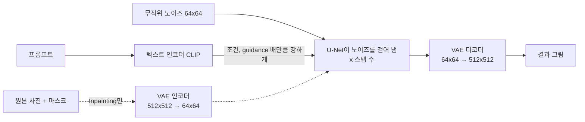
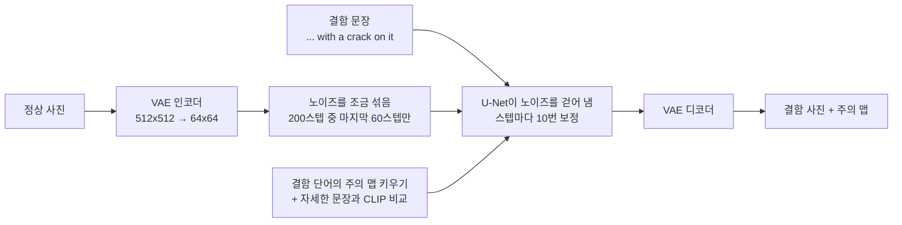
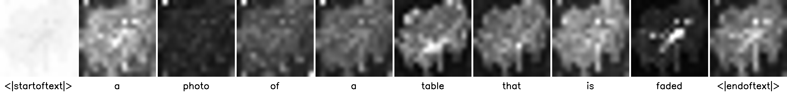
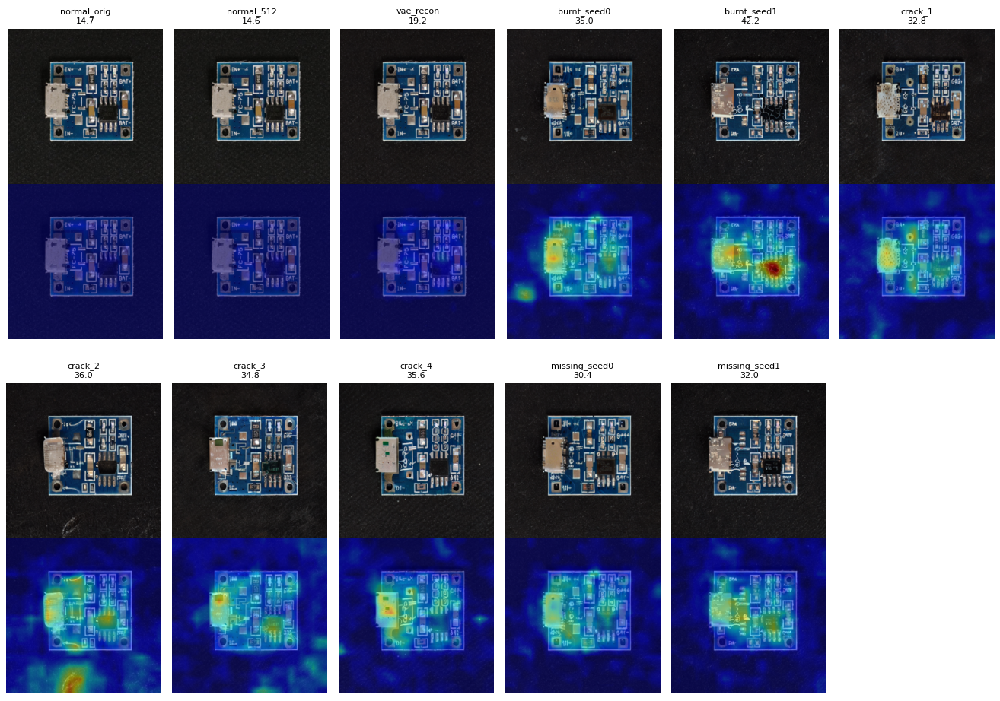

# 8주차. 생성형 AI로 제조 결함 데이터 만들기

8-1에서 Stable Diffusion을 익히고, 8-2에서 AnomalyAny로 결함 데이터를 만든 뒤 6주차 PaDiM으로 채점했습니다. 아래에 8-1 요약, 8-2 요약 순서로 정리했습니다.

## 8-1 요약: Stable Diffusion 실습

글(프롬프트)로 그림을 만들고(Text-to-Image), 사진의 일부만 다시 그려(Inpainting) **정상 제품 사진에 불량을 넣을 수 있는지** 확인한 실습입니다. 원본 코드를 그대로 돌린 뒤, 결과가 왜 그렇게 나왔는지 개인 실험 4개로 확인했습니다.

실행 환경: Google Colab Pro, L4 GPU, Python 3.13 · 자세한 실행 기록은 `StableDiffusion_직접해보기.ipynb`

### 한눈에 보기

| 질문 | 답 (근거) |
|---|---|
| 스텝은 몇 번이면 충분한가? | **20\~30스텝.** 20스텝부터 구도가 정해지고, 그 뒤로는 시간만 늘어난다 (실험 ①) |
| guidance는 얼마가 좋은가? | **3\~12.** 1은 연필 그림, 20은 색이 깨진다. CLIP 점수는 오히려 20이 가장 높아서, 숫자만 보면 틀린다 (실험 ②) |
| 그림에 말이 빠진 건 우연인가? | **절반 확률.** 시드 20개 중 말은 10장에만 나왔다 (실험 ③) |
| Inpainting은 마스크 안만 바꾸나? | **아니다.** 마스크 밖도 세밀한 부분이 조금 바뀌고, 원인은 VAE 압축이다 (실험 ④) |
| 불량 데이터 생성에 쓸 수 있나? | 쓸 수 있지만, 원하는 그림이 절반만 나올 수 있어 **더 만들고 골라내는 비용**과 **마스크 밖을 원본으로 되돌리는 처리**가 필요하다 |

### 실행 흐름

- 512×512 그림을 64×64 **잠재 공간**에서 계산해서 빠르다(L4에서 30스텝 2.2초). 잠재 공간 한 칸이 원본 8×8 픽셀을 맡는다.
- Inpainting은 마스크의 흰 부분을 프롬프트대로 다시 그린다. 그래서 정상 제품 사진의 원하는 위치에 결함을 넣을 수 있다.

### 원본 실행 결과

| 흐름 | 결과 |
|---|---|
| 3. Text-to-Image (우주인이 달에서 말을 탐) | 우주인과 달은 나왔지만 **말이 빠졌다** |
| 4. Inpainting (회색 판 + 원 마스크 + "원형 자국") | 원 안에만 거친 고리 모양 자국이 생겼다 |
| 5. Inpainting (해변 사진 + 타원 마스크 + "묻힌 보물 상자") | 상자는 생겼지만 묻히지 않고 모래 위에 놓였다 |

마스크가 노란색/보라색으로 보이는 것은 `display_image`에 `cmap='gray'`가 없어서다. 실제 마스크는 흰색(다시 그릴 곳)과 검은색(그대로 둘 곳)이다.

### 개인 실험

교수님이 말씀하신 비교 설계와 믿을 수 있는 수치를 생각해서, AI가 제안한 실험 중 네 가지를 골라 해 봤습니다. 원본 코드는 건드리지 않았고, 실험 셀에는 모두 `[개인 실험]` 표시를 했습니다. 모든 실험에서 시드를 고정해서 비교하려는 값만 바뀌게 했습니다.

#### ① 스텝 수: 몇 번이면 충분한가

| 스텝 | 5 | 10 | 20 | 30 | 50 | 100 |
|---|---|---|---|---|---|---|
| 시간 | 0.58초 | 0.90초 | 1.55초 | 2.20초 | 3.50초 | 6.76초 |

원본 실습은 30스텝으로 그림을 만드는데, 이게 적당한지, 더 늘리면 더 좋아지는지 궁금해서 개인적으로 실험해 봤습니다. 같은 그림(시드 고정)으로 스텝 수를 5, 10, 20, 30, 50, 100으로 바꿔 보니 5\~10스텝은 흐릿했습니다. 20스텝부터는 그림 구도가 잘 잡혔고, 그 뒤로는 국기 같은 작은 부분만 바뀌어 비슷비슷했습니다. 대신 시간은 스텝 수에 비례해서 늘어났습니다(30스텝 2.20초, 100스텝 6.76초). 스텝을 많이 늘린다고 그림이 크게 좋아지지는 않고 시간만 오래 걸려서, 무조건 많이 돌리는 게 좋은 것만은 아니라는 것을 알았습니다.

> 📖 이유: 노이즈가 많은 앞쪽 스텝에서 큰 구도가 정해지고, 뒤쪽 스텝에서는 세부만 다듬어진다. 스텝마다 U-Net을 같은 횟수만큼 돌려서 시간은 스텝 수에 비례한다.

#### ② guidance_scale: 프롬프트를 얼마나 세게 따르게 할까 (시드 3개 평균 CLIP 점수)

| guidance | 1 | 3 | 5 | 7.5 | 8.5 | 12 | 20 |
|---|---|---|---|---|---|---|---|
| CLIP 점수 | 29.50 ± 0.78 | 31.74 ± 1.73 | 32.23 ± 2.76 | 32.31 ± 2.41 | 32.46 ± 2.80 | 30.17 ± 0.91 | **35.45** ± 0.79 |

guidance 값을 키우면 프롬프트를 더 잘 따를 것 같아서 1, 3, 5, 7.5, 8.5, 12, 20으로 바꿔 가며 실행해 봤습니다. 비교에는 수업 시간(SlowPaper)에 함께 읽은 논문인 CLIP으로 매기는 CLIP 점수(그림이 글과 얼마나 맞는지 점수로 나타낸 것)를 썼고, 이 비교 방법은 AI가 추천해 줬습니다. CLIP은 Stable Diffusion이 프롬프트를 숫자로 바꿀 때 쓰는 텍스트 인코더이기도 합니다. 1은 연필 그림처럼 나왔고, 3\~12는 다 비슷하게 원하는 대로 나왔고, 20은 색이 깨지고 뭉개져서 알아보기 힘들었습니다. 그런데 점수는 20이 가장 높았습니다. 점수만 보면 20이 가장 좋은 그림이지만 실제로는 아니었습니다. CLIP 점수는 "글의 내용이 그림에 들어 있는지"만 보고, 그림이 잘 그려졌는지는 보지 않기 때문입니다. 6장 실습에서 loss만 보고 판단하면 안 됐던 것과 같은 문제여서, 숫자와 그림을 같이 봐야 한다고 생각했습니다.

> 📖 이유 (Classifier-Free Guidance): `예측 = 부정 예측 + guidance × (프롬프트 예측 − 부정 예측)`. guidance가 1이면 끌어당기는 힘이 없고 부정 프롬프트(`cartoon, painting, illustration`)도 계산에서 빠져 그림 같은 결과가 나온다. 너무 크면 값이 모델이 학습한 범위를 벗어나 색이 깨진다.

#### ③ 말이 빠진 건 우연인가 (시드 20개, Faster R-CNN으로 말 탐지)

원본 프롬프트는 "말을 탄 우주인"인데 결과 그림에 말이 없었습니다. 모델이 말을 못 그리는 건지, 그냥 운이 나빴던 건지 궁금해서 시드(처음 시작하는 노이즈)를 20개로 바꿔 20장을 그려 봤습니다. 말이 있는지는 물체 탐지 모델(Faster R-CNN)로 판정했고, 그림을 직접 봐도 판정이 맞았습니다. 우주인은 20장 모두 나왔지만 말은 10장, 딱 절반만 나왔습니다. 원본 결과는 운이 나빴던 것이었습니다. 생성 AI는 그때그때 결과가 달라서 한 장만 보고 판단하면 안 된다는 것을 알게 됐습니다.

> 📖 이유: 시드가 처음 노이즈를 정하고, 그 노이즈에서 앞쪽 스텝에 구도가 정해진다. 또 프롬프트를 읽는 CLIP은 단어의 뜻은 잘 담지만 "누가 무엇을 탄다" 같은 관계는 약하게 담는다.

#### ④ Inpainting은 마스크 안만 바꾸나 (해변 사진)

| 원본과의 픽셀 평균 차이 (0\~255) | 마스크 안 | 마스크 밖 | 마스크 밖에서 크게(20 이상) 바뀐 픽셀 |
|---|---|---|---|
| Inpainting 결과 | 35.28 | 3.90 | 1.6% |
| VAE로 압축·복원만 (생성 없음) | 5.03 | 3.50 | 1.3% |

Inpainting은 마스크로 칠한 곳만 다시 그린다고 배웠는데, 정말 나머지는 그대로인지 궁금했습니다. 해변 사진에서 원본과 결과가 얼마나 다른지 칠한 곳 안과 밖으로 나눠서 쟀습니다. 새로 그리지 않고 압축했다가 풀기만 한 사진과도 비교해 봤습니다. 칠하지 않은 곳도 야자수나 파도 무늬 같은 세밀한 부분이 조금 바뀌었는데(평균 차이 3.90), 압축했다가 풀기만 한 사진도 거의 똑같이 바뀌었습니다(3.50). 원인은 압축이었습니다. 이 모델은 그림을 가로세로 8분의 1 크기로 줄여서 작업하고 다시 키우는데, 그 과정에서 작은 세부가 뭉개집니다. 6장 AutoEncoder에서 배운 "압축하면 세부가 사라진다"와 같은 원리입니다. 실제 공장 사진에 쓰면 글자나 작은 부품이 흐려질 수 있어서, 칠하지 않은 곳은 원본으로 되돌려야 한다고 생각했습니다.

### 개인 회고

#### 실습을 통해 알게 된 것

Stable Diffusion은 무작위 노이즈에서 시작해서, 프롬프트에 맞게 노이즈를 조금씩 걷어 내며 그림을 만든다. 512×512 픽셀을 바로 다루지 않고 64×64로 줄인 잠재 공간에서 계산해서, L4 GPU에서 30스텝 한 장이 2.2초면 됐다.

Inpainting은 사진과 마스크를 같이 넣으면 마스크의 흰 부분만 다시 그린다. 회색 판의 원 안에만 결함 자국이 생기고 바깥은 그대로였다. 정상 제품 사진에 결함 위치를 칠하면 부족한 불량 데이터를 늘릴 수 있겠다는 걸 알게 됐다.

교수님이 말씀하신 "loss만 보고 판단한 실험은 실패"라는 말이 생성 모델에도 그대로 해당된다는 것을 확인했다. 숫자 하나만 보고 판단하면 안 된다. guidance를 바꿔 가며 CLIP 점수(그림이 프롬프트와 얼마나 맞는지)를 재 보니, 색이 깨지고 뭉개진 guidance 20이 가장 높은 점수(35.45)를 받았다. CLIP 점수는 내용만 보고 품질은 보지 않기 때문이다. 그림을 같이 보지 않았다면 20이 가장 좋다고 착각했을 것이다.

SlowPaper에서 읽은 CLIP을 이번 실습에서 두 번 만났다. 한 번은 Stable Diffusion이 프롬프트를 숫자로 바꾸는 **텍스트 인코더**로, 또 한 번은 생성한 그림이 프롬프트와 얼마나 맞는지 재는 **CLIP 점수**로 썼다. 논문에서 배운 대로 CLIP은 사진과 글을 같은 공간에 놓고 얼마나 가까운지를 보는데, 실험을 해 보니 그 한계도 그대로 드러났다. "우주인", "말", "달" 같은 단어의 뜻은 잘 담지만 "누가 무엇을 탄다" 같은 관계는 약해서 말이 절반만 나왔고(실험 ③), 글의 내용이 들어 있는지만 보고 그림이 잘 그려졌는지는 보지 않아서 망가진 그림에 가장 높은 점수를 줬다(실험 ②). 논문으로만 읽었을 때는 장점이 먼저 보였는데, 직접 써 보니 어디에 약한지까지 알게 됐다.

#### 어려웠던 것

원본 모델 저장소가 사라졌는데도 `try/except` 때문에 에러 없이 끝나서, 출력 문구를 읽기 전까지는 무엇이 잘못됐는지 몰랐다. 예외 처리가 있는 코드는 결과가 정말 나왔는지 출력까지 확인해야 한다.

#### 좋았던 점

L4 GPU에서 한 장이 2초 정도라, 설정을 바꿔 가며 여러 장을 그리는 실험을 금방 해 볼 수 있었다.

#### 현장에 쓴다면

정상 제품 사진에 결함을 넣을 위치를 마스크로 칠하고 Inpainting으로 불량 이미지를 만들어, 부족한 불량 데이터를 늘리는 데 쓸 것 같다. 다만 실험 ③처럼 원하는 그림이 절반만 나올 수 있다. 생성은 장당 몇 초면 되지만, 그만큼 더 만들고 쓸 만한 그림을 사람이 골라내는 비용이 든다. 또 실험 ④처럼 마스크 밖의 세밀한 부분(인쇄 글자, 작은 부품)도 흐려질 수 있어서, 마스크 밖은 원본 픽셀로 되돌려 붙일 것이다. 그래서 시드와 설정을 고정해 결과를 재현할 수 있게 하고, 골라내는 비용까지 따져서 쓸지 정할 것이다.

#### 앞으로 해 볼 것

6장 실습의 VisA PCB 정상 사진에 Inpainting으로 결함을 그려 넣고, PaDiM이 그 사진을 불량으로 잡아내는지 확인해 보고 싶다. 생성한 결함이 실제 불량 데이터 대신 쓸 만큼 그럴듯한지 확인하는 방법이 될 것 같다.

### 원본 코드에서 걸린 것

| 위치 | 내용 | 어떻게 했나 |
|---|---|---|
| 흐름 4·5 | `stabilityai/stable-diffusion-2-inpainting`이 Hugging Face에서 내려가 401 에러. `try/except` 때문에 **에러 없이 이미지만 안 나옴** | 같은 모델의 `sd2-community/stable-diffusion-2-inpainting`으로 주소만 바꿈 (원본 줄은 주석으로 남김) |
| 흐름 3 | `# generator=generator`로 시드가 주석 처리돼 실행마다 그림이 다름 | 원본은 그대로 두고, 실험 셀에서만 시드 고정 |
| 흐름 2 | `display_image`에 `cmap` 없음 → 마스크가 노란색/보라색으로 보임 | 설명에 적음 |
| 흐름 1 | 코랩 버전(diffusers 0.40.0, transformers 5.18.0)이 원본(0.33.1, 4.52.4)과 다름 | 경고만 뜨고 실행에는 문제없어 그대로 둠 |
| 다시 실행 | 흐름 5가 `display_image`를 다시 정의해서, 흐름 4만 다시 돌리면 그림 모양이 달라짐 | 세션을 다시 시작하고 처음부터 순서대로 실행 |

## 8-2 요약: 생성형 AI를 활용한 제조결함 데이터 생성

**정상 사진 1장과 결함을 설명하는 문장**만으로, 추가 학습 없이 결함 사진을 만드는 AnomalyAny(CVPR 2025, EPFL)를 실습했습니다. 원본 코드를 그대로 돌린 뒤, 결과가 왜 그렇게 나왔는지 개인 실험 2개로 확인했습니다.

### 한눈에 보기

| 질문 | 답 (근거) |
|---|---|
| 정상 사진 1장으로 결함을 만들 수 있나? | **물체에 따라 다르다.** 탁자는 상판에 얼룩, 헤이즐넛은 4장 중 2장이 균열, PCB는 `crack` 문장으로 4장 중 0장 |
| 결함은 어디에 생기나? | **결함 단어의 주의(attention)가 몰린 자리.** `faded`의 주의가 몰린 상판 가운데에 얼룩이 생겼다 |
| PCB는 왜 안 됐나? | 문장이 맞지 않았다. "탄 자국", "부품 누락"으로 바꾸니 4장 중 2장이 결함처럼 보였다 (실험 ①) |
| 생성 결과를 AI로 걸러 낼 수 있나? | **자동으로는 못 한다.** PaDiM은 8장 모두 불량으로 봤다. 결함 자리뿐 아니라 다시 그려진 커넥터에도 반응했다 (실험 ②) |

### 실행 흐름

- `init_image_guidance_scale=0.3`이라 200스텝 중 마지막 60스텝만 돈다. 그래서 진행 표시줄이 61/200에서 끝나고, 물체의 모양과 배치는 거의 그대로 남는다.
- 문장은 세 개를 쓴다: 그림을 만드는 `prompt`, 정상 기준 `normal_prompt`, 결함을 자세히 풀어 쓴 `detailed_prompt`.

### 원본 실행 결과 (코랩 Pro A100, 1장 3~4분)

| 물체 / 결함 문장 | 결과 |
|---|---|
| 탁자 / faded (1장) | 모양은 그대로이고 상판에 희끗한 얼룩이 생겼다. "햇빛에 바램"보다는 얼룩에 가깝다 |
| 헤이즐넛 / crack (4장) | 2장은 금이 뚜렷했다. 1장은 배경에 검은 부스러기가 생겼고, 1장은 정상과 거의 같았다 |
| PCB / crack (4장) | 균열은 0장. 커넥터가 망가지거나 바닥이 긁혔고, 4장 모두 인쇄 글자와 배선이 뭉개졌다 |

단어별 주의 맵을 보면 물체 단어(`table`)는 탁자 전체를, 결함 단어(`faded`)는 상판 가운데 좁은 곳을 비춘다. 그 자리에 얼룩이 생겼다.

### 개인 실험

#### ① PCB에 맞는 결함 문장 (시드 0, 1 고정)

`crack` 대신 PCB에 실제로 생기는 결함을 문장으로 줬다.

| 문장 | 시드 0 | 시드 1 |
|---|---|---|
| missing component (부품 누락) | 부품 자리가 빈 패드로 바뀜 | 결함이 뚜렷하지 않음 |
| burnt mark (탄 자국) | 결함이 뚜렷하지 않음 | IC 주변이 까맣게 탐 (주의 맵과 같은 자리) |

- 4장 중 2장이 결함처럼 보였다(`crack`은 4장 중 0장). 원본 셀은 시드가 출력되지 않아 같은 시드로 비교하지 못했고 장수가 적어서 단정하지는 않는다.
- 같은 시드끼리는 문장이 달라도 기판 모양이 거의 같았다. 전체 모습은 시드가, 결함이 생기는 자리는 결함 단어의 주의가 정한다.

#### ② 6주차 PaDiM으로 채점하기

생성한 결함 사진을 사람 대신 AI가 먼저 걸러 줄 수 있는지 보려고, 6주차와 같은 설정의 PaDiM(VisA pcb4 실제 정상 804장으로 학습)에 넣었다.

| 이미지 | 이상 점수 | 판정 (기준 23.84) |
|---|---|---|
| VisA 테스트 (확인용) | AUROC 0.9824 | 실제 불량을 잘 가려냄 |
| `normal.png` 원본 / 512×512 / VAE 압축·복원만 | 14.69 / 14.58 / 19.18 | 모두 정상 |
| 생성 이미지 8장 (crack 4, missing 2, burnt 2) | 30.38~42.17 | **모두 불량** |

- **예상과 다른 결과**: 눈으로는 결함이 안 보이던 3장도 불량으로 판정됐다.
- 히트맵은 탄 자국(42.17, 최고점)과 바닥 긁힘을 정확히 가리켰지만, 8장 모두 **다시 그려진 USB 커넥터**에도 반응했다.
- VAE 압축·복원만 한 사진(19.18)은 정상이었으니 압축 자체가 원인은 아니고, 디노이징 중에 기판이 다시 그려진 흔적이 원인으로 보인다.
- PaDiM은 "정상과 다른 곳"을 찾을 뿐, 의도한 결함인지 생성 흔적인지는 구분하지 못한다. 자동 선별에는 못 쓰지만, 사람이 어디를 볼지 알려 주는 1차 검사로는 쓸 수 있다.

### 원본 코드에서 걸린 것

| 실제로 겪은 것 | 어떻게 했나 |
|---|---|
| `CLIPFeatureExtractor` import 에러 (코랩 transformers 5.18). transformers만 낮추면 diffusers 0.40과 충돌 | `transformers<5` + `diffusers==0.30.3`으로 맞춤 |
| `%load_ext autoreload` 에러 (Python 3.13에 `imp` 없음) | 개발용 기능이라 주석 처리 |
| 코랩에서 `image_guidance.show()`가 그림을 띄우지 않음 | `display()`로 바꿈 |

| 실행 전에 미리 고친 것 | 어떻게 했나 |
|---|---|
| 설치 셀이 없음 (`pyrallis`, `clip` 필요, 실행해 보니 코랩에 없었음) | 설치 줄 추가 |
| PCB용 `normal.png`가 저장소에 없음 | 원본 노트북 출력에서 꺼내 저장 |

모델 주소 `runwayml/stable-diffusion-v1-5`는 처음에 저장소가 사라진 줄 알고 미러 주소로 바꿨다. 확인해 보니 옛 주소가 새 주소로 자동 연결돼 원본 줄 그대로 돌아가서 되돌렸다. 원본 코드는 그대로 두고, 바꾼 줄은 바로 위에 원본 줄과 이유를 주석으로 남겼다.

### 개인 회고

#### 실습을 통해 알게 된 것

공장에서는 불량이 드물어서 결함 사진을 모으기 어렵다. 이번 실습의 AnomalyAny는 정상 사진 1장과 결함을 설명하는 문장만으로, 추가 학습 없이 Stable Diffusion에서 결함이 있는 사진을 만든다. 정상 사진에 노이즈를 조금만 섞어서 출발하기 때문에(200스텝 중 마지막 60스텝만 진행) 물체의 모양과 배치는 거의 그대로 남고, 결함 단어(`faded`, `crack`)가 그림에 강하게 반영되도록 주의(attention) 맵을 키우면서 결함을 그려 넣는다.

단어별 주의 맵을 그려 보니 물체 단어(`table`)는 물체 전체를, 결함 단어(`faded`)는 상판 가운데 좁은 곳을 비췄고, 실제로 그 자리에 얼룩이 생겼다. 결함 단어의 주의 맵이 결함 위치를 알려 주므로, 결함 이미지와 함께 "어디가 불량인지"를 나타내는 마스크도 얻을 수 있겠다고 생각했다. 이상 탐지 모델을 평가하려면 이런 픽셀 단위 정답이 필요하다.

하지만 만든다고 다 쓸 수 있는 것은 아니었다. 헤이즐넛 균열은 4장 중 2장만 그럴듯했고, 나머지는 배경에 엉뚱한 자국이 생기거나 정상과 거의 같았다. 탁자는 "햇빛에 바램"보다 얼룩에 가까웠고, PCB는 균열 대신 커넥터가 망가지거나 글자와 배선이 뭉개졌다. 생성한 결함 데이터는 사람이 보고 골라야 하고, 물체에 맞는 결함 문장을 고르는 것이 중요하다는 것을 알게 됐다.

#### 어려웠던 것

주의(attention) 맵을 이해하는 것이 가장 어려웠다. 문장 속 단어 하나가 그림의 어느 자리에 영향을 주는지 나타낸 지도라는 것까지는 알겠는데, 이걸 키우면 왜 그 자리에 결함이 생기는지는 바로 와닿지 않았다. 단어별 주의 맵을 나란히 그려 보고, `faded`의 주의가 몰린 상판 가운데에 실제로 얼룩이 생긴 것을 보고 나서야 이해가 됐다.

생성된 그림이 결함인지 아닌지 판단하는 것도 어려웠다. 탁자의 얼룩은 "햇빛에 바램"이라고 보기 애매했고, PCB의 글자와 배선이 뭉개진 것은 결함인지 생성 과정의 흔적인지 헷갈렸다. 결함 이미지 1장에 3\~4분이 걸려서 여러 장을 만들려면 기다리는 시간이 길었다. 하지만 교수님이 현장에서는 오래 걸리는 작업이 하루 단위로 걸린다고 말씀하셔서, 부담 갖지 않고 그냥 해 봤다.

#### 좋았던 점

정상 사진 1장과 문장만으로, 추가 학습 없이 결함 이미지가 나오는 것이 신기했다. 주의 맵으로 결함 단어가 그림의 어디에 영향을 주는지 눈으로 확인할 수 있어서 좋았고, 개인 실험에서 PCB에 맞는 문장(탄 자국)으로 바꾸니 실제 결함처럼 나와서 뿌듯했다. 코랩 Pro의 A100으로 돌려서 1장이 3분 남짓(187\~197초)이면 끝난 것도 좋았다.

#### 현장에 쓴다면

드문 불량 사진을 이 방법으로 만들어 불량 데이터를 보충하는 데 쓸 것 같다. 다만 결과가 들쭉날쭉해서 그대로 쓰지 않고 사람이 보고 쓸 만한 것만 고를 것이다. 고르는 일은 생성 결과를 분석하는 AI를 하나 더 두어 도움을 받으면 좋겠다고 생각했는데, 개인 실험에서 PaDiM으로 해 보니 결함이 생긴 자리는 잘 찾았지만 생성 과정에서 다시 그려진 부분까지 불량으로 봤다. 그래서 AI는 "어디가 달라졌는지"를 표시해 주는 1차 검사로 쓰고, 그게 실제 결함처럼 보이는지는 사람이 최종 판단하는 식으로 나눠 쓸 것이다. 결함 문장은 "균열" 같은 일반적인 말보다 그 제품에 실제로 생기는 결함으로 정하고, 시드를 고정해 기록해 두어 좋은 결과를 다시 만들 수 있게 할 것이다.

#### 앞으로 해 볼 것

PaDiM이 생성 이미지를 모두 불량으로 본 이유가 커넥터처럼 매번 다시 그려지는 부분 때문이었으니, 마스크(`mask_image`)로 결함을 넣을 자리만 바뀌게 하고 나머지는 정상 사진 그대로 두면 PaDiM이 결함 자리에만 반응하는지 확인해 보고 싶다. 그렇게 되면 생성 이미지를 AI로 걸러 내는 방법이 실제로 쓸 만해질 것 같다.
