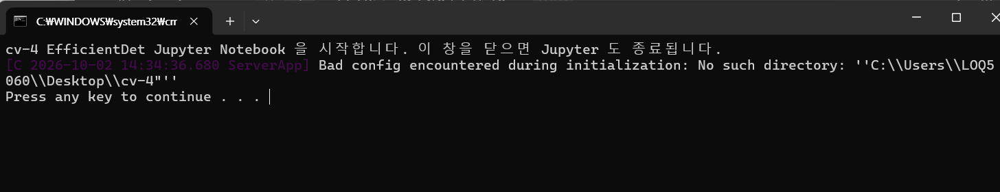
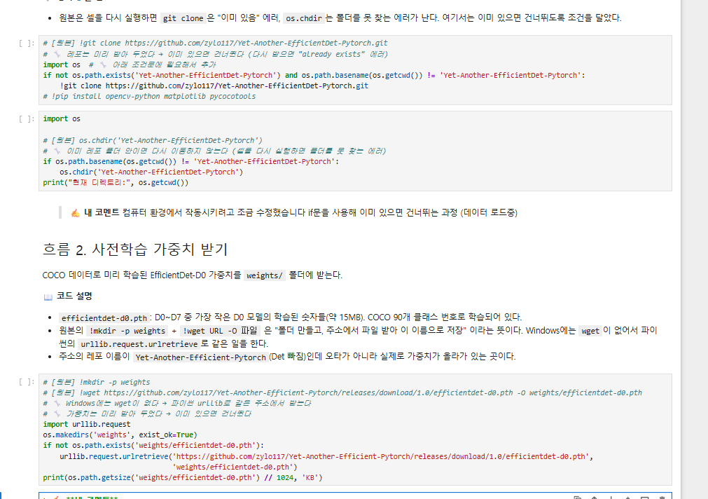
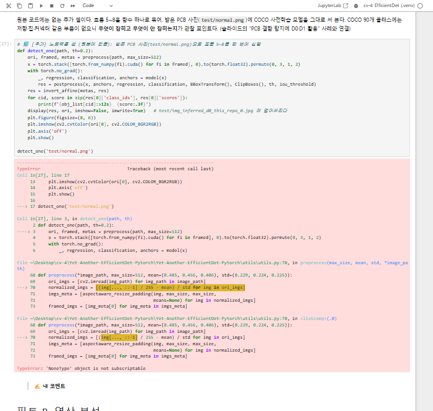
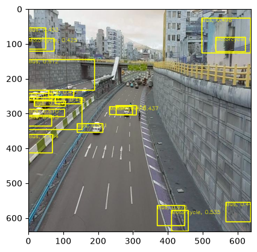
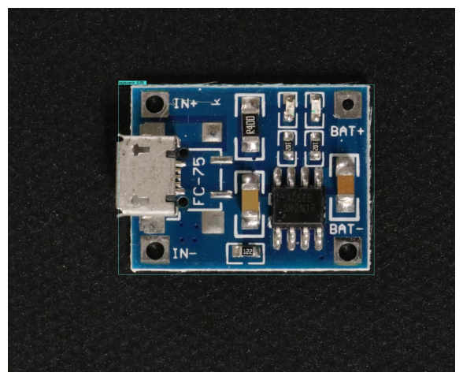

# EfficientDet 실습 — 회고 참고 기록

실습 노트북(`EfficientDet_직접해보기.ipynb`)을 준비하고 따라 하면서 막혔던 부분을 시간순으로 모았다. 개인 회고(막혔던 부분과 해결, KPT, AAR)를 쓸 때 참고한다.

## 진행하면서 막혔던 부분과 해결

| # | 막힌 부분 | 원인 | 해결 |
|---|---|---|---|
| 1 | 원본 노트북을 이 PC에서 그대로 실행할 수 없음 | 원본은 Colab(리눅스)용이다. `/content/...` 경로, `wget`, `mkdir -p` 같은 리눅스 전용 명령이 들어 있다 | 이 PC에서 안 되는 곳만 고치고, 고친 곳마다 `☁️ 코랩용(원본)`과 `💻 노트북용`을 나란히 표시했다 |
| 2 | 영상 분석용 `soccer.mp4`가 없음 | 원본 Colab 실행 기록에도 `os.path.exists('soccer.mp4')`가 `False`였다. 실제로 쓰인 파일은 `soccer.gif`(2732×1440, 367프레임)였다 | `soccer.gif`를 받아 `video_src`를 바꿨다. OpenCV는 gif도 영상처럼 읽는다 |
| 3 | yml의 `project_name`이 데이터 폴더 이름과 다름 | 원본 메모에는 `car_detect_proj`, 실제 폴더는 `my_car_detect_proj`라서 그대로 쓰면 데이터를 못 찾는다 | `my_car_detect_proj`로 맞췄다. 원본 Colab 로그도 `logs/my_car_detect_proj`에 저장되어 있어서 실제로는 이 이름을 쓴 것으로 보인다 |
| 4 | yml의 `num_gpus: 0`으로 두면 CPU로 학습함 | `train.py`가 `num_gpus`가 0이면 GPU를 끈다 | `num_gpus: 1`로 바꿔 GPU(RTX 5060)로 학습했다 |
| 5 | `train.py`의 `ReduceLROnPlateau(..., verbose=True)` 에러 | 최신 PyTorch에서 `verbose` 인자가 없어졌다 | 원본 노트북 안내대로 `verbose=True`를 지웠다 |
| 6 | 학습이 에폭당 3분 30초씩 걸림 (40에폭이면 2시간 넘음) | 워커 기본값 12개를 Windows에서는 에폭마다 프로세스 12개로 새로 띄운다. 그동안 GPU 사용률은 0%였다. 원본 Colab 로그에도 "워커 12개는 너무 많다(권장 2개)"는 경고가 있었다 | 학습 명령에 `-n 0`을 붙였다 → 에폭당 약 15초, 학습 전체 약 10분 |
| 7 | 노트북에서 `! python train.py`가 실패함 | 이 PC에서 `python`은 시스템 파이썬을 가리킨다. 시스템 파이썬에는 `pycocotools`, `tensorboardX`가 없다 | `!{sys.executable} train.py`로 지금 커널(.venv)의 파이썬을 쓰게 했다 |
| 8 | `Jupyter_실행.bat` 실행 시 `No such directory` 오류 (사진 1) | `%~dp0`는 끝에 `\`가 붙는다. 따옴표로 감싸면 `"...\cv-4\"`가 되고, 마지막 `\"`가 따옴표 문자로 읽혀 경로 끝에 `"`가 붙었다 | `"%~dp0."`로 바꿔 마지막 글자가 `\`가 아니게 했다 |
| 9 | 원본 코드와 다른 셀이 생각보다 많음 (사진 2) | 리눅스 명령(`wget`, `ls`, `pwd`, `unzip`)을 모두 파이썬 코드로 통째로 바꿔서, 원본 줄이 안 보였다 | 바꾼 줄마다 원본 줄을 `☁️ 코랩용`으로 남기고 `💻 노트북용` 줄을 나란히 적었다. 원본이 그대로 되는 셀(`git clone`, `os.chdir`, `%cd`)은 원본으로 되돌렸다 |
| 9-1 | 원본으로 되돌린 `!ls -l`, `!pwd`가 `'ls' is not recognized...` 에러 | Git Bash에서 띄운 Jupyter로 시험해서 Git의 리눅스 도구가 PATH에 잡혀 "된다"고 잘못 판단했다. bat 파일로 띄운 실제 Jupyter는 Windows 명령창(cmd)으로 실행해서 `ls`·`pwd`·`unzip`·`grep`이 없다 | 다시 `💻 노트북용`으로 바꿨다(`os.getcwd()`, `os.listdir`, `zipfile`, `dir /b /od`). 이후로는 bat 파일과 같은 환경(PowerShell에서 실행)에서 확인했다 |
| 9-2 | 학습이 시작되지 않음 (`UnicodeDecodeError: 'cp949' codec can't decode byte 0xf0`) | yml 파일 안에 `☁️ 코랩용`, `💻 노트북용` 같은 한글·이모지 주석을 넣었는데, `train.py`가 yml을 Windows 기본 인코딩(cp949)으로 읽다가 이모지에서 실패했다. `!` 명령은 실패해도 노트북 셀이 멈추지 않아서, 다음 셀(가중치 폴더 이동)에서야 문제가 드러났다 | yml은 파이썬으로 파일을 쓰게 바꾸고, ☁️/💻 설명은 셀의 파이썬 주석으로만 남겼다. 파일 안에는 원본의 영어 주석만 둔다 |
| 10 | PCB 사진 추론에서 `'NoneType' object is not subscriptable` 에러 (사진 3) | 커널이 이미 레포 폴더 안에 있는 상태에서 흐름 1(`git clone`, `os.chdir`)을 다시 실행했다. 레포 안에 레포가 한 겹 더 받아졌고, 그 안쪽 사본에는 `test/normal.png`가 없어서 `cv2.imread`가 `None`을 돌려줬다 | 안쪽 사본을 지우고 커널을 재시작해 처음부터 다시 실행했다. 흐름 1은 커널 재시작 직후에만 실행한다 |

## 실행 결과에서 눈에 띈 것

| 관찰 | 이유 (노트북 💡 참고) |
|---|---|
| 첫 에폭 Classification loss가 약 2만으로 시작 (원본 Colab도 16233) | 클래스 head가 새로 시작하고, 작은 차(중앙값 약 18px)는 앵커와 잘 안 겹쳐 Focal Loss를 나누는 수가 작다 |
| 2단계 학습 로그가 에폭 10부터 시작 | `train.py`가 가중치 파일 이름의 step(80)으로 "이미 10에폭 했다"고 계산한다. 실제로 더 학습하는 건 30이 아니라 20에폭이다 |
| 평가 AP가 0.010 (원본 Colab은 0.000) | 작은 물체가 많고, 학습과 예측의 앵커 설정이 다르다 |
| 마지막 예측에서 건물에 "Bus" 라벨, 하늘색 박스가 노란색으로 보임 (사진 4) | 클래스 이름이 한 칸씩 밀림(`category_id - 1`인데 `obj_list[0]`이 `cars`), 앵커 불일치, BGR 이미지를 `plt.imshow`(RGB)로 띄움 |
| PCB 사진을 COCO 모델이 `keyboard`(0.63)로 탐지 (사진 5) | COCO 90개 클래스에는 저항·칩 같은 부품이 없다. 기판 전체를 가장 비슷한 물체로 본 것이다 |

## 사진

**사진 1. `Jupyter_실행.bat` 경로 오류** (막힌 부분 8)

**사진 2. 흐름 1은 원본 줄을 살렸는데 흐름 2부터 코드가 통째로 바뀐 모습** (막힌 부분 9)

**사진 3. 레포가 두 겹으로 받아져 생긴 에러** (막힌 부분 10) — 에러 경로에 `Yet-Another-EfficientDet-Pytorch`가 두 번 들어 있다

**사진 4. 학습한 모델로 test 이미지 예측** — 건물에 "Bus" 라벨이 붙고, 하늘색이어야 할 박스가 노랗게 보인다

**사진 5. 받은 PCB 사진에 COCO 사전학습 모델 적용** — 기판 전체를 `keyboard`로 잡았다

