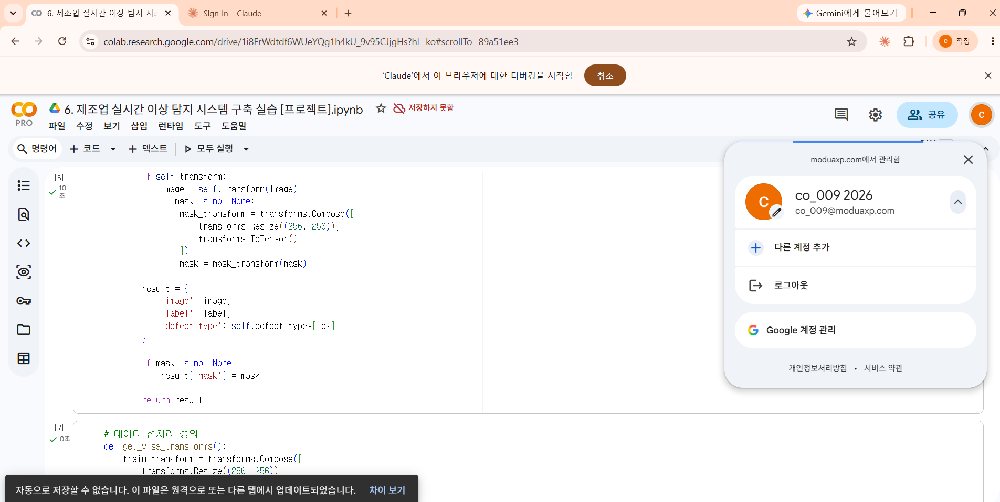
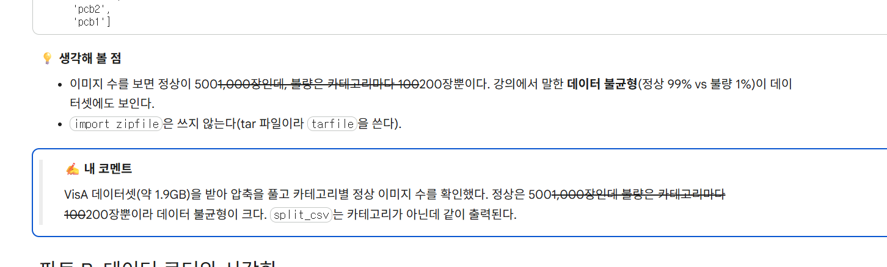
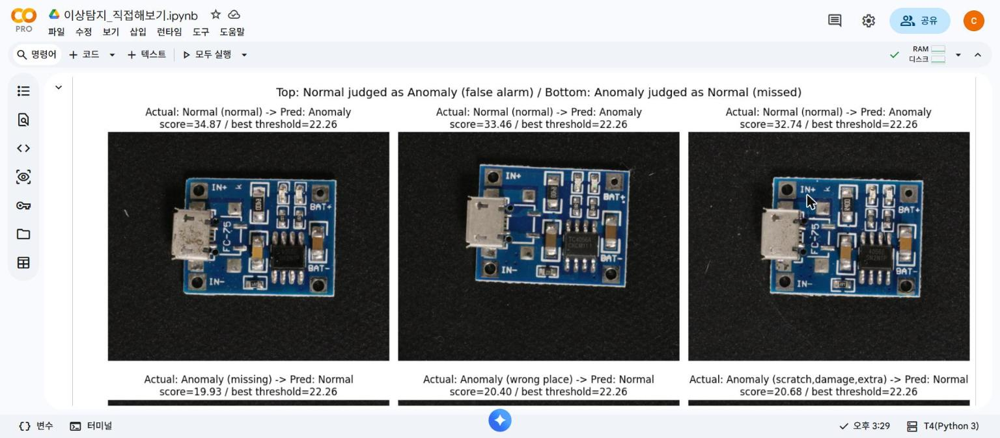
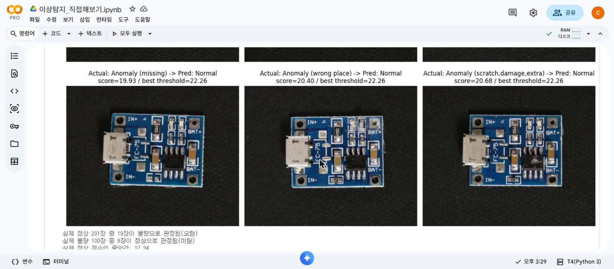

# 제조업 실시간 이상 탐지 실습 — 회고 참고 기록

실습 노트북(`이상탐지_직접해보기.ipynb`)을 준비하고 따라 하면서 막혔던 부분을 시간순으로 모았다. 개인 회고(막혔던 부분과 해결, KPT, AAR)를 쓸 때 참고한다.

## 진행하면서 막혔던 부분과 해결

| # | 막힌 부분 | 원인 | 해결 |
|---|---|---|---|
| 1 | 내 노트북(RTX 5060, 8GB)에서 돌릴지 코랩에서 돌릴지 고민 | 원본은 리눅스 기준 코드(`num_workers=2`, `/` 경로)다. PaDiM은 학습 특징 `[630336, 1536]`을 GPU에 모아 합쳐서 4~9GB가 필요하다고 계산됐다 | 코랩(Pro)에서 하기로 했다. 고칠 곳이 거의 없고 GPU 메모리도 넉넉하며, 1.9GB 데이터셋도 내 PC 디스크를 쓰지 않는다 |
| 2 | 코랩에 올린 노트북의 런타임 유형에 Python 3이 안 보임 | 노트북 파일의 커널 정보가 로컬 가상환경용(`6-CV 이상탐지 (.venv)`)으로 들어가 있었다 | 커널 정보를 `python3`으로 바꿔 다시 올렸다 |
| 3 | 노트북이 엉뚱한 구글 계정(개인 계정)에 올라감 (사진 1) | 크롬 프로필이 두 개(개인 / 직장)인데, Claude 확장이 연결된 쪽이 개인 프로필이었다. 코랩 Pro는 직장 프로필의 `co_009` 계정이다. 개인 계정에서는 A100·L4가 비활성이고 "Pro+ 업그레이드" 안내가 떠서 이상하다는 걸 알 수 있었다 | 직장 프로필 창에서도 Claude 확장에 로그인해 연결하고, co_009 계정 코랩에 노트북을 다시 올려 T4 GPU로 실행했다 |
| 4 | 첫 셀부터 `import wget`에서 막힐 뻔함 | 원본은 `# !pip install wget`까지 주석 처리되어 있는데, 코랩에는 `wget` 파이썬 패키지가 없다(실행해 보니 새로 설치됨). 원본 작성자 PC에는 이미 깔려 있었던 것으로 보인다 | 이 줄만 주석을 풀고 `# 📄 원본` / `# ☁️ 코랩용`으로 표시했다. 원본 코드 셀 43개 중 바뀐 셀은 이 하나다 |
| 5 | 설명 칸의 글자 일부에 취소선이 그어짐 (사진 2) | 코랩 마크다운은 `~` 두 개 사이를 취소선으로 바꾼다. "500~1,000장인데 … 100~200장"처럼 한 문단에 범위를 두 번 쓰면 그 사이가 지워진 것처럼 보였다. 확인하다가 불량 수를 "100~200장"으로 잘못 적은 것도 찾았다(VisA는 12개 카테고리 모두 불량 100장) | 설명 칸의 `~`를 모두 `\~`로 바꿔 취소선을 막았고, 불량 수를 "100장"으로 고쳤다 |

## 실행 결과에서 눈에 띈 것 (코랩 Pro, T4 GPU)

런타임이 끊겨서 처음부터 두 번 실행했다. 노트북에 남은 것은 **2차 실행** 결과다.

| 모델 | AUROC 원본 기록 → 1차 → 2차 | 2차 AUPRC | 2차 Best F1 | 해석 (노트북 💡 참고) |
|---|---|---|---|---|
| PaDiM | 0.953 → 0.961 → **0.962** | 0.900 | 0.872 | 가장 좋다. 차원 축소 행렬·좌우 뒤집기·순서 섞기가 무작위라 실행마다 조금씩 다르다 |
| AutoEncoder | 0.265 → 0.266 → 0.264 | 0.226 | 0.525 | 손실이 1.64 근처에서 멈춤. 입력은 약 -2.1~2.6인데 출력은 Sigmoid(0~1)라 복원할 수 없는 값이 있다. 무작위(0.5)보다 낮다 = 거꾸로 맞힘 |
| One-Class SVM | 0.822 → 0.811 → 0.824 | 0.714 | 0.667 | 특징맵을 평균 내서 위치 정보가 사라진다 |

- PaDiM 학습 특징 `[630336, 1536]`(파트 C), `[630336, 1792]`(파트 D) 모두 T4(15GB)에서 메모리 문제 없이 돌았다.
- AutoEncoder 50에폭이 T4에서 에폭당 약 12~15초, 합쳐서 약 15분 걸렸다.
- 코랩 파이썬이 3.13이라 `tar.extractall`에서 `DeprecationWarning`이 떴다. 동작에는 영향이 없다.

## 개인 실험 (원본에 없는 셀, 2차 실행 출력 기준)

| 위치 | 궁금했던 점 | 결과 |
|---|---|---|
| 흐름 2 | 원본 출력에는 정상 수만 나오는데, 불량은 몇 장일까? | 12개 카테고리 모두 불량 100장. 불량 비율 9~17%, 전체 11.1%(정상 9,621 / 불량 1,200) |
| 흐름 15 | PaDiM이 틀리는 이미지는 어떻게 생겼을까? (사진 3) | 최적 임계값 22.26. 오탐: 실제 정상인데 32.7~34.9점(그중 하나는 기판이 기울어짐). 미탐: 실제 불량인데 19.9~20.7점으로, 실제 정상의 78~83%보다 높은 경계선 사례(실제 정상 중앙값 17.34). 실제 정상 201장 중 19장 오탐, 실제 불량 100장 중 8장 미탐 → 임계값 하나로 완벽히 못 나눈다 |
| 흐름 20 | Gradio 판정 기준 15는 맞는 값일까? | 파트 D 모델(layer1~3) AUROC 0.976. 실제 정상 점수 12.35~34.01, 실제 불량 21.97~60.90. 임계값 15면 실제 불량은 100% 잡지만 실제 정상의 67.2%(201장 중 135장)를 불량으로 판정 → 너무 낮다 |

- AUROC 0.26의 의미(거꾸로 맞힘, 뒤집으면 약 0.74)와 랜덤 시드(고정하면 재현, 성능은 여러 시드 평균으로)는 실험 없이 코멘트에 해석으로 적었다.
- 처음에 설명 칸에 출력으로 확인되지 않는 숫자(임시 셀로 계산하고 지운 값)를 적었다가 지적받았다. 그 숫자를 실험 셀에 출력 줄로 추가하고, 다시 실행한 출력 기준으로 모든 숫자를 맞췄다.

## 교수님 피드백 반영 (10/13)

수업에서 교수님이 "테스트 전에 모델이 최적화됐는지 러닝 커브(loss와 지표를 함께, 학습과 검증을 함께)로 확인해야 하고, loss만 보고 판단한 실험은 실패"라고 하셨다. 이번 과제에서 에폭 학습을 하는 모델은 AutoEncoder뿐이라 그 부분을 보완했다.

| 개인 실험 (흐름 14 아래) | 결과 |
|---|---|
| AutoEncoder 러닝 커브 + before/after (원본 vs Sigmoid 제거, 30에폭, 같은 시드) | 원본: 학습 loss 2.28 → 1.65로 줄었지만 테스트 AUROC는 0.25~0.27에서 그대로. Sigmoid 제거: AUROC 0.28 → 0.92(최고 0.93, 29에폭), 테스트 정상 loss 0.33 → 0.05로 계속 감소해 과적합 지점은 아직 없음 |
| PaDiM 시드 5개 | AUROC 0.9535 / 0.9616 / 0.9574 / 0.9640 / 0.9638, 평균 0.960 ± 0.004 |
| AutoEncoder(Sigmoid 제거) 최적화 + 시드 5개 (60에폭, 테스트셋을 검증 150장 / 최종 테스트 151장으로 분리, 검증 AUROC로 에폭 선택) | 최종 테스트 AUROC 0.9442 / 0.9339 / 0.9275 / 0.9305 / 0.9364, 평균 0.935 ± 0.006, 고른 에폭 41·46·26·45·53. 과적합은 60에폭까지 없음. 상위 1% 픽셀 점수는 0.933 ± 0.013으로 개선 없음 |
| 같은 최종 테스트 151장으로 PaDiM 시드 5개 | 0.9788 / 0.9794 / 0.9745 / 0.9792 / 0.9721, 평균 0.977 ± 0.003 (AutoEncoder 0.935 ± 0.006) |
| 임계값을 검증 데이터로 정하기 (파트 D 모델 재학습 후) | 원본 15: 재현율 100%, 정밀도 40.3%, 오탐 74/101, 미탐 0/50 → 검증 F1 최고 22.13: 재현율 98.0%, 정밀도 84.5%, 오탐 9/101, 미탐 1/50 → 재현율 95% 이상 22.25: 재현율 96.0%, 정밀도 84.2%, 오탐 9/101, 미탐 2/50 |
| 200에폭 과적합 확인 (시드 0·1) | 검증 loss 최저 199에폭(0.03052)·193에폭(0.02806) → loss 과적합 없음. 검증÷학습 1.092·1.018 → 1.726·1.612. 검증 AUROC 최고 58에폭(0.9388)·161에폭(0.9414), 30에폭 이후 0.92~0.94 |

- 테스트셋은 관찰용으로만 쓰고 에폭 선택에는 쓰지 않았다(YOLO 과제 평가에서 지적된 test 누수를 피함).
- 코랩에 T4가 남아 있지 않아("백엔드를 할당하지 못했습니다") 이 실험들은 L4 GPU에서 돌렸다. 흐름 14는 다시 돌리지 않아 노트북의 다른 숫자는 그대로다.

