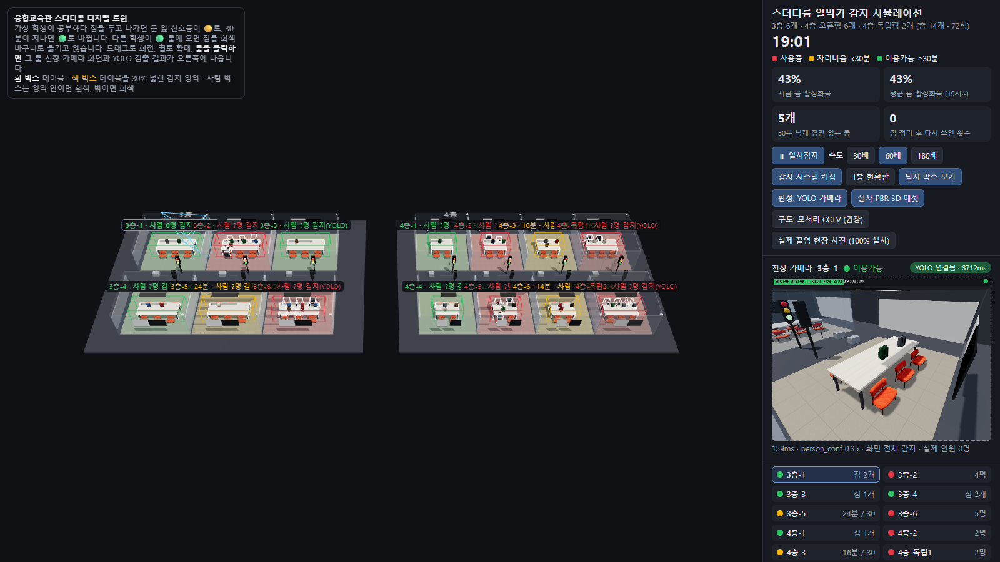
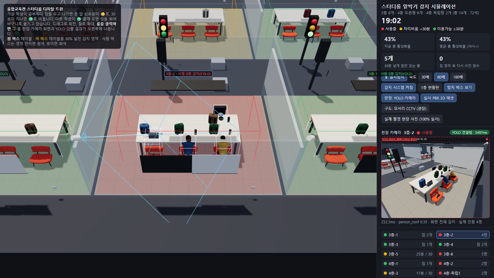
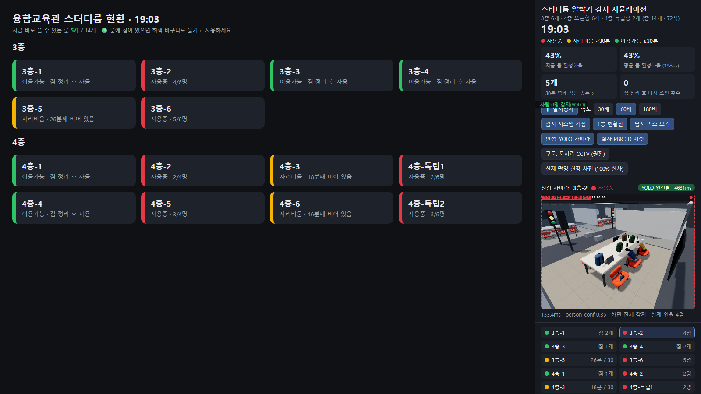

# 1주차 · 3D 테스트

스터디룸 알박기 감지의 판정 코드(MVP)와, 이를 3D 가상 스터디룸에서 시험한 환경입니다.

> **3D 시뮬레이션은 한계를 확인하고 중단했습니다.** 판정 코드(MVP)는 그대로 쓰고, 검증은 실제 사진과 실제 룸 영상으로 진행합니다. 아래 "중단한 이유"를 참고하세요.

## 실행 화면

| 전체 화면 | 룸 선택 시 천장 카메라 |
|---|---|
|  |  |



왼쪽은 스터디룸 14개의 신호등 상태와 탐지 박스, 오른쪽은 선택한 룸의 천장 카메라 화면과 YOLO 판정 결과입니다.

| 경로 | 내용 |
|---|---|
| [mvp/detector.py](mvp/detector.py) | YOLO11s로 테이블·사람 검출, 테이블 박스를 30% 넓힌 감지 영역 안의 사람 판정 |
| [mvp/room_logic.py](mvp/room_logic.py) | 사용중(빨강) / 자리비움 30분 미만(노랑) / 이용가능 30분 이상(초록) 판정 |
| [mvp/run.py](mvp/run.py) | 웹캠·영상으로 실시간 판정, 상태가 바뀐 순간 스냅샷(모자이크) 1일 보관 후 삭제 |
| [mvp/test_room_logic.py](mvp/test_room_logic.py) | 판정 규칙 테스트 6개 |
| [mvp/twin/index.html](mvp/twin/index.html) | 3D 디지털 트윈 (스터디룸 14개, 가상 학생, 문 앞 신호등, 1층 현황판) |
| [mvp/twin/yolo_server.py](mvp/twin/yolo_server.py) | 3D 룸별 천장 카메라 렌더를 YOLO11s로 판정하는 서버 |
| [mvp/twin/eval_yolo.py](mvp/twin/eval_yolo.py) | 3D 렌더로 자세별 검출률 측정 |
| [측정샘플](측정샘플) | 측정에 쓴 천장 카메라 렌더 예시 |

## 3D 측정 결과 (렌더 112장, YOLO11s, 임계값 0.35)

| 자세 | 검출률 | 평균 신뢰도 |
|---|---|---|
| 앉아서 공부 | 98.2% (160/163) | 0.77 |
| 엎드려 잠 | 48.9% (43/88) | 0.67 |
| 걷는 중 | 75.0% (33/44) | 0.77 |

룸 판정 정확도 92.0% (사람 있는 룸 75/84, 빈 룸 28/28). 3D 사람 모델이 단순해 엎드린 자세는 실제 사진(6/6)보다 낮게 나오므로, 실제 성능은 [YOLO검증](../YOLO검증) 노트북을 기준으로 봅니다.

## 중단한 이유

1. **3D 사람은 실제 사람과 달라서 YOLO 결과를 믿기 어렵다.** 엎드린 자세 검출률이 3D에서는 48.9%였지만, 실제 사진에서는 6/6(평균 신뢰도 0.85)이었다. 3D 결과로는 실제 성능을 판단할 수 없다.
2. **렌더링 환경에 따라 결과가 흔들린다.** 위 실행 화면처럼, GPU 없이 렌더링하면 3층-2에 4명이 앉아 있어도 YOLO가 0명으로 판정했다. 판정 1회에 3~5초가 걸려 실시간 시험도 어려웠다.
3. **현실처럼 만들려면 비용이 크다.** 사실적인 사람 모델, 조명, 재질을 갖추려면 언리얼 엔진 같은 도구와 며칠 이상의 작업이 필요해, 이번 일정과 맞지 않았다.

→ 판정 코드와 감지 영역 방식은 3D에서 흐름을 확인한 것으로 충분하다고 보고, **YOLO 검증은 실제 사진([YOLO검증](../YOLO검증))과 실제 룸 고정 촬영 영상으로 진행**하기로 했다. 3D 화면은 14개 룸 운영 모습을 보여 주는 시각화로만 남긴다.

## 실행

가상환경에 `torch`, `ultralytics`를 설치한 뒤:

```bash
python mvp/run.py --source 0 --time-scale 60          # 웹캠, 30분 → 30초 시연
python mvp/twin/yolo_server.py --port 8766 --open     # 3D + YOLO 판정
python -m pytest mvp -q                                # 판정 규칙 테스트
```

가중치(`yolo11s.pt`)는 처음 실행할 때 자동으로 내려받습니다. 3D 사람·의자 모델 파일(`mvp/twin/models/*.glb`)은 출처 확인 전이라 저장소에 올리지 않았습니다.
