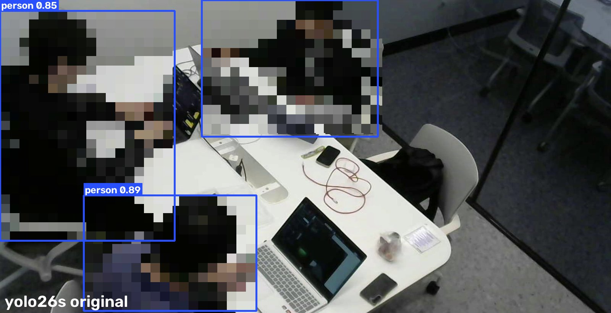
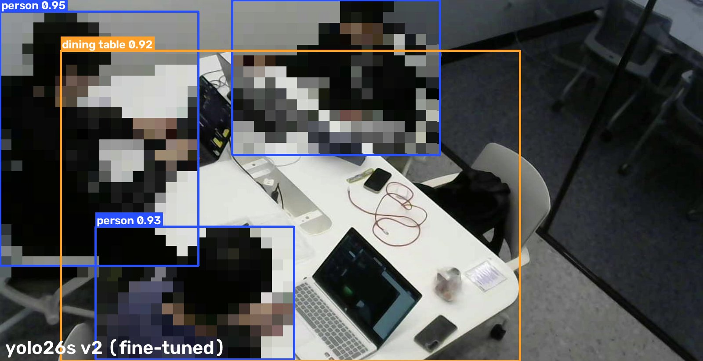
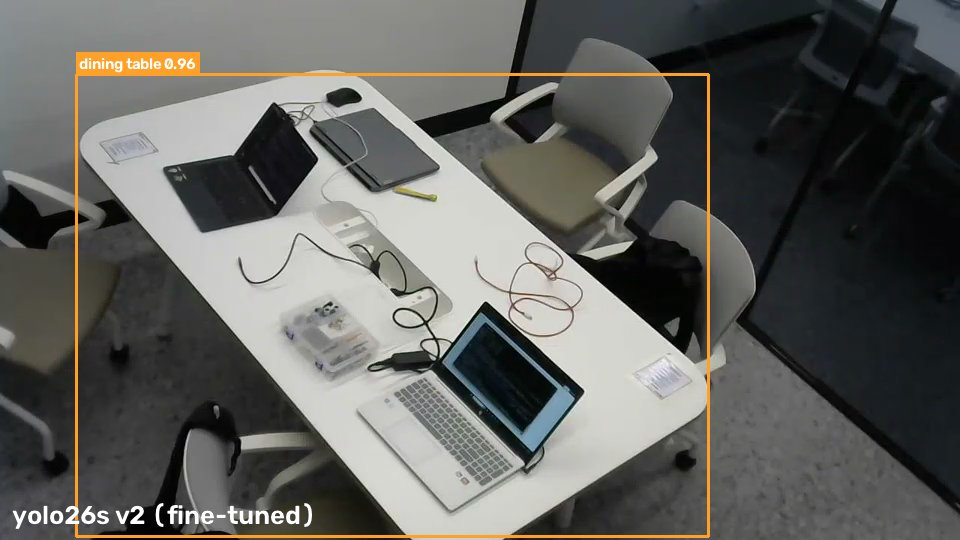
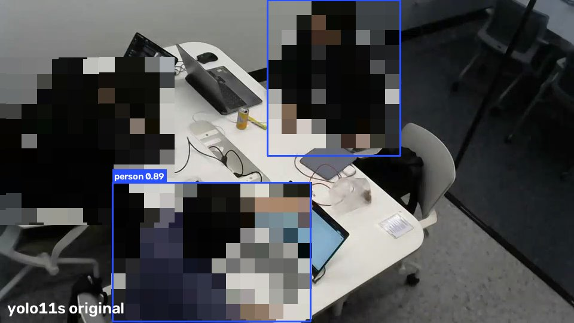
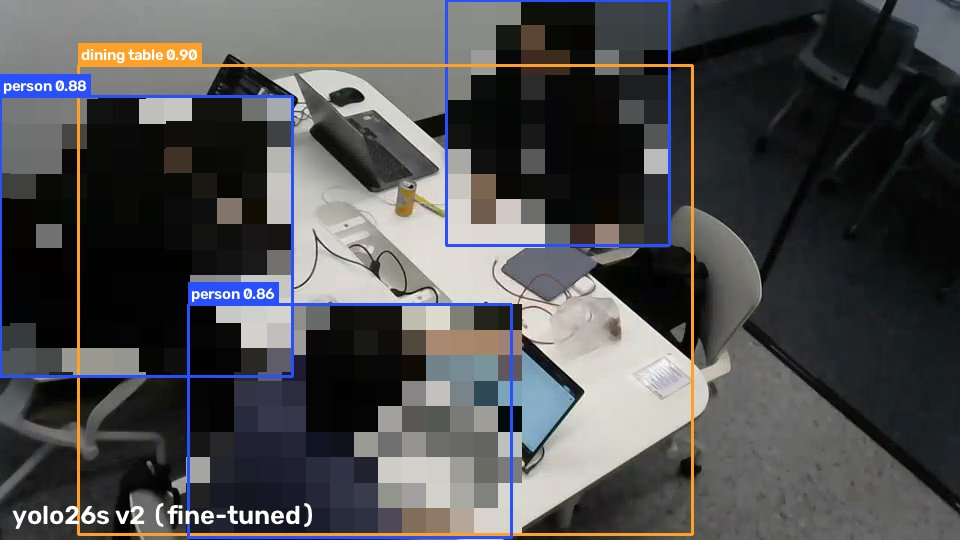

# 2일차 · YOLO 모델 비교와 테이블·사람 파인튜닝

2일차(2026-10-18)에는 라즈베리파이 웹캠으로 찍은 실제 스터디룸 영상으로 사전학습 YOLO 16종을 비교했습니다. 테이블과 엎드린 사람을 둘 다 잘 잡는 모델이 없어서, 학습 데이터를 직접 모아 파인튜닝했습니다. 최종 모델은 **YOLO26s 파인튜닝 버전(v2)**입니다.

| 파일·폴더 | 내용 |
|---|---|
| [YOLO비교](YOLO비교) | 사전학습 모델 16종 비교 코드와 결과 (검출률, 엎드린 사람, 리소스) |
| [데이터수집](데이터수집) | 학습 데이터를 만든 코드, 테이블 라벨 검수 화면, 학습 데이터셋(dataset_v2) |
| [파인튜닝](파인튜닝) | 학습·평가 코드, 코랩 노트북, 학습 기록, 결과 화면, **최종 모델 파일과 설명서** |
| [render_public.py](render_public.py) | 이 폴더의 결과 화면을 사람 모자이크 처리해서 만든 코드 |

> 결과 화면은 모두 사람 영역을 모자이크했습니다. 검출 박스와 신뢰도는 그대로입니다.

## 결과 한눈에 보기

학습에 쓰지 않은 시험 영상 기준입니다. (A: 천장 고정 카메라 1차.mp4 뒤 20%, B: 라즈베리파이 웹캠 영상)

| 모델 | 테이블 A | 테이블 B | 엎드린 사람 | 앉은 사람 | 파라미터 | GPU 1장 |
|---|---|---|---|---|---|---|
| YOLO11s 원본 (1주차 기본 모델) | 95% | 0% | 6% | 100% | 9.5M | 27ms |
| YOLO26s 원본 | 2% | 0% | 92.9% | 100% | 10.0M | 29ms |
| YOLO11s v2 (파인튜닝) | 100% | 100% | 98.8% | 100% | 9.5M | 27ms |
| **YOLO26s v2 (파인튜닝, 최종)** | **100%** | **100%** | **100%** | **100%** | 10.0M | 29ms |
| YOLO26m v2 (파인튜닝) | 100% | 100% | 100% | 100% | 21.9M | 27ms |
| YOLO26l v2 (파인튜닝) | 100% | 100% | 100% | 100% | 26.3M | 40ms |

| 원본 YOLO26s | 파인튜닝 YOLO26s v2 |
|---|---|
|  |  |
|  |  |

원본은 테이블을 전혀 잡지 못했고, 파인튜닝 후에는 사람이 있을 때와 짐만 남은 빈 자리 모두 테이블을 0.9 이상으로 잡습니다.

## 황예성이 한 일

### 1. 실제 영상으로 사전학습 YOLO 16종 비교 → [YOLO비교](YOLO비교)
- 라즈베리파이 + Logitech C270 웹캠 영상(18초, 3명 공부 중)에서 0.5초마다 36장을 뽑아, 크기별 11종(v8·11·12·26)과 구조가 다른 5종(v5u, v9, v10, RT-DETR, YOLO-World)을 같은 조건(imgsz 960, conf 0.25)으로 돌렸습니다.
- 장면에 실제로 있는 개수(사람 3, 노트북 3, 휴대폰 2, 마우스 1, 가방 1, 테이블 1)를 직접 세어 정답으로 쓰고, 몇 %를 잡았는지 채점했습니다.
- 1차.mp4 마지막 7초(84프레임)의 **책상에 엎드린 사람**을 판정 기준값 0.35로 잡는지도 따로 비교했습니다.
- 모델마다 새 프로세스에서 파라미터, 연산량, 파일 크기, CPU·GPU 시간, RAM·VRAM을 측정했습니다.

| 모델 | 물건 5종 | 테이블 (B) | 엎드린 사람 | 파라미터 | CPU 1장 |
|---|---|---|---|---|---|
| yolov8n | 62% | 8% | 56.0% | 3.2M | 67ms |
| yolov8s | 89% | 0% | 29.8% | 11.2M | 155ms |
| yolov8m | 98% | 3% | 86.9% | 25.9M | 382ms |
| yolo11n | 78% | 0% | 54.8% | 2.6M | 71ms |
| yolo11s | 72% | 0% | 6.0% | 9.5M | 142ms |
| yolo11m | 94% | 83% | 57.1% | 20.1M | 386ms |
| yolo11l | 100% | 100% | 31.0% | 25.4M | 493ms |
| yolo12s | 81% | 0% | 81.0% | 9.3M | 173ms |
| yolo26n | 63% | 3% | 65.5% | 2.6M | 69ms |
| yolo26s | 96% | 0% | 92.9% | 10.0M | 155ms |
| yolo26m | 94% | 0% | 94.0% | 21.9M | 368ms |
| yolov5su | 74% | 0% | 44.0% | 9.2M | 131ms |
| yolov9s | 85% | 92% | 2.4% | 7.3M | 181ms |
| yolov10s | 100% | 8% | 97.6% | 8.1M | 131ms |
| rtdetr-l | 100% | 72% | 91.7% | 33.0M | 1055ms |
| yolov8s-worldv2 | 87% | 0% ('table'로 질문) | 81.0% | 12.8M | 190ms |

- 물건 5종은 사람·노트북·휴대폰·마우스·가방 평균입니다. CPU 시간은 노트북 CPU, imgsz 960 기준입니다.
- **사람은 모든 모델이 잘 잡았지만, 테이블과 엎드린 사람을 둘 다 잘 잡는 모델은 없었습니다.** 테이블을 잡는 yolo11l은 엎드린 사람이 31%, 엎드린 사람을 잡는 yolov10s는 테이블이 8%였습니다.
- 그래서 사전학습 모델 중에서 고르는 대신, 우리 영상으로 파인튜닝하기로 했습니다.

### 2. 학습 데이터 수집 → [데이터수집](데이터수집)

| 출처 | 장수 | 테이블 라벨 | 사람·물건 라벨 |
|---|---|---|---|
| 휴대폰으로 테이블 주변을 돌며 찍은 영상 18초 | 181장 (3프레임마다) | 4개 모델 후보 → **181장 전부 눈으로 검수**, 틀린 박스는 손으로 수정 | yolov10s 자동 라벨 |
| 천장 고정 카메라 영상(1차.mp4) 앞 80% | 528장 (2초마다) | 카메라 고정 → 정답 박스 하나를 모든 프레임에 사용 | yolov10s 자동 라벨 |
| 위에서 찍은 엎드린 사람 사진 | 6장 × 3번 복사 | 4개 모델 후보 + 눈으로 검수 | yolov10s 자동 라벨 (기준 0.2) |

- **테이블 후보:** 테이블을 잘 잡던 yolo11l, yolo11m, yolov9s, rtdetr-l의 박스 중 가장 확실한 것을 후보로 썼습니다.
- **검수에서 고친 것:** 옆 룸의 작은 테이블을 잡은 3장은 본 테이블로 바꾸고 옆 룸 테이블은 따로 라벨링했습니다. 테이블 절반만 잡은 1장은 손으로 다시 그렸고, 의자까지 포함해 너무 커진 4장은 되돌렸습니다. → [테이블라벨_검수](데이터수집/테이블라벨_검수)
- **사람·물건 라벨:** 엎드린 사람과 물건을 가장 잘 잡은 yolov10s로 자동 라벨링했습니다.
- **라벨링 규칙:** 테이블은 물건이나 사람에 가려진 부분까지 포함해 전체를 박스로 그립니다. 클래스 번호는 COCO 그대로(0=사람, 60=테이블) 둬서 기존 코드에 그대로 붙습니다.
- **학습용과 시험용 분리:** 1차.mp4 뒤 20%(엎드린 구간 포함)와 웹캠 영상은 학습에 넣지 않고 시험에만 썼습니다.
- 최종 데이터셋은 학습 637장(휴대폰 144 + 1차.mp4 475 + 엎드린 사진 18), 검증 90장(휴대폰 37 + 1차.mp4 53)입니다. → [dataset_v2](데이터수집/dataset_v2)

### 3. 파인튜닝 → [파인튜닝](파인튜닝)
- **1차 시도 (테이블 위주, 휴대폰 영상만):** 테이블은 100%가 됐지만 **사람과 가방을 잊어버렸습니다.** (웹캠 사람 100% → 68%, 가방 89% → 14%, 엎드린 사람 6% → 0%)
- **v2 (사람 데이터 추가):** 1차.mp4 프레임과 엎드린 사람 사진을 넣고, 학습률을 낮춰(AdamW, lr0 0.001, 25에포크, imgsz 960) 다시 학습했습니다. 백본 고정과 전체 학습을 비교해 전체 학습을 택했습니다. (백본 고정은 가방 25%)
- **같은 데이터로 여러 버전 학습:** YOLO11s, YOLO26s는 노트북(RTX 5060)에서, YOLO26m·l은 코랩 A100에서 학습했습니다. 코랩은 연결이 끊겨도 이어서 학습하도록 결과를 에포크마다 구글 드라이브에 저장했습니다. → [알박기_yolo26_ml_학습.ipynb](파인튜닝/알박기_yolo26_ml_학습.ipynb)

| 원본 YOLO11s | YOLO26s v2 |
|---|---|
|  |  |

엎드린 장면에서 원본 YOLO11s는 엎드린 사람(왼쪽)을 신뢰도 0.14로만 잡아 화면에 나오지 않았고, 테이블도 놓쳤습니다. YOLO26s v2는 둘 다 잡습니다.

### 4. 모델 선택과 처리 구조
- **처리 구조:** 룸마다 라즈베리파이에서 추론하면 카메라와 라즈베리파이가 N개씩 필요합니다. 카메라 영상을 서버로 모아 한 번에 추론하면 카메라 N개와 서버 1대로 운영할 수 있어 서버 방식을 택했습니다.
- **모델:** 파인튜닝 후 YOLO11s와 YOLO26s는 테이블·사람 모두 100%로 차이가 미미했습니다. 엎드린 사람이 100%(YOLO11s 98.8%)로 가장 높은 **YOLO26s v2**를 쓰기로 했습니다. m·l은 정확도 이득 없이 CPU 기준 2.5~3.5배 느려 제외했습니다.
- **처리량:** YOLO26s v2는 GPU로 1장에 29ms(약 34장/초)라서, 14개 룸을 2초마다 판정하는 데 필요한 초당 7장의 약 5배 여유가 있습니다. (노트북 RTX 5060 기준 계산이고, 여러 카메라를 동시에 받아 본 것은 아닙니다)
- YOLO26은 엣지(CPU) 장치용 구조라 나중에 룸별 처리로 바꿀 때도 그대로 쓸 수 있습니다. 다만 성능을 올린 것은 구조가 아니라 **우리 영상으로 한 파인튜닝**입니다. (원본 YOLO26s는 테이블 0~2%)

### 5. 한계
- 시험 영상은 실제 쓸 고정 카메라 화면이지만 **룸은 1곳**입니다. 다른 룸에 설치하면 그 룸 화면으로 다시 확인해야 합니다.
- 엎드린 사람 시험은 **1명, 7초 분량**입니다. 얼굴을 카메라 쪽으로 두거나 후드·모자를 쓴 경우, 조명 변화는 아직 확인하지 않았습니다.
- YOLO26s v2는 가방을 거의 못 잡습니다(웹캠 0%). 사람·테이블 판정에는 영향이 없습니다.
- 사람·물건 라벨은 yolov10s 자동 라벨이라 그 모델의 실수를 일부 배웠을 수 있습니다.

## 모델 사용법

[파인튜닝/모델](파인튜닝/모델) 폴더의 `알박기_yolo26s_v2.pt`와 [README_모델설명.txt](파인튜닝/모델/README_모델설명.txt)를 보면 됩니다. 클래스 번호가 COCO 그대로라 기존 YOLO 코드에 파일만 바꿔 끼우면 됩니다.

```python
from ultralytics import YOLO
model = YOLO("알박기_yolo26s_v2.pt")
r = model.predict("frame.jpg", imgsz=960, conf=0.25, classes=[0, 60])  # 0=사람, 60=테이블
```

## 다시 실행하려면
- 코드 안의 영상·폴더 경로(`D:\CV프로젝트`, `G:\내 드라이브`)는 작성자 노트북 기준입니다. 원본 영상은 용량과 개인정보 때문에 올리지 않았습니다.
- 데이터셋으로 바로 학습: `YOLO("yolo26s.pt").train(data="데이터수집/dataset_v2/data.yaml", epochs=25, imgsz=960, batch=8, optimizer="AdamW", lr0=0.001)`
- 사용 버전: ultralytics 8.4.176, PyTorch 2.11 (CUDA 12.8)

> 문서와 코드는 생성형 AI(Claude)를 활용해 작성하고 정리했습니다. 실험 방향, 영상 촬영, 모델 선택과 처리 구조 결정은 직접 했습니다.
