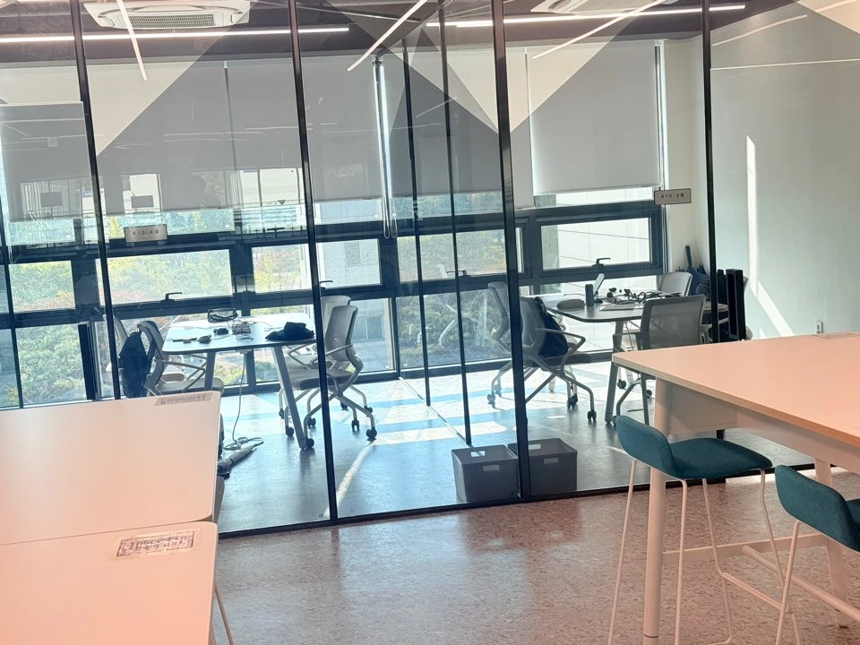
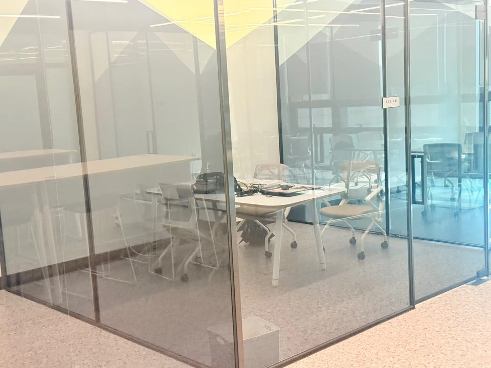
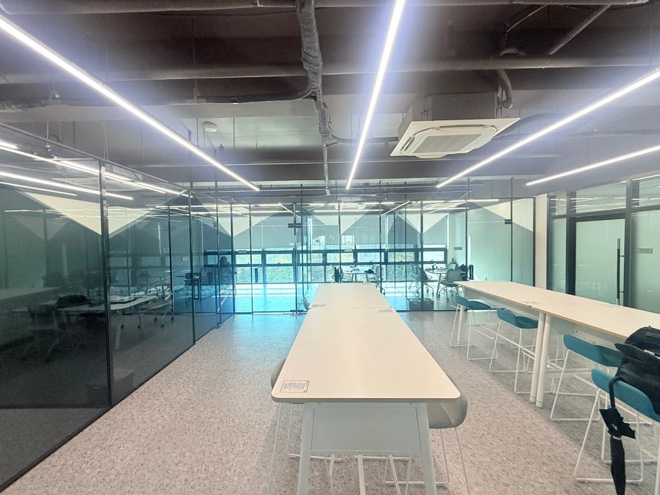
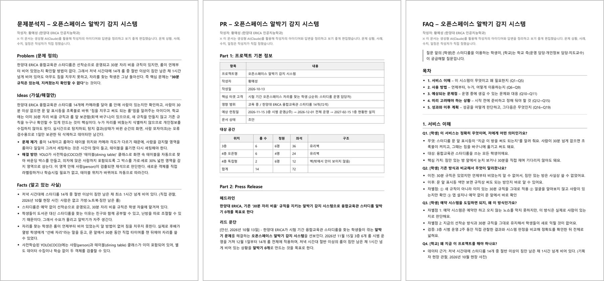
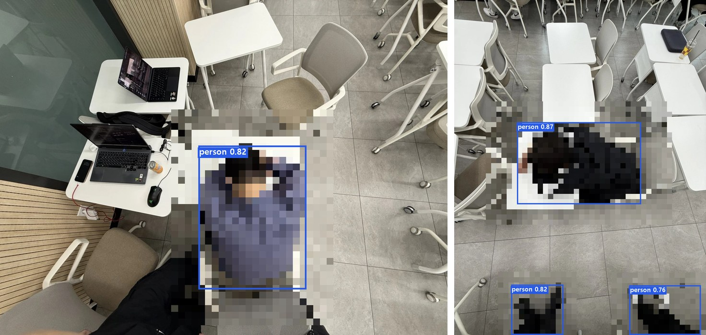
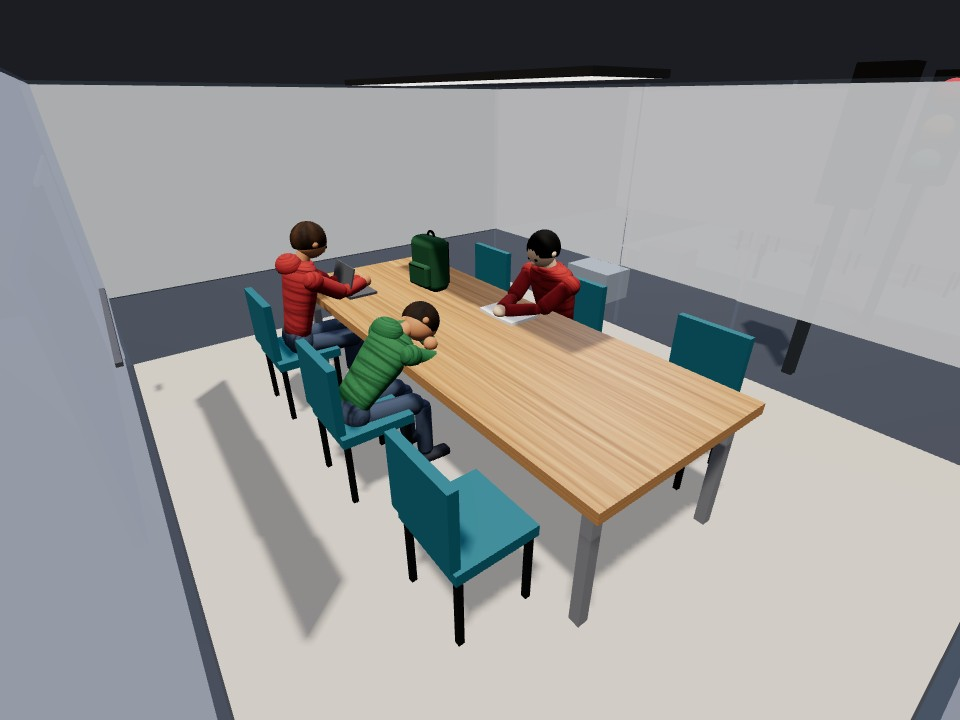

# 1주차 · 오픈스페이스 알박기 감지 시스템

1주차에는 1차 회의(2026-10-15)에서 역할과 구현 방향을 정하고, 판정 코드(MVP), 3D 테스트 환경, YOLO 검증까지 진행했습니다.

| 파일·폴더 | 내용 |
|---|---|
| [1차_회의보고서.pdf](1차_회의보고서.pdf) | 1차 회의 보고서 (10/15): 팀 공통 부분 + 황예성 개인 연구 보고(문제 정의, 기획서, 판정 방식 설계, 엎드린 사람 검증, 3D 시험) |
| [3D테스트](3D테스트) | MVP 판정 코드와 3D 디지털 트윈 (한계를 확인하고 시뮬레이션은 중단, 실행 화면과 중단 이유 정리) |
| [YOLO검증](YOLO검증) | 책상에 엎드린 사람 검출 실험 노트북 (모델 6종 비교, 리소스 측정) |

## 1차 회의 요약 (팀 공통)

| 항목 | 내용 |
|---|---|
| 일시 | 2026년 10월 15일(목) |
| 참석자 | 황예성, 이창민, 박서준 |
| 주요 활동 | 기획서(PR/FAQ) 공유와 검토, 구현 방향과 테스트 방식 결정, 엎드린 사람 인식 즉석 실험, 역할 분담 |

### 프로젝트 소개

| 구분 | 내용 |
|---|---|
| 문제 | 저녁 시간대에 14개 룸 중 절반 이상이 짐만 남은 채 1시간 넘게 비어 있음. 30분 자리 비움 규칙은 있지만 언제부터 비었는지 확인할 방법이 없어, 자리를 찾는 학생은 짐을 치우지 못하고 돌아섬 |
| 해결 방안 | 룸마다 카메라를 달고 YOLO로 사람 유무만 판단. 테이블 박스를 30% 넓힌 영역에 사람이 없는 상태가 30분을 넘으면 문 앞 신호등을 초록불로 바꿔, 학생이 짐을 룸 앞 바구니로 옮기고 쓸 수 있게 함 |
| 신호등 | 빨강 사용 중 · 노랑 자리 비움 30분 미만 · 초록 30분 이상(사용 가능) |
| 개인정보 | 얼굴을 식별하지 않고 사람 유무만 봄. 상태가 바뀐 순간의 화면만 모자이크해 1일 보관 후 삭제 |

### 문제해결과정: 엎드린 사람도 잡을 수 있는가

1. **문제 제기**: 책상에 엎드린 사람은 사전학습 YOLO가 잘 인식하지 못할 것이라는 의견이 나왔습니다. 사람이 있는데도 없다고 판단하면 30분 뒤 초록불이 켜져, 공부 중인 사람의 짐이 치워질 수 있습니다.
2. **검증**: 미팅 중에 팀원이 직접 책상에 엎드린 모습을 위에서 광각으로 6장 찍고, YOLO 모델 6종을 바로 돌려 봤습니다. 모든 모델이 6장 모두에서 엎드린 사람을 검출했습니다.
3. **결론**: 우려와 달리 인식은 잘 됩니다. 다만 모델에 따라 신뢰도 차이가 커서, 어떤 모델을 쓰고 임계값(사람으로 인정하는 신뢰도 기준)을 얼마로 둘지 팀에서 합의하기로 했습니다. 결과 표는 아래 [4. YOLO 검증](#4-yolo-검증--yolo검증)에 있습니다.

### 이번 미팅에서 한 일

- 기획서(문제분석지, PR, FAQ)를 함께 검토했습니다.
- MVP(룸 1개)와 3D 시뮬레이션 시연을 보고 동작 방식을 확인했습니다. YOLO11s 검출 → 테이블 박스 30% 확대 감지 영역 → 30분 3색 판정 구조입니다.
- 모델별 리소스를 비교했습니다. YOLO11s는 CPU에서 1장 0.1초, 18MB이고, YOLO11x는 0.65초, 109MB입니다.
- **조치 사항**: 역할을 확정했고(황예성 총괄·통합, 이창민 라즈베리파이, 박서준 YOLO 검증·실험), 1차 구현은 룸 1개 단위로 하기로 했습니다. 테스트는 3D 시뮬레이션으로 먼저 하고 마지막에 실제 룸에서 10회 정도 확인하기로 했으며, 문서는 링크로 공유해 함께 수정하고 팀 카톡방을 만들었습니다.

### 논의 사항

| 주제 | 내용 | 결론 |
|---|---|---|
| 추론 위치 | 라즈베리파이 안에서 직접 추론 vs 서버에서 판정 후 신호만 전송 | 추가 논의 (모델은 어느 쪽이든 동일) |
| 모델 크기 | nano부터 시작해 단계적으로 올리기. 라즈베리파이에서 small은 무거울 수 있음 | 모델·임계값 합의 필요 |
| 학습 여부 | 사전학습으로 사람 인식은 충분 | 감지 영역 안/밖 판정 테스트에 집중 |
| 엎드린 사람 | 인식은 되지만 신뢰도가 낮을 수 있음. 패딩·모자를 쓰고 엎드린 경우는 어려움 | 해결을 프로젝트 목표에 포함 |
| 책상 검출 | 책상이 dining table로 잘 안 잡힘 | ① 비전 LLM 재확인 ② 책상 데이터 추가 학습 ③ 박서준 테스트 |
| 감지 영역 보정 | 실제 사람이 있던 위치를 기준으로 영역을 보정하는 방식 | 참고 아이디어 |
| 확장성 | 문 없는 오픈 책상, 독서실에도 적용 가능 | 고도화 단계에서 다룸 |

### 다음 미팅까지 할 일

- 사용할 모델과 임계값(사람 신뢰도 기준)을 합의한다.
- 실제 룸에서 고정 촬영한 영상으로 판정 정확도를 확인한다.
- 라즈베리파이에서 모델을 돌려 속도를 재고, 추론 위치(내부 vs 서버)를 정한다.
- 책상 검출 보완 방법을 테스트해 하나를 고른다.
- 기획서에 실험 결과와 모델 선택 근거를 반영하고 PPT 초안을 만든다.

| 담당 | 역할 | 맡는 일 |
|---|---|---|
| 황예성 | 총괄·통합 | 기획서 보완, PPT 초안, 모듈 통합, 판정 로직 관리 |
| 이창민 | 라즈베리파이 | 룸 고정 촬영, 라즈베리파이·카메라·LED 세팅, 모델 속도 측정 |
| 박서준 | YOLO 검증·실험 | 영상 정답 기록, 임계값 튜닝, 책상 검출 보완, EfficientDet 재확인 |

| 날짜 | 내용 |
|---|---|
| 10/17(금)~18(토) | 룸 고정 촬영, 라즈베리파이 세팅 |
| 10/19(일)~20(월) | 영상 정답 기록·튜닝, LED 신호등, PPT 초안 |
| 10/20(화) | 2차 미팅: 모델·임계값 합의, 진행 점검 |
| 10/21(수) | 전체 연결 테스트와 리허설 |

- 실제 환경 테스트는 팀이 스터디룸 하나를 직접 확보해, 팀원들이 이용자 역할을 하며 진행합니다.
- 남은 문제: 책상 검출률이 낮고, 패딩·모자로 몸이 가려지면 놓칠 수 있으며, 30분 직전에 잠깐 들르면 타이머가 초기화됩니다.

> 이때 정한 방향 중 3D 시뮬레이션 테스트, 사전학습 모델 그대로 사용, 테이블 박스 30% 감지 영역은 2주차에 바뀌었습니다. → [2주차](../2주차)

## 황예성 개인 연구 보고 요약

제조업 비전 주제에서 출발해 출튀 감지를 거쳐 오픈스페이스 알박기 감지로 주제를 좁혔습니다. 융합교육관 스터디룸 14개를 직접 조사해 "30분 규칙은 있는데, 지켜졌는지 확인할 수 없다"를 핵심 문제로 정하고, 6 Pager 기획서(문제분석지·PR·FAQ 19문항)로 정리했습니다. 판정은 YOLO11s로 테이블과 사람을 찾고, 테이블 박스를 30% 넓힌 감지 영역 안에 사람이 있는지로 보도록 설계해 룸마다 영역을 손으로 그리지 않게 했습니다. 회의에서 나온 "엎드린 사람은 못 잡는다"는 우려는 회의 중 사진 6장으로 바로 확인했고(모델 6종 모두 6/6), 정확도와 속도의 균형으로 YOLO11s를 기본 모델로 골랐습니다. 룸 14개를 다 찍을 수 없어 만든 3D 디지털 트윈에서는 앉은 사람 98.2%, 룸 판정 92.0%가 나왔지만, 엎드린 사람이 48.9%로 실제와 달라 실제 룸 영상 검증으로 방향을 바꿨습니다.

| 번호 | 연구 질문 | 방법 | 결론 |
|---|---|---|---|
| RQ1 | 무엇이 문제이고, 학교에 이미 있는 규칙으로 풀 수 있는가 | 스터디룸 14개 현장 조사, 저녁 시간대 사진, 후배가 겪은 사례 정리 | 30분 규칙과 회색 바구니는 이미 있음. 지켜졌는지 확인할 수 없는 것이 문제 |
| RQ2 | 기존 서비스와 무엇이 달라야 하는가 | 유사 사례 4가지 조사 | 룸 단위, 기존 30분 규칙, 자동 감지 영역, 얼굴 미식별 |
| RQ3 | 룸마다 영역을 손으로 그리지 않고 재석을 판단할 수 있는가 | 판정 방식 설계, MVP 판정 코드와 규칙 테스트 6개 | 테이블 박스 +30% 감지 영역, 10초 가림 보정, 3색 규칙 |
| RQ4 | 엎드린 사람을 사전학습 YOLO로 잡을 수 있는가 | 회의 중 위에서 찍은 사진 6장, 모델 6종 | 6종 모두 6/6. 기본 모델 YOLO11s |
| RQ5 | 룸 14개를 다 찍지 않고 판정을 시험할 수 있는가 | 3D 디지털 트윈, 천장 카메라 렌더 112장 | 엎드린 사람 48.9%로 실제와 달라 중단, 실제 영상 검증으로 전환 |

| 항목 | 내용 |
|---|---|
| 장치 | 팀 노트북 (CPU 속도 측정) |
| 소프트웨어 | Python, Ultralytics YOLO, 웹 기반 3D 디지털 트윈(브라우저 + YOLO 판정 서버) |
| 입력 크기 | 960 |
| 데이터 | 엎드린 사람 사진 6장(실제 스터디룸, 2명, 위에서 광각) · 실제 스터디룸 영상(공용 테이블 신뢰도 확인) · 3D 천장 카메라 렌더 112장 |
| 기간 | 2026-10-13 ~ 10-17 (기획 10/13, 1차 회의 10/15, 3D 시험 10/15~17) |

## 황예성이 한 일

### 1. 아이디어 구상과 문제 정의
- 제조업 비전 주제에서 출발해 출튀 감지를 거쳐 **오픈스페이스 알박기 감지**로 주제를 구체화했습니다.
- 융합교육관 스터디룸 14개를 직접 조사했습니다. 예약 없이 선착순으로 운영되고, 학교의 30분 자리 비움 규칙과 룸 앞 보관함(회색 바구니)이 있다는 점을 확인했습니다.
- 핵심 문제를 **"30분 규칙은 있는데, 지켜졌는지 확인할 수 없다"**로 정의하고, 판정 규칙(빨강 사용중 · 노랑 30분 미만 · 초록 30분 이상)을 정했습니다.
- 저녁 시간대에 짐만 남은 룸을 사진으로 남기고, 후배가 겪은 알박기 사례도 정리했습니다. 새 규칙을 만들지 않고, 이미 있는 규칙을 누구나 확인할 수 있게 만드는 것이 목표입니다.

| 현장 1 | 현장 2 | 현장 3 |
|---|---|---|
|  |  |  |

융합교육관 스터디룸 현장 조사 사진입니다. 유리벽으로 나뉜 룸과 오픈형 공간이 있고, 예약 없이 선착순으로 씁니다. 짐만 두고 자리를 비운 룸이 있어도, 방금 온 학생은 언제부터 비었는지 알 수 없습니다.

### 2. 기획서
- 6 Pager PR/FAQ 양식으로 문제분석지, PR, FAQ 19문항을 작성하고 PDF로 정리했습니다. → [0_기획서](../0_기획서)
- HKU Find A Seat, 2023 도서관 좌석 감지 논문, 국내 라즈베리파이 좌석 감지 논문, 대학 도서관 예약 시스템을 조사해 차별점을 정리했습니다. (룸 단위 판정, 기존 30분 규칙 활용, 감지 영역 자동 설정, 얼굴 미식별)
- 예약 시스템은 예약만 하고 오지 않는 노쇼를 막을 수 없지만, 이 방식은 실제로 사람이 있는지로 판단합니다.

| 차별점 | 내용 |
|---|---|
| 룸 단위 판정 | 좌석 하나하나가 아니라 룸 하나를 한 화면으로 보고 사용 중인지 판단한다 |
| 기존 30분 규칙 활용 | 새 규칙을 만들지 않고, 학교의 30분 자리 비움 규칙과 회색 바구니를 그대로 쓴다 |
| 감지 영역 자동 설정 | 룸마다 영역을 손으로 그리지 않고, 테이블 위치로 자동으로 정한다 |
| 얼굴 미식별 | 누가 앉았는지 알아보지 않고, 사람이 있는지만 본다 |

왼쪽부터 문제분석지, PR, FAQ의 첫 쪽입니다. 전체는 [0_기획서](../0_기획서) 폴더에 있습니다.

### 3. 판정 방식 기획
- YOLO11s로 테이블과 사람을 검출하고, **테이블 박스를 가로·세로 30% 넓힌 감지 영역** 안에 사람이 있는지로 재석을 판단하도록 설계했습니다. 감지 영역을 손으로 그릴 필요가 없습니다.
- 사람이 10초 넘게 안 보여야 부재로 보는 가림 보정과, 30분 기준 3색 판정 규칙을 정했습니다.
- 상태가 바뀐 순간의 화면만 사람을 모자이크해 오류 검수용으로 1일 보관한 뒤 삭제하고, 데이터만 남기는 보관 방식을 정했습니다.

| 규칙 | 값 | 이유 |
|---|---|---|
| 검출 | YOLO11s (사람·테이블), 입력 960 | 사전학습 COCO에 사람과 테이블이 이미 있어 추가 학습 없이 시작할 수 있음 |
| 감지 영역 | 가장 큰 테이블 박스를 가로·세로 30% 확대 | 룸마다 영역을 손으로 그리지 않기 위해 |
| 가림 보정 | 사람이 10초 넘게 안 보여야 부재 | 잠깐 가려지거나 검출을 놓쳐도 상태가 흔들리지 않게 |
| 신호등 | 빨강 사용 중 · 노랑 30분 미만 · 초록 30분 이상 | 학교 30분 자리 비움 규칙을 그대로 적용 |
| 보관 | 상태가 바뀐 순간의 화면만 사람을 모자이크해 1일 보관 후 삭제 | 오류 검수는 하되 개인정보는 남기지 않게 |

이 규칙으로 판정 코드(MVP)를 만들었습니다. 검출과 감지 영역(`detector.py`), 3색 판정(`room_logic.py`), 웹캠·영상 실시간 판정과 모자이크 스냅샷(`run.py`)으로 나누고, 판정 규칙 테스트 6개를 붙였습니다. 1차 회의에서 이 MVP와 3D 시뮬레이션을 시연해 동작 방식을 팀원들과 확인했습니다. → [3D테스트](3D테스트)

1주차에 정한 판정 방식이 프로젝트를 거치며 어떻게 바뀌었는지는 아래와 같습니다.

| 항목 | 1주차 설계 | 최종 (바뀐 이유) |
|---|---|---|
| 검출 모델 | 사전학습 YOLO11s | 파인튜닝 YOLO26s v2 (천장 각도의 테이블을 못 잡음) |
| 감지 영역 | 테이블 박스를 가로·세로 30% 넓힘 | SAM 테이블 테두리 +15%, 겹침 10% (박스가 통로까지 덮음) |
| 재석·부재 | 10초 넘게 안 보이면 부재 | 같음, 2초 연속 보여야 재석 |
| 신호등 | 빨강 사용 중, 노랑 30분 미만, 초록 30분 이상 | 빈 책상(사람도 짐도 없음)은 바로 초록 추가 |
| 판정 장치 | 룸별 라즈베리파이 추론 검토 | 교내 PC 1대 (라즈베리파이 1장 2.8초·81.3°C) |
| 보관 | 상태가 바뀐 순간만 모자이크해 1일 보관 | 같음 |

### 4. YOLO 검증 → [YOLO검증](YOLO검증)
- 회의에서 나온 "엎드린 사람은 못 잡을 것"이라는 우려를 미팅 중 바로 사진 6장으로 검증했습니다. **모델 6종 모두 6장 전부 검출**했습니다.
- 모델별 파라미터, 연산량, 파일 크기, CPU/GPU 속도를 측정해 **YOLO11s를 기본 모델로 정한 근거**를 만들었습니다. (평균 신뢰도 0.85, CPU 1장 약 0.1초, 18MB. YOLO11x는 0.95지만 약 0.6초, 109MB)
- 실제 스터디룸 영상을 분석해 룸의 공용 테이블은 0.63~0.71로 잘 잡힌다는 것을 확인했습니다. (1인용 책상은 대부분 0.2 미만) 이 판단은 2주차에 천장 고정 카메라 영상을 돌려 보면서 뒤집혔습니다. → [2주차](../2주차)

회의 중 위에서 광각으로 찍은 엎드린 사람 사진과 YOLO11s 검출 결과입니다(기준 0.35). 사람은 모자이크했습니다.

| 모델 | 평균 신뢰도 | 가장 낮은 값 | 검출 (기준 0.35) |
|---|---|---|---|
| YOLO11x | 0.95 | 0.93 | 6/6 |
| **YOLO11s (선택)** | **0.85** | **0.79** | **6/6** |
| YOLOv8s | 0.80 | 0.55 | 6/6 |
| YOLO11n | 0.71 | 0.42 | 6/6 |
| YOLOv8n | 0.68 | 0.50 | 6/6 |
| YOLO26n | 0.54 | 0.41 | 6/6 |

사진 6장(2명), 입력 960 기준입니다. 6종 모두 6장을 전부 잡았지만 가장 낮은 신뢰도가 0.41에서 0.93까지 차이가 커서, 모델과 기준값은 팀에서 합의하기로 했습니다.

### 5. 3D 테스트 환경 → [3D테스트](3D테스트)
- 스터디룸 14개를 3D로 만들고, 가상 학생이 공부하다 짐을 두고 나가는 시나리오를 시뮬레이션했습니다.
- 룸마다 천장 카메라 시점을 렌더링해 YOLO11s 서버로 판정하고, 룸을 클릭하면 실시간 카메라 화면과 검출 결과를 보여 주게 만들었습니다.
- 렌더 112장으로 측정한 결과, 앉은 사람은 98.2%였지만 엎드린 사람은 48.9%로 실제 사진(6/6)과 크게 달랐습니다.
- GPU 없이 렌더링하면 4명이 앉아 있어도 0명으로 판정했고, 판정 한 번에 3~5초가 걸려 실시간 시험도 어려웠습니다.
- **3D 사람 모델의 한계로 실제 성능을 판단할 수 없다고 보고 시뮬레이션은 중단했습니다.** 검증은 실제 사진과 실제 룸 영상으로 전환했고, 3D는 운영 모습 시각화로만 남겼습니다.

| 룸을 고르면 나오는 천장 카메라 화면 | 측정에 쓴 렌더 예시 |
|---|---|
|  |  |

| 자세·판정 | 3D 렌더 (112장) | 실제 사진 |
|---|---|---|
| 앉아서 공부 | 98.2% (160/163) | — |
| 걷는 중 | 75.0% (33/44) | — |
| 엎드려 잠 | 48.9% (43/88) | 100% (6/6, 평균 신뢰도 0.85) |
| 룸 판정 | 92.0% (사람 있는 룸 75/84, 빈 룸 28/28) | — |

3D 화면의 사람은 모두 가상 인물입니다. 점수가 모델이 아니라 그래픽의 한계를 재고 있다고 보고 하루 만에 중단했습니다.

## 결론

1주차에 한 일은 네 가지로 정리됩니다.

- **문제 정의**: 현장 조사로 "30분 규칙은 있는데, 지켜졌는지 확인할 수 없다"는 문제를 정하고, 새 규칙 대신 기존 규칙을 확인할 수 있게 만드는 방향을 세웠습니다.
- **기획서와 차별점**: 6 Pager 기획서로 문제와 해결안을 정리하고, 유사 사례 4가지와 비교해 차별점 네 가지를 정했습니다.
- **판정 방식과 MVP**: 테이블 박스 +30% 감지 영역, 10초 가림 보정, 3색 규칙으로 판정 코드를 만들어 이후 실험의 기준으로 썼습니다.
- **빠른 검증**: 엎드린 사람 우려는 회의 중 사진 6장으로 바로 확인해 YOLO11s를 기본 모델로 정했습니다. 3D 시뮬레이션은 한계를 숫자로 확인하고 접어, 실제 영상 검증으로 방향을 바꿨습니다.

> 문서와 코드는 생성형 AI(Claude)를 활용해 작성하고 정리했습니다. 문제 정의, 현장 조사, 사진 촬영, 판정 규칙과 수치 목표는 직접 정했습니다.
