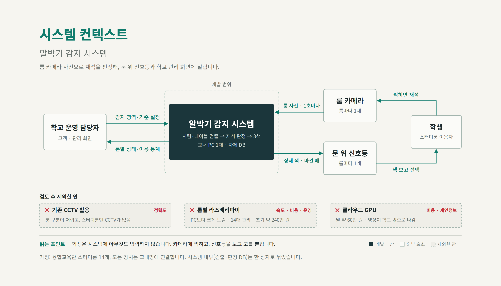
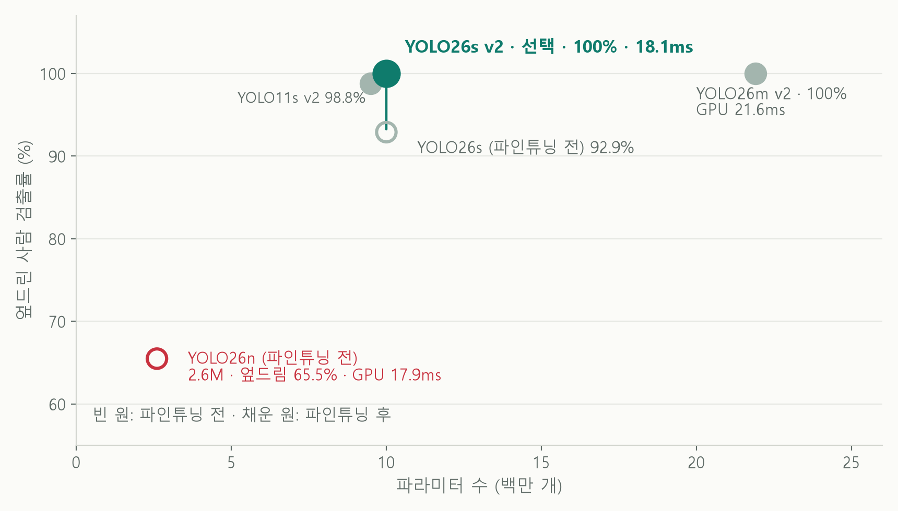
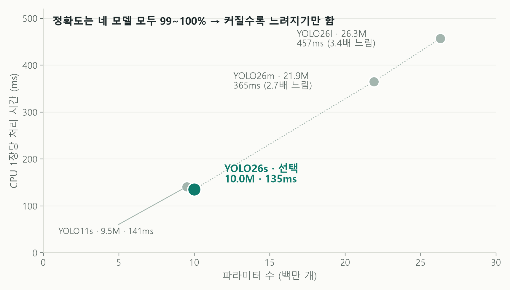
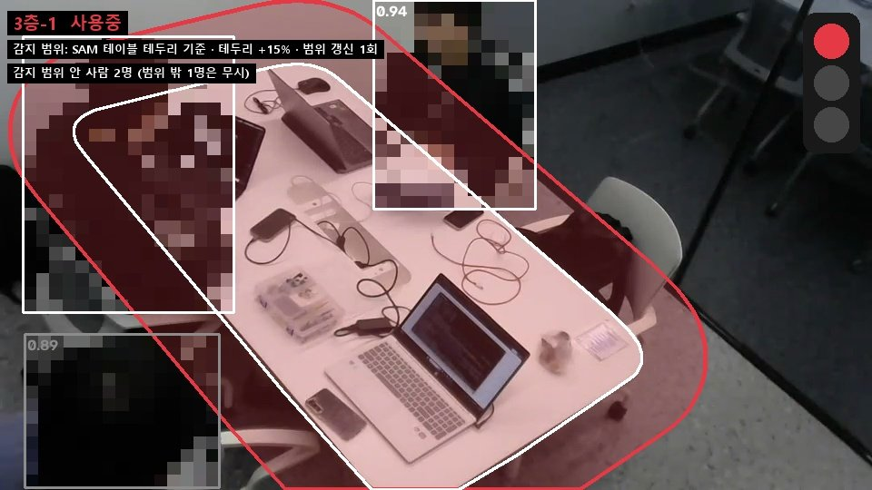
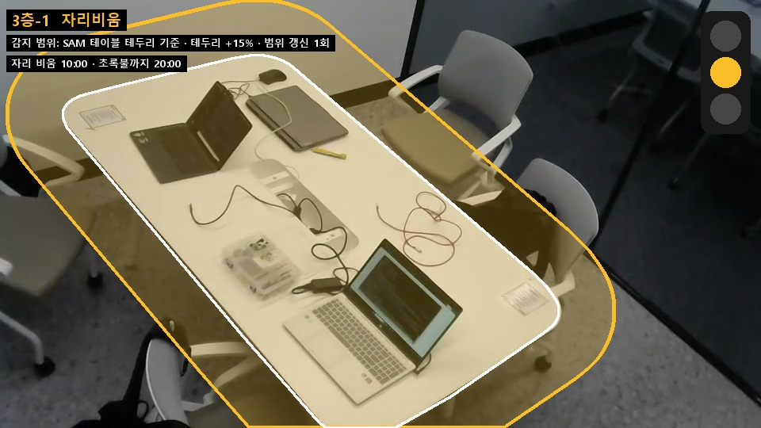
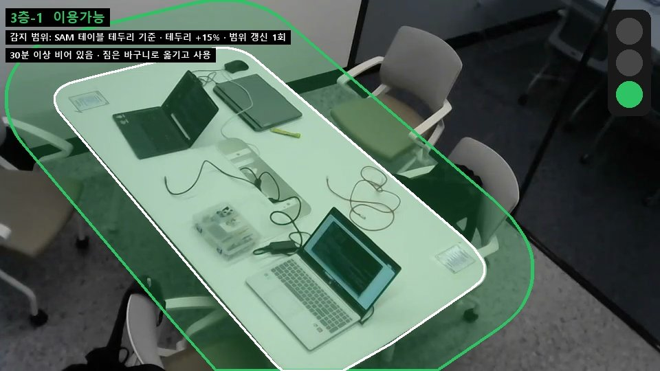
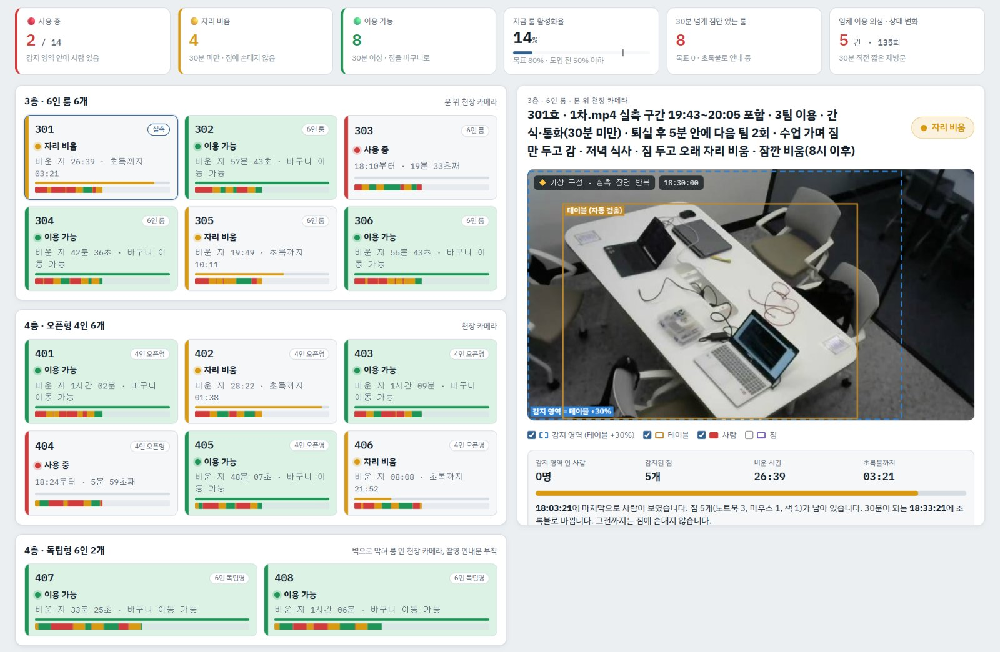

# 3일차 · 비용 계산, 서버 사양, 감지 영역, 발표 자료

> 이 문서는 Claude(AI)와 함께 정리했다.

3일차(2026-10-20 ~ 10-21)에는 교수님 피드백을 반영해 학교에 파는 B2B 기준으로 비용을 계산하고, 학교 예산과 비교했다. 실측값으로 서버 최소 사양을 정하고, 테이블 감지 영역과 판정 방식을 고쳤다. 이 내용을 15장짜리 발표 자료로 묶었다.

| 파일·폴더 | 내용 |
|---|---|
| [알박기_비용계산표.html](알박기_비용계산표.html) | 초기 비용과 월 운영비 계산표. 내려받아 브라우저로 열면 가정값을 바꿔 다시 계산할 수 있다 |
| [시스템_컨텍스트_다이어그램.html](시스템_컨텍스트_다이어그램.html) | 시스템 컨텍스트 다이어그램 (브라우저로 열기). 같은 그림의 PNG는 images 폴더에 있다 |
| [images](images) | 다이어그램, 모델 비교 그래프, SAM 감지 영역, 판정 예시, 대시보드 화면 |
| [videos](videos) | 대시보드 영상(도입 전), 한 룸 판정 영상 |

> 사람이 나오는 화면은 모두 모자이크했다.

## 1. 개요

### B2B 방향
고객과 사용자를 나눈다. **고객은 학교 운영 담당**이다. 돈을 내고, 감지 영역과 기준을 설정하고, 관리 화면에서 룸별 상태와 이용 통계를 본다. **사용자는 학생**이다. 시스템에 아무것도 입력하지 않고, 문 위 신호등 색을 보고 룸을 고른다.

### 교수님 피드백과 반영

| 피드백 | 반영 |
|---|---|
| 타깃을 정한다 | 고객은 학교 운영 담당, 사용자는 학생으로 정했다. 판단 기준을 ① 정확도·속도 ② 비용 ③ 운영·유지보수 ④ 개인정보 4가지로 세웠다 |
| 비용이 정말 최소인지 보여 준다. 오픈소스도 공짜가 아니고 인건비가 든다 | 초기 비용과 구독료를 항목별로 계산하고, 점검·수리·재학습 인건비를 구독료에 넣었다 → [2. 비용 계산](#2-비용-계산) |
| 라즈베리파이는 버린 안으로 솔직하게 말한다 | 팀원이 실측한 결과와 함께 제외한 이유를 정리했다 → [6. 라즈베리파이 검토 결과](#6-라즈베리파이-검토-결과) |
| 최소 사양(1060급)을 정하고 병렬 테스트를 한다 | 실측값으로 1060급 처리 시간을 추정했다. 룸 14개 병렬 테스트는 아직 못 했다 → [4. 서버 최소 사양](#4-서버-최소-사양) |
| 무엇을 시도했고 왜 그렇게 정했는지 스토리로 보여 준다 | 발표 자료를 문제 → 타깃과 판단 기준 → 제외한 안 → 선택 → 비용 순서로 구성했다 → [8. 발표 자료](#8-발표-자료) |

## 2. 비용 계산

→ [알박기_비용계산표.html](알박기_비용계산표.html)

### 무엇을 했나
학교에 도입할 때 드는 초기 비용과 매달 드는 비용을 항목별로 계산하는 표를 만들었다. 왼쪽 가정값을 바꾸면 합계가 바로 다시 계산된다.

### 정한 가정과 이유
- **개발비**: 비용표에 넣지 않았다. 대신 운영에 드는 인건비(점검, 고장 수리, 재학습)는 구독료에 넣었다.
- **DB**: 판정 서버 PC 안에 둔다. 클라우드 DB 비용이 들지 않고, 데이터가 학교 밖으로 나가지 않는다.
- **수집 간격**: 룸마다 1초에 1장을 받는다.
- **환율**: 1달러 = 1,350원. 클라우드 GPU와 라즈베리파이 같은 비교 안의 달러 가격을 원으로 바꿀 때 쓴다.
- **서버 PC**: 50만 원. 라이젠 5 5600급 CPU, GTX 1070급 GPU, 램 16GB다. CPU가 카메라 14대의 영상을 받아 푸는 일을 맡는데, i5-7600은 4코어라 과부하가 걱정돼 6코어 12스레드급으로 정했다. 가격은 같은 급 PC 기준 추정이다.
- **카메라**: Tapo C210, 대당 45,900원. 이유는 아래에 따로 적었다.
- **PoE 스위치**: 필요 없다. 와이파이 카메라라 랜선으로 전원을 줄 일이 없다.
- **설치**: 업체 시공 없이 거치대로 고정만 한다. 고정 부자재는 대당 1만 원으로 잡았다.
- **전기 공사**: 신호등과 카메라 전원용으로 전체 30만 원을 잡았다.
- **1층 현황판**: 고도화 단계로 미루고 이번 비용에서 뺐다.
- **감가상각**: 월 비용에서 뺐다. 장비값은 이미 초기 비용에 들어 있다.

### 카메라를 Tapo C210으로 고른 이유
- 저가 가정용 홈캠은 대부분 제조사 앱과 클라우드로만 영상을 볼 수 있다. RTSP로 영상을 직접 받을 수 없고, 영상이 학교 밖 서버를 거친다.
- Tapo C210은 카메라 계정을 만들면 RTSP/ONVIF로 서버가 영상을 직접 받을 수 있다. 처음 등록할 때만 인터넷이 필요하고, 그 뒤로는 학교 내부 와이파이로만 쓴다.
- 학교 와이파이가 WPA2-Enterprise(계정으로 로그인하는 방식)이면 카메라가 접속하지 못하므로 전용 공유기를 따로 둬야 한다.

### 결과

**초기 비용 207만 원 (룸 14개, 룸당 약 15만 원)**

| 항목 | 계산 | 금액 |
|---|---|---|
| 카메라 (Tapo C210) | 14대 × 45,900원 | 64만 원 |
| 판정 서버 PC (DB 포함) | 1대 | 50만 원 |
| 문 앞 신호등 | 14개 × 35,000원 | 49만 원 |
| 전기 공사 | 전체 | 30만 원 |
| 카메라 고정 부자재 | 14곳 × 10,000원 | 14만 원 |
| PoE 스위치 | 와이파이 카메라라 불필요 | 0원 |
| 1층 현황판 | 고도화 단계에서 추가 | 0원 |
| **합계** | | **207만 원** |

**매달 드는 비용**
- **구독료**: 룸당 월 1.5만 원이다. 14개 룸이면 월 21만 원, 연 252만 원이다. 점검, 고장 수리(출장비 제외), 재학습 인건비가 들어 있다.
- **전기세**: 월 3만 원 수준이다. 학교 전기를 쓰므로 구독료와 별도로 학교가 부담한다.

> 계산표 파일의 구독료 기본값은 월 20만 원으로 들어가 있다. 최종 구독료(월 21만 원)로 보려면 구독료 칸에 210000을 넣는다.

## 3. 학교 예산 대비

### 무엇을 했나
구독료가 학교에 부담되는 금액인지 보려고 한양대 2026학년도 교비회계 자금예산서(ERICA)와 비교했다.

- 출처: [한양대학교 예산 공개](https://site.hanyang.ac.kr/web/budget)
- 회계기간: 2026.03.01 ~ 2027.02.28 (2026.2.20 공고)

| 예산 항목 | 2026학년도 예산 |
|---|---|
| 학생지원비 | 103.6억 원 (10,362,781,802원, 2025 추경 92.1억 원) |
| 교내장학금 | 370.7억 원 |
| 실험실습비 | 18.5억 원 |

### 결과

| 비교 | 금액 | 학생지원비 대비 |
|---|---|---|
| 연간 구독료 | 252만 원 | 약 0.02% |
| 첫해 (초기 207만 원 + 구독 252만 원) | 459만 원 | 약 0.04% |

- 소프트웨어융합대학 몫도 추정해 봤다. 정원 2,114명 중 소융대가 174명(8.2%)이라 이 비율로 나누면 약 6.6~8.5억 원이고, 단과대 공통분을 빼면 3.3~4.3억 원이다. 가정이 들어간 추정이라 발표에는 전체 예산 기준만 쓴다.
- 예산은 1년 단위로 심의한다. 2026학년도 예산은 2026.2.20에 공고됐다.

## 4. 서버 최소 사양

### 무엇을 했나
교수님 피드백대로 최소 사양을 정하려고 팀 노트북(RTX 5060 Laptop GPU, 라이젠 7 250)으로 YOLO26s v2(입력 960)의 1장 처리 시간을 쟀다.

필요한 속도는 룸 14개 × 1초에 1장 = **초당 14장**이다. 1장을 **71ms 안에** 처리해야 한다.

| 방식 | 1장 처리 | 초당 처리 | 판단 |
|---|---|---|---|
| CPU만 | 135ms | 7.4장 | 부족 |
| CPU + GPU | 18.1ms | 55장 | 필요량의 3.9배 |

### 1060·1070급 추정
GPU 연산 성능(TFLOPS) 비율로 환산했다. RTX 5060 노트북은 약 15 TFLOPS로 추정했다.

| GPU | 연산 성능 | 1장 처리 | 71ms 기준 |
|---|---|---|---|
| RTX 5060 노트북 | 약 15 TFLOPS | 18.1ms (실측) | 통과 |
| GTX 1070 | 6.5 TFLOPS | 약 42ms (환산) | 통과 |
| GTX 1060 | 4.4 TFLOPS | 약 62ms (환산) | 통과, 여유 적음 |

### 결과
**최소 사양은 GTX 1060급, 권장 사양은 GTX 1070급**으로 정했다. 환산은 연산 성능만 비교한 보수적 예측이다. 시범 운영 때 실제 장비로 다시 잰다.

## 5. 모델 비교 정리

### 무엇을 했나
2일차 비교 결과를 발표용으로 다시 정리하고, 처리 시간을 다시 쟀다. GPU 시간은 RTX 5060 노트북, 입력 960에서 30번 돌린 중앙값이다.

**GPU 1장당 처리 시간과 정확도**

| 모델 | 파라미터 | 테이블 | 엎드린 사람 | GPU 1장 |
|---|---|---|---|---|
| YOLO26n (파인튜닝 전) | 2.6M | 3% | 65.5% | 17.9ms |
| YOLO26s (파인튜닝 전) | 10.0M | 2% | 92.9% | 21.0ms |
| YOLO11s v2 | 9.5M | 100% | 98.8% | 17.7ms |
| **YOLO26s v2 (최종)** | **10.0M** | **100%** | **100%** | **18.1ms** |
| YOLO26m v2 | 21.9M | 100% | 100% | 21.6ms |

**CPU(라이젠 7 250) 1장당 처리 시간**

| 모델 | 파라미터 | CPU 1장 | YOLO26s v2 대비 |
|---|---|---|---|
| YOLO11s v2 | 9.5M | 141ms | 비슷함 |
| **YOLO26s v2** | **10.0M** | **135ms** | **기준** |
| YOLO26m v2 | 21.9M | 365ms | 2.7배 느림 |
| YOLO26l v2 | 26.3M | 457ms | 3.4배 느림 |

| 파라미터 대비 엎드린 사람 검출률 | 파라미터 대비 CPU 처리 시간 |
|---|---|
|  |  |

### 결과와 해석
- **YOLO26n은 제외했다.** 엎드린 사람을 65.5%만 잡는다. 엎드린 사람을 놓치면 사람이 있는데도 초록불이 켜질 수 있다. GPU에서는 n(17.9ms)과 s(18.1ms)의 속도 차이도 거의 없다.
- **m·l은 정확도 이득이 없다.** s와 똑같이 100%인데 CPU에서 2.7~3.4배 느리다.
- YOLO26은 NMS-free 구조라 NMS 후처리가 필요 없다. YOLO11은 NMS 후처리가 필요하다.
- YOLO26s 파인튜닝 전 21.0ms와 후 18.1ms의 차이는 측정 오차다. 구조가 같아서 속도가 달라질 이유가 없다.
- 테이블 칸의 '파인튜닝 전' 값 두 개는 채점 방식과 시험 영상이 다르다. 26s의 2%는 정답 박스와의 겹침(IoU)으로 채점한 값(천장 카메라 1차.mp4)이고, 26n의 3%는 테이블을 잡았는지만 본 값(웹캠 영상)이다.
- 2일차 README의 GPU 시간(예: YOLO26s v2 29ms)은 다른 날 잰 값이라 몇 ms 차이가 난다. 어느 값이든 기준 71ms보다 훨씬 빠르다.
- 검출률과 파라미터 원자료는 1_모델비교·파인튜닝 폴더에 있다: [resource.json](../1_모델비교·파인튜닝/YOLO비교/resource.json), [results.json](../1_모델비교·파인튜닝/YOLO비교/results.json), [sleep_results.json](../1_모델비교·파인튜닝/YOLO비교/sleep_results.json), [eval_results.json](../1_모델비교·파인튜닝/파인튜닝/eval_results.json)

## 6. 라즈베리파이 검토 결과

→ 원본: [최종보고서/05_라즈베리파이](../../최종보고서/05_라즈베리파이) (팀 저장소 [10_Project/최종보고서/05_라즈베리파이](https://github.com/gosu1/ERICA_X_MODULABS_CV/tree/main/10_Project/최종보고서/05_라즈베리파이))

### 무엇을 했나
이창민 팀원이 10/21 새벽에 라즈베리파이에서 최종 모델을 직접 돌려 보고 결과를 팀 저장소에 올렸다. 여기에는 요약만 적고, 원본 파일은 위 링크에서 본다.

| 항목 | 값 |
|---|---|
| 장치 | Raspberry Pi 4B, CPU 3스레드 |
| 모델 | YOLO26s v2, 입력 960 |
| 표본 | 녹화 영상에서 뽑은 659장 |
| 평균 처리 시간 | 2,831.8ms/장 |
| 처리량 | 0.353장/초 |
| 최대 메모리 | 620.5MiB |
| 최고 온도 | 81.3°C |
| 정확도 | 100% (재구성한 기준) |

정확도는 원래 쓰던 evaluate.py와 정답 라벨이 없어서, 평가 기준을 재구성해 낸 참조 점수다.

### 결과: 제외
1. **1초 간격 판정이 안 된다.** 1장에 약 2.8초가 걸려 GPU 서버(18.1ms)보다 약 156배 느리다.
2. **과열된다.** 최고 81.3°C까지 올랐다.

비용도 룸마다 1대씩 14대를 두면 초기 비용이 약 240만 원이다(라즈베리파이 5와 카메라 모듈 기준).

## 7. 감지 영역과 판정

### 무엇을 했나
파인튜닝 뒤에도 문제가 남았다. YOLO의 테이블 박스는 사각형이라, 비스듬히 놓인 테이블에서는 테이블 옆 통로까지 덮는다. 그래서 지나가는 사람도 재석으로 셌다.

이를 막으려고 SAM으로 테이블 테두리를 따고, 짧은 변의 15%만큼 부풀려 감지 영역으로 쓴다.

① 빈 룸에서 YOLO26s v2가 테이블 박스를 찾는다 → ② 박스를 SAM에 넣어 테이블 테두리를 딴다 → ③ 테두리를 짧은 변의 15%만큼 부풀려 감지 영역을 만든다.

### 겹침 기준 25% → 10%
사람 박스가 감지 영역과 10% 이상 겹치면 재석으로 센다(처음에는 25%). 재석을 더 넓게 잡으려면 영역을 넓히거나 겹침 기준을 낮춰야 한다. 영역을 더 넓히면 유리벽 너머 옆방 사람까지 잡혀서, 영역은 +15%로 두고 겹침 기준을 낮췄다.

### 색 규칙

| 빨강 · 사용 중 | 노랑 · 자리 비움 | 초록 · 이용 가능 |
|---|---|---|
|  |  |  |
| 감지 영역 안에 사람이 있다. 영역 밖 1명은 세지 않는다 | 사람이 없고 30분이 안 됐다. 짐에 손대지 않는다 | 30분 넘게 비어 있다. 짐은 바구니로 옮기고 사용한다 |

### 한 룸 판정 영상
→ [videos/한룸_판정_사례1_사례2.webm](videos/한룸_판정_사례1_사례2.webm)

- **사례 1 · 짐만 두고 나감**: 사람이 나가면 노랑이 되고, 30분이 지나면 초록이 된다.
- **사례 2 · 짐까지 챙겨 나감**: 빈 책상도 노랑을 거쳐 초록이 된다.
- 처음에는 임시 박스로 판정하고, 룸이 비면 SAM으로 감지 영역을 정한다.
- 빈 책상 장면은 짐을 지운 합성 사진이고, 비운 시간은 실제 30분을 기다리지 않고 빠르게 계산했다.

### 한계
지금 코드는 짐이 있는지가 아니라 사람이 없는 시간만 잰다. 그래서 사례 2처럼 빈 책상도 노랑을 거쳐 초록이 된다. 짐 검출은 고도화 과제로 남긴다.

## 8. 발표 자료

- 발표 슬라이드(15장): https://claude.ai/artifact/GHg1Jhe3MWCBcRjXfK3M5P
- 비용 계산표: https://claude.ai/artifact/XypTFJVGbBM4VjjTz1k9g2
- 시스템 컨텍스트 다이어그램: https://claude.ai/artifact/XgnvkjPQ8eHsWmCfuWAszb

> 세 링크는 비공개라서, 작성자가 공유 메뉴로 공유해야 열린다. 비용 계산표와 다이어그램은 이 폴더의 HTML 파일로도 볼 수 있다.

| 장 | 제목 | 내용 |
|---|---|---|
| 1 | 표지 | |
| 2 | 문제 | 공부하는 사람은 없고 짐만 한가득이다. 30분 규칙은 있지만 언제 나갔는지 모른다 |
| 3 | 타깃과 판단 기준 | ① 정확도·속도 ② 비용 ③ 운영·유지보수 ④ 개인정보 |
| 4 | 시스템 컨텍스트 | 학교 운영 담당, 룸 카메라, 신호등, 학생과 시스템의 관계 |
| 5 | 카메라 | 기존 CCTV 활용은 제외 → [2. 비용 계산](#2-비용-계산)의 카메라 선택 이유 |
| 6 | 판정 위치 | 라즈베리파이와 클라우드는 제외하고 교내 PC로 판정 |
| 7 | 모델 | → [5. 모델 비교 정리](#5-모델-비교-정리) |
| 8 | 데이터 | 파인튜닝. 합성 데이터 80장은 중단 |
| 9 | 감지 영역과 판정 | → [7. 감지 영역과 판정](#7-감지-영역과-판정) |
| 10 | 서버 사양 | → [4. 서버 최소 사양](#4-서버-최소-사양) |
| 11 | 비용 | 연간 구독료는 학생지원 예산의 0.02% |
| 12 | 개인정보 | |
| 13 | MVP | 대시보드와 판정 영상 |
| 14 | 추후 계획 | 현장 데이터가 부족하다 → 준비, 7일 수집, 학습·테스트, 합격하면 적용. 테스트에 떨어지면 재학습한다. 중단 기준: 개인정보 검토 불통과, 또는 짐 분실·다툼 문의 주 3건 이상 |
| 15 | 마무리 | |

### MVP 대시보드 (도입 전)
→ [videos/대시보드_도입전_1740-1830.webm](videos/대시보드_도입전_1740-1830.webm)

시스템이 없을 때 17:40부터 18:30까지 짐만 남은 룸이 늘어나는 모습을 대시보드로 보여 준다. 18:30에는 14개 룸 중 사용 중 2개, 30분 넘게 짐만 있는 룸 8개, 룸 활성화율 14%다.

- 301호 카메라 화면은 실제 촬영 장면을 반복해 쓴 가상 구성이다.
- 대시보드의 감지 영역 표시(테이블 +30%)는 이전 기준으로 만든 화면이다. 지금 기준은 [7. 감지 영역과 판정](#7-감지-영역과-판정)의 SAM 테두리 +15%다.
- 18:30 화면 캡처: [images/대시보드_도입전_1830.png](images/대시보드_도입전_1830.png)

## 9. 남은 일
- **룸 14개 병렬 테스트**: 교수님이 요청했지만 아직 못 했다.
- **GTX 1060 실측**: 지금은 연산 성능 비율로 환산한 값뿐이다.
- **학교 협조**: 시설팀, 운영 담당, 개인정보 부서와 협의해야 한다.
- **실제 견적**: 신호등과 전기 공사 견적을 받아야 한다.
- **슬라이드 2장(문제) 근거 수치**: 관찰·설문 수치를 채워야 한다.
- **출장비**: 구독료에서 뺀 출장비 금액을 정해야 한다.
