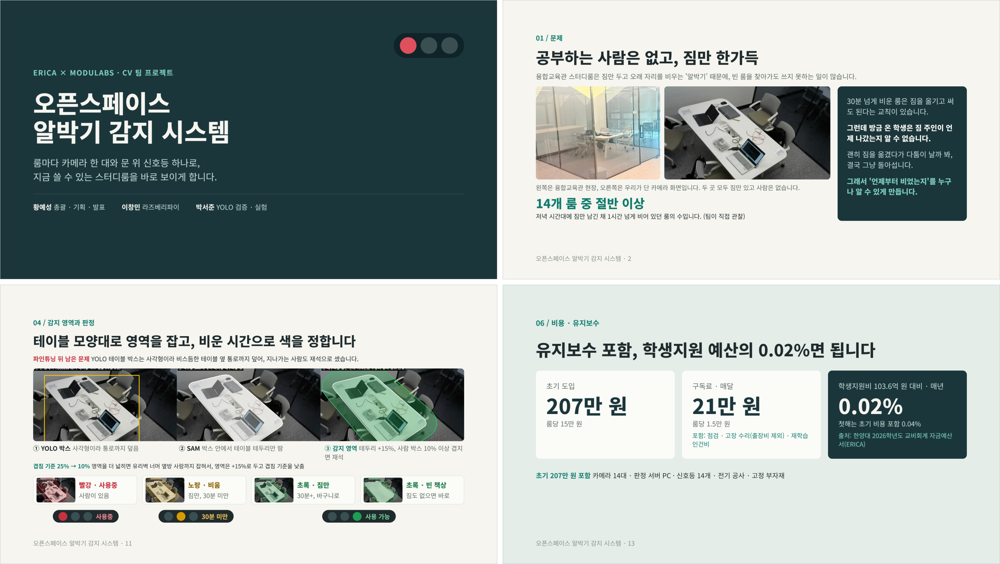

# 2주차 · 모델·데이터, 비용·판정, 2차 회의 (2026-10-18 ~ 10-21)

| 파일·폴더 | 내용 |
|---|---|
| [2차_회의보고서.pdf](2차_회의보고서.pdf) · [.docx](2차_회의보고서.docx) | 2차 회의 보고서 (10/21): 팀 공통 부분 + 황예성 개인 연구 보고(사전학습 16종 비교, 727장 파인튜닝, SAM 감지 범위, 비용·서버 사양, MVP 대시보드, 발표 자료) |
| [1_모델비교·파인튜닝](1_모델비교·파인튜닝) | 사전학습 YOLO 16종 비교, 학습 데이터 727장 제작(테이블 라벨 181장 검수), 파인튜닝(YOLO26s v2)과 모델 파일 |
| [2_비용·판정·발표준비](2_비용·판정·발표준비) | B2B 비용 계산, 학교 예산 비교, 서버 최소 사양, SAM 감지 범위, 판정 예시, 발표 자료 준비 |

## 1차 회의 이후 바뀐 것

| 1차에서 정한 일 | 결과 |
|---|---|
| 모델과 임계값 합의 | 사전학습 16종 비교 후 YOLO26s v2(파인튜닝)로 결정 |
| 실제 룸 영상으로 판정 확인 | 천장 고정 카메라 영상 22분 촬영, 앞 80% 학습 · 뒤 20% 시험 |
| 라즈베리파이 속도 측정, 추론 위치 결정 | 1장 2,832ms, 최고 81.3°C → 교내 PC 1대로 결정 |
| 책상 검출 보완 | 파인튜닝으로 테이블 검출 2% → 100% |
| 기획서 반영, PPT 초안 | 발표 슬라이드, 프로젝트 보고서 작성 |

## 시도했다가 제외한 것

- **3D 시뮬레이션**: 엎드린 사람 48.9%로 실제 사진(6/6)과 달라 중단
- **사전학습 모델 그대로 사용**: 테이블과 엎드린 사람을 둘 다 잡는 모델이 없음
- **1차 파인튜닝**: 테이블은 100%가 됐지만 사람을 잊음(100% → 68%) → v2로 해결
- **합성 데이터로 학습**: 모델이 이미 잡는 장면이라 학습에서 제외, 약점(후드 쓰고 엎드린 사람) 찾기에 활용
- **사각형 박스 감지 영역**: 통로까지 덮음 → SAM 테이블 테두리 +15%, 겹침 기준 25% → 10%
- **룸별 라즈베리파이, 클라우드 GPU**: 속도·과열·비용·개인정보 문제로 제외

자세한 내용은 보고서의 문제해결과정, 논의 사항, 팀 결정 사항 표에 있습니다.

## 황예성이 한 일

1차 회의(10/15) 이후 부딪힌 문제를 어떻게 고민하고 고쳤는지, 실패한 시도까지 순서대로 적었습니다.

### 1. 3D 시뮬레이션으로 검증하려다 멈춘 일
- **문제**: 룸 14개를 실제로 다 찍을 수 없어 판정을 시험할 방법이 필요했습니다.
- **시도**: 스터디룸 14개 디지털 트윈을 만들어 가상 학생과 천장 카메라 렌더로 시험했습니다.
- **실패**: 엎드린 사람 검출이 48.9%로 실제 사진(6/6)과 달랐습니다. GPU 없이 렌더링하면 4명을 0명으로 판정했습니다. 가상 화면이 실제와 달라 검증 수단으로 믿을 수 없었습니다.
- **바꾼 것**: 하루 만에 중단하고, 실제 룸에 카메라를 달아 찍은 영상으로 검증하기로 했습니다.

3D 화면과 측정 결과는 [1주차](../1주차#5-3d-테스트-환경--3d테스트)에 있습니다.

### 2. 테이블을 못 잡는 문제
- **문제**: 실제 영상에서 사전학습 YOLO가 우리 테이블을 거의 못 잡았습니다(YOLO26s 2%). 책상을 식탁(dining table)으로만 배워, 천장에서 내려다본 흰 테이블은 모르는 것이었습니다.
- **고민**: 더 큰 모델이면 잡을까? 사전학습 16종을 같은 조건으로 비교했지만 테이블과 엎드린 사람을 둘 다 잡는 모델은 없었습니다. 크기가 아니라 데이터 문제라고 판단했습니다.
- **시도**: 우리 룸 사진 727장을 직접 만들어 파인튜닝했습니다. 테이블 라벨 181장은 전부 눈으로 검수했습니다.
- **실패**: 1차 학습은 테이블 위주 데이터라, 테이블은 100%가 됐지만 사람을 잊었습니다(사람 100%→68%, 가방 89%→14%).
- **바꾼 것**: 사람 데이터를 같이 넣고 학습률을 낮춘 v2로 다시 학습했습니다. 테이블 2%→100%, 엎드린 사람 92.9%→100%가 됐습니다.

| 원본 YOLO26s | 파인튜닝 YOLO26s v2 |
|---|---|
|  |  |

짐만 남은 빈 자리에서 원본은 테이블을 잡지 못했고, v2는 신뢰도 0.96으로 잡습니다.

| 모델 | 테이블 A | 테이블 B | 엎드린 사람 | 앉은 사람 | 파라미터 |
|---|---|---|---|---|---|
| YOLO11s 원본 | 95% | 0% | 6% | 100% | 9.5M |
| YOLO26s 원본 | 2% | 0% | 92.9% | 100% | 10.0M |
| YOLO11s v2 | 100% | 100% | 98.8% | 100% | 9.5M |
| **YOLO26s v2 (최종)** | **100%** | **100%** | **100%** | **100%** | 10.0M |

학습에 쓰지 않은 영상 기준입니다(A: 천장 고정 카메라 뒤 20%, B: 웹캠).

파라미터 대비 엎드린 사람 검출률입니다. n은 엎드린 사람을 65.5%만 잡고, m·l은 정확도가 같으면서 CPU에서 2.7~3.4배 느려 YOLO26s v2로 정했습니다.

### 3. 기존 YOLO 박스로는 감지 범위를 제대로 잡을 수 없는 문제
- **문제**: 감지 범위를 YOLO 테이블 박스를 30% 넓혀 만들었는데, 박스는 사각형이라 테이블 모양과 맞지 않았습니다. 비스듬한 테이블에서는 옆 통로까지 덮어 지나가는 사람도 재석으로 셌습니다.
- **고민**: 박스를 넓히거나 줄이는 것만으로는 통로와 테이블 끝자리를 동시에 맞출 수 없어, 기존 YOLO 인식 범위의 한계라고 판단했습니다.
- **시도**: 테이블 박스를 SAM에 넣어 테이블 테두리만 따고, 테두리를 15% 부풀려 감지 범위로 썼습니다.
- **실패**: 테이블 끝에 앉은 사람을 잡으려고 범위를 더 넓히자 유리벽 너머 옆방 사람까지 잡혔습니다.
- **바꾼 것**: 범위는 +15%로 두고, 사람 박스의 겹침 기준을 25%에서 10%로 낮췄습니다.

① 빈 룸에서 YOLO 테이블 박스 → ② SAM으로 테이블 테두리 → ③ 짧은 변의 15%만큼 부풀린 감지 범위.

| 겹침 기준 | 사람별로 재석으로 센 비율 | 사람이 있는데 룸을 비었다고 본 순간 |
|---|---|---|
| 25% (처음) | 95.3% | 1초 |
| 15% | 96.9% | 1초 |
| **10% (최종)** | **97.5%** | **0초** |
| 1% | 99.5% | 0초 (통로에 선 사람까지 재석) |

| 빨강 · 사용 중 | 노랑 · 자리 비움 | 초록 · 이용 가능 |
|---|---|---|
|  |  |  |

같은 룸에서 신호등 색이 바뀌는 모습입니다. 사람은 모자이크했습니다.

### 4. 비용이 너무 크게 나온 문제
- **문제**: 처음 계산한 초기 비용에는 PoE 스위치, 업체 시공, 현황판 모니터까지 들어 있어 학교가 내기엔 컸습니다.
- **시도**: 와이파이 홈캠(Tapo C210)으로 바꿔 PoE와 시공을 빼고, 현황판은 고도화로 미뤘습니다. 월 운영비는 룸당 1.5만 원 구독으로 정해 점검·수리·재학습 인건비를 넣었습니다.
- **결과**: 초기 207만 원, 연 252만 원으로 ERICA 학생지원비의 0.02%입니다.

고객은 학교 운영 담당, 사용자는 학생입니다. 판정은 교내 PC 1대에서 합니다.

| 항목 | 계산 | 금액 |
|---|---|---|
| 카메라 (Tapo C210) | 14대 × 45,900원 | 64만 원 |
| 판정 서버 PC | 1대 | 50만 원 |
| 문 앞 신호등 | 14개 × 35,000원 | 49만 원 |
| 전기 공사 | 전체 | 30만 원 |
| 카메라 고정 부자재 | 14곳 × 10,000원 | 14만 원 |
| **합계** | 룸당 약 15만 원 | **207만 원** |

구독은 룸당 월 1.5만 원(연 252만 원)으로, ERICA 학생지원비 103.6억 원의 0.02%입니다.

### 5. 말로는 전달하기 어려운 문제
- **문제**: 판정 방식과 도입 효과를 말로 설명하면 이해하기 어려웠습니다.
- **시도**: 눈으로 보는 것이 이해하기 쉽다고 판단해 MVP 사이트를 만들었습니다. 학습 데이터(실제 룸 천장 카메라 영상 22분)를 더미 데이터로 삼아 14개 룸을 가상으로 운영하는 관리자 대시보드 시뮬레이션입니다(룸 상태, 부재 기록, 통계·KPI, 도입 전/후 비교).
- **결과**: 저녁 식사 시간 룸 활성화율이 도입 전 22%에서 도입 후 50%로 바뀌는 것을 한 화면에서 보여 줄 수 있게 됐습니다.

도입 전 18:30 화면입니다. 14개 룸 중 사용 중 2개, 30분 넘게 짐만 있는 룸 8개, 룸 활성화율 14%입니다. 도입 후에는 저녁 식사 시간 활성화율이 22%에서 50%로 올라갑니다.

### 6. 발표 슬라이드
- 발표 슬라이드를 만들고, 팀원들의 피드백을 받아 슬라이드를 수정했습니다.

발표 자료 일부(표지, 문제, 감지 범위와 판정, 비용)입니다. 최종본은 [../최종보고서](../최종보고서)에 있습니다.
