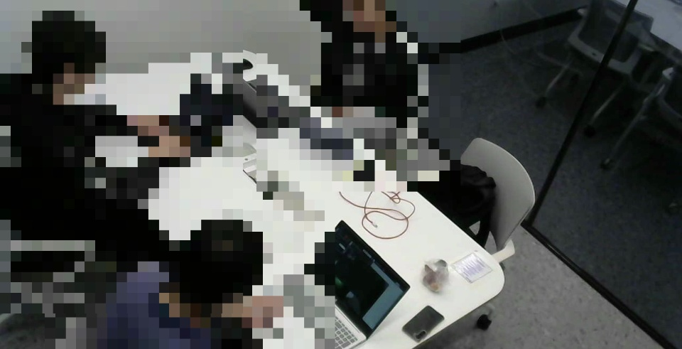
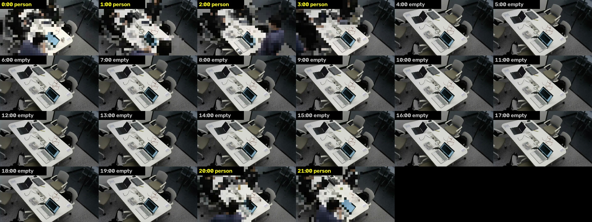
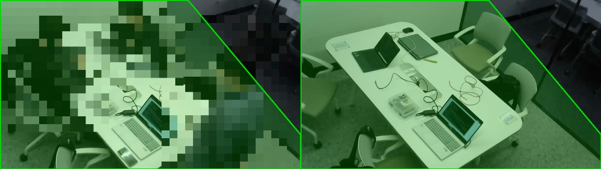
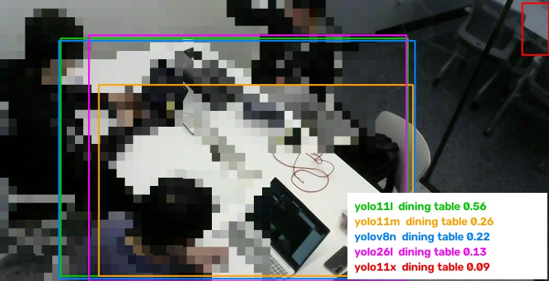
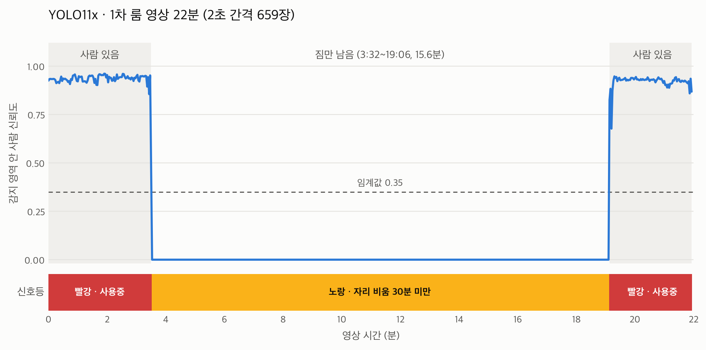
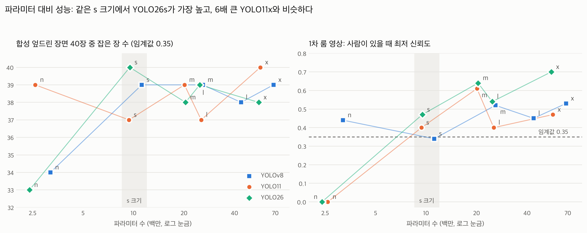
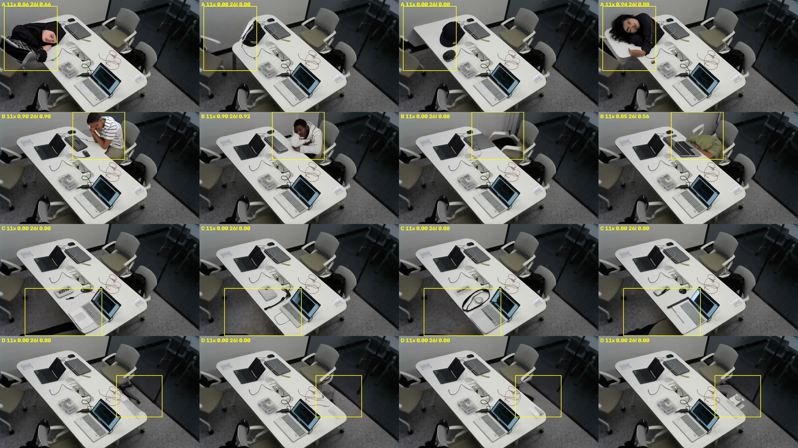
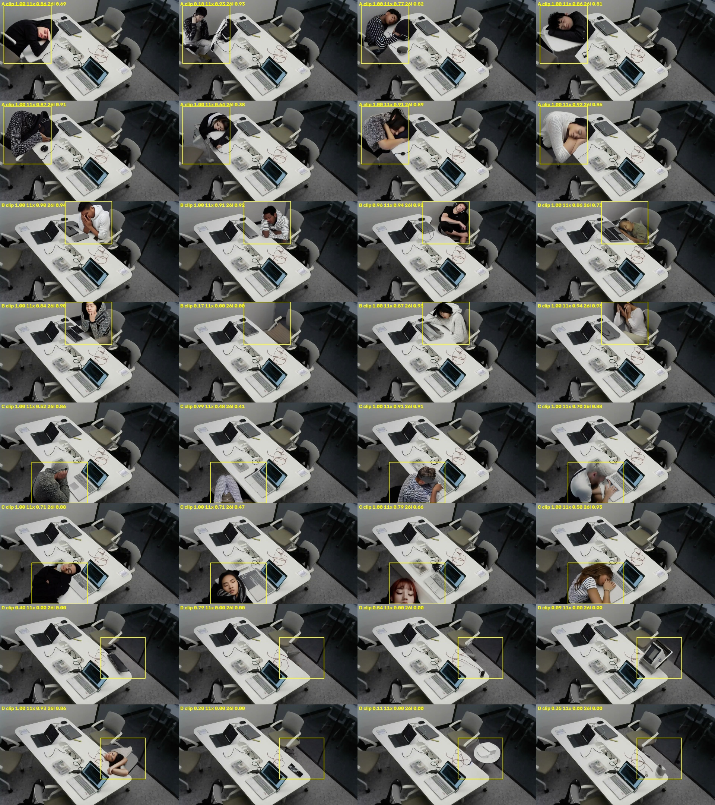
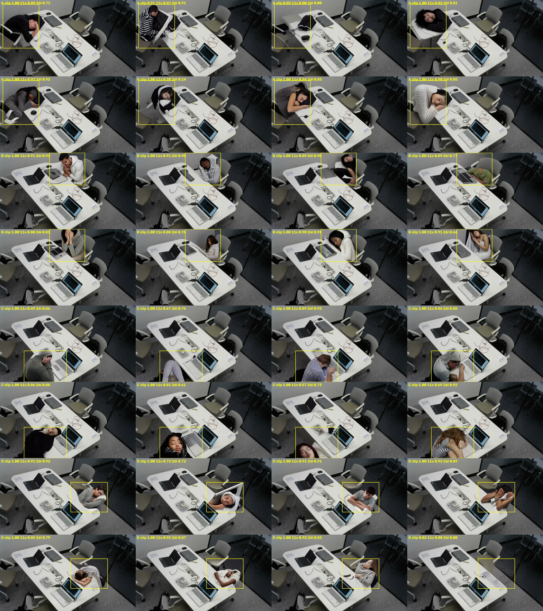

# 실험 이미지

실험에 쓴 이미지와 결과 그래프를 모았다. 이 저장소는 공개라서, 실제 사람이 나오는 이미지(01~04)는 YOLO11x로 사람을 찾아 박스를 사방 25% 넓힌 뒤 모자이크했다. 07~09의 사람은 Stable Diffusion이 그린 가상 인물이다. 수치와 해석은 ../EXPERIMENTS.md에 있다.

1. **01_녹화영상.jpg**: 라즈베리파이 웹캠(C270) 화면을 17초 녹화한 영상에서 카메라 영역만 잘라 낸 프레임이다. 사람 3명이 계속 앉아 있다. 이 영상으로 15종의 첫 비교(36장)와 테이블 검출 시험을 했다(EXPERIMENTS.md 1절).

   

2. **02_1차룸영상_1분간격.jpg**: 1차.mp4(22분)를 1분 간격으로 뽑은 썸네일이다. 3:30까지 사람이 있고, 3:32부터 19:06까지 노트북과 가방만 남고, 19:08부터 다시 사람이 있다. 실제 평가는 2초 간격 659장으로 했고, 정답은 썸네일을 보고 2초 단위로 기록했다(1절, 5절).

   

3. **03_감지영역.jpg**: zone_1차.json의 감지 영역(초록)이다. 유리벽 너머 복도를 빼고 방 안 전체를 덮는다. 왼쪽은 사람이 있는 2:00, 오른쪽은 빈 방인 10:00이다. 사람 박스의 중심이 이 영역 안에 있으면 사용중으로 본다.

   

4. **04_테이블검출.jpg**: 녹화 영상 5초 지점에서 모델마다 가장 확실한 COCO dining table 박스다. YOLO11l(0.56)만 기준 0.35를 넘었고, 나머지는 위치는 비슷해도 신뢰도가 0.3 미만이었다. YOLO11x(빨강)는 유리벽 너머 의자를 테이블로 잡았다. 이 결과로 테이블 검출 대신 다각형 감지 영역을 쓰기로 했다(1절).

   

5. **05_1차영상_판정그래프.png**: 1차 영상에서 감지 영역 안 사람 신뢰도와, 그 값만으로 계산한 신호등 상태다. 당시 결정 모델이던 YOLO11x 결과이고, 신호등 상태는 정답과 659장 모두 일치했다(1절). 현재 모델(YOLO26s)로는 다시 그리지 않았다.

   

6. **06_파라미터대비성능.png**: 15종의 파라미터 수(가로, 로그 눈금)와 성능이다. 왼쪽은 합성 엎드린 장면 40장 중 잡은 장 수, 오른쪽은 1차 영상에서 사람이 있을 때의 최저 신뢰도다. 같은 s 크기에서 YOLO26s가 두 지표 모두 가장 높고, 6배 큰 YOLO11x와 비슷하다(5절).

   

7. **07_합성_시험생성.jpg**: 1차 영상의 빈 방 프레임(8:00)에 자리 4곳(A~D, 줄) x 옷차림 4가지(칸)로 엎드린 사람을 그려 넣은 첫 시험 16장이다. 사람이 그려진 것은 5장뿐이고, 아래쪽(C)과 오른쪽(D) 자리는 0장이었다. 노란 숫자는 YOLO11x와 26l의 신뢰도다(4절).

   

8. **08_합성_2차생성.jpg**: 자리별 보이는 방향과 부정 지시문을 넣어 다시 만든 32장이다(자리마다 위 줄 남성, 아래 줄 여성). 24장에 사람이 그려졌고, 그중 16장이 엎드린 장면이다. 노란 숫자는 CLIP 점수와 YOLO11x, 26l 신뢰도다(4절).

   

9. **09_합성_어려운장면.jpg**: 외투, 후드, 담요로 머리와 몸을 가린 32장이다. 엎드린 장면 21장 중 둘째 줄 둘째 칸(A_5, 후드를 쓴 여성)을 YOLO26l은 0.14로 놓쳤고 YOLO11x는 0.38로 겨우 잡았다. 15종으로 넓혀 보면 이 장면을 YOLO26s는 0.42로 잡았다. 첫째 줄 셋째 칸(A_2)은 의자에 외투만 걸린 이미지로, 모든 모델이 사람으로 잡지 않았다(4절, 5절).

   
