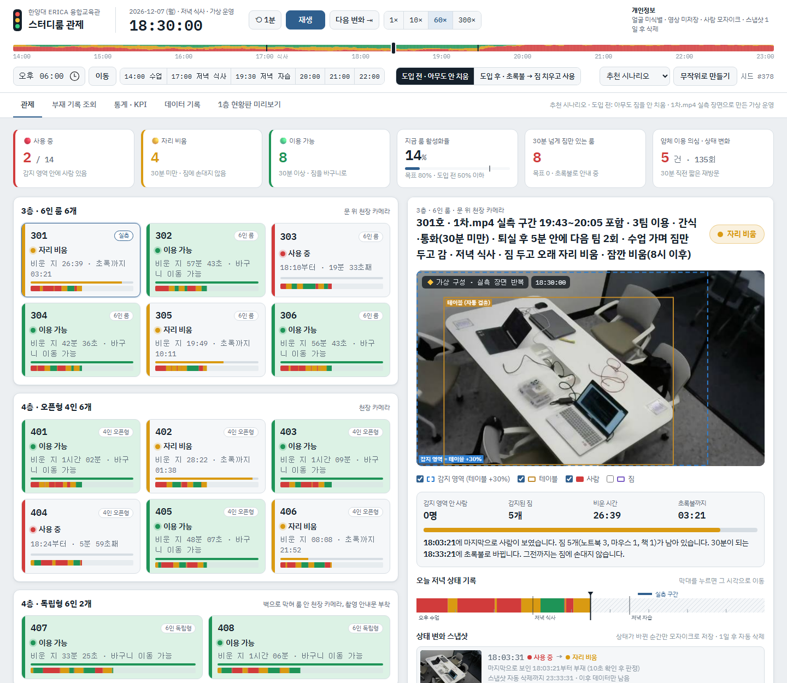
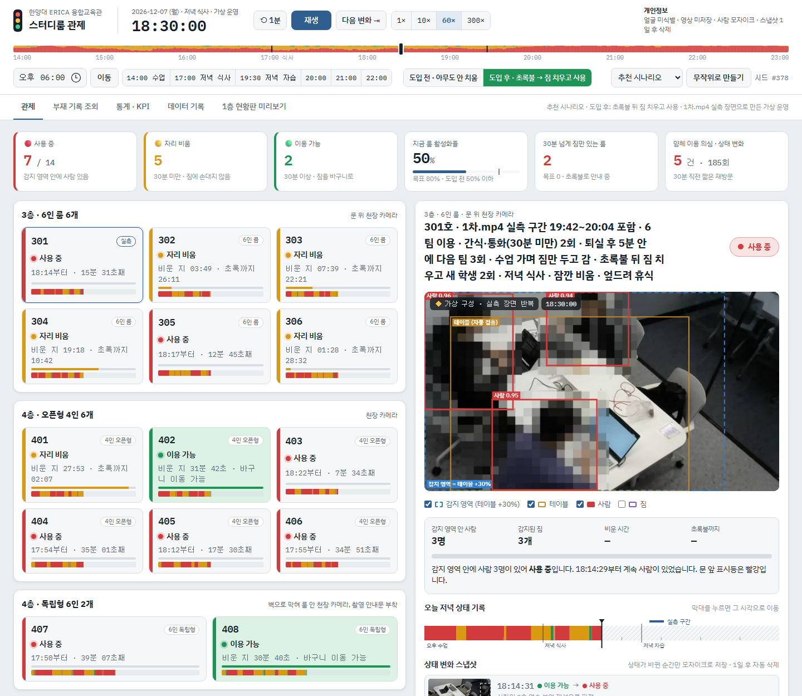
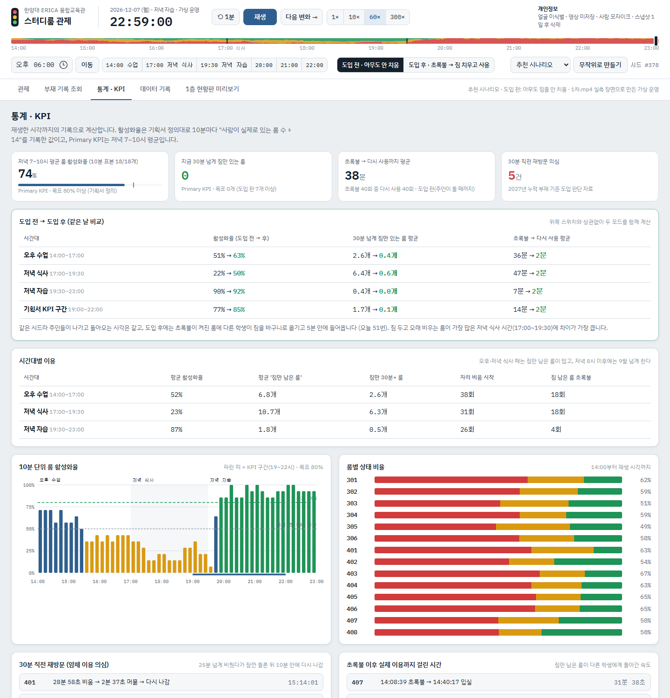
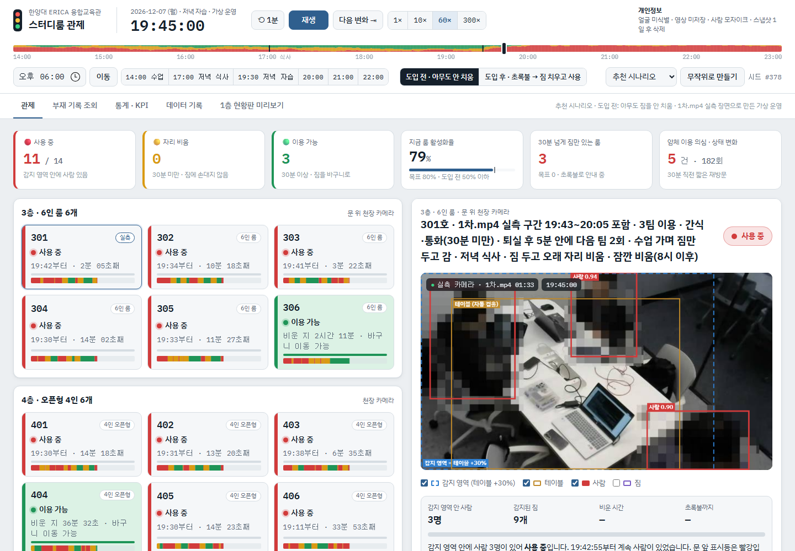

# DEMO · 관리자 대시보드 (가상 운영)

스터디룸 운영 담당자가 보는 화면입니다. 실제로 찍은 **1차.mp4**(천장 고정 카메라, 22분)를 파인튜닝 모델 **YOLO26s v2**로 1초마다 판정하고, 그 결과로 융합교육관 스터디룸 14개의 하루(14:00~23:00)를 가상으로 운영합니다.

## 실행

- **가장 쉬운 방법**: 이 폴더를 내려받아 `index.html`을 더블클릭합니다. 서버 없이 브라우저에서 바로 열립니다. (판정 데이터를 `data/detections.js`에 넣어 둠)
- 서버로 열기: 이 폴더에서 `python -m http.server 8770`을 실행하고 `http://localhost:8770`에 접속합니다.
- 주소로 원하는 화면 바로 열기: `index.html?t=18:30` (그 시각으로), `&tab=stats` (통계 탭), `&sys=after` (도입 후), `&play=0` (멈춘 채로)
- 키보드: `Space` 재생/일시정지, `←` `→` 1분 이동

## 화면 한눈에 보기

| 화면 | 보이는 것 |
|---|---|
|  | **관제 · 도입 전 18:30**: 저녁 식사 시간이라 사용 중 2개, 30분 넘게 짐만 있는 룸 8개, 활성화율 14% |
|  | **관제 · 도입 후 18:30**: 같은 날 같은 시각. 초록불이 켜지면 다른 학생이 짐을 바구니로 옮기고 5분 안에 써서 활성화율 57% |
|  | **통계 · KPI**: 같은 날을 도입 전과 도입 후로 나란히 비교한 표, 10분 단위 활성화율, 룸별 상태 비율 |
|  | **실측 카메라**: 301호에서 1차.mp4를 그대로 재생하는 구간. 사람(빨강), 테이블(주황), 감지 영역(파랑 점선 = 테이블 +30%). 사람은 모자이크 |

## 도입 전 / 도입 후 비교 스위치

시간 막대 아래 스위치로 바꿉니다. 처음 열면 **도입 전**입니다.

| 모드 | 내용 |
|---|---|
| **도입 전 · 아무도 안 치움** | 지금 현장과 같습니다. 30분이 넘어 초록불이 켜져도 짐을 치우는 사람이 없어, 주인이 돌아올 때까지 짐만 남은 룸이 그대로 있습니다 |
| **도입 후 · 초록불 → 짐 치우고 사용** | 초록불이 켜지면 기다리던 학생이 짐을 바구니로 옮기고 5분 안에 씁니다 |

같은 시드면 두 모드는 같은 날입니다. 주인들이 나가고 돌아오는 시각은 똑같고, 도입 후에만 초록불 뒤 새 학생이 들어옵니다.

추천 시나리오(시드 #378) 비교:

| 시간대 | 활성화율 | 30분 넘게 짐만 있는 룸 | 초록불 → 다시 사용 |
|---|---|---|---|
| 오후 수업 14:00~17:00 | 51% → 63% | 2.6개 → 0.4개 | 36분 → 2분 |
| 저녁 식사 17:00~19:30 | 22% → **50%** | 6.4개 → **0.6개** | 47분 → 2분 |
| 저녁 자습 19:30~23:00 | 90% → 92% | 0.4개 → 0.0개 | 7분 → 2분 |
| 기획서 KPI 구간 19:00~22:00 | 77% → **85%** | 1.7개 → 0.1개 | 14분 → 2분 |

시드 300개 평균으로는 저녁 식사 시간 활성화율 26% → 51%, '30분 넘게 짐만 있는 룸' 42% → 3%, 기획서 KPI(저녁 7~10시 활성화율) 73% → 80%입니다.

## 현장 관찰을 반영한 하루 (도입 전 기준)

| 시간대 | 시각 | 이용 모습 |
|---|---|---|
| 오후 수업 | 14:00~17:00 | 수업 때문에 짐만 두고 가는 사람이 많아 활성화율 50% 안팎 |
| 저녁 식사 | 17:00~19:30 | 대부분 밥 먹으러 가서 활성화율 40% 미만, 30분 넘게 짐만 있는 룸이 40% 정도(6개 안팎) |
| 저녁 자습 | 19:30~23:00 | 식사에서 돌아와 8시 이후 활성화율 9할 이상 |

- 짐이 하나도 없는 룸은 거의 없습니다. 한 팀이 나가면 다음 팀이 5분 안에 들어옵니다.
- 룸마다 잠깐 비움, 간식·통화, 수업, 저녁 식사, 30분 직전 재방문(얌체 의심), 30분 직후 복귀, 엎드려 휴식, 퇴실 후 다음 팀 같은 상황을 시간대에 맞게 섞습니다. `무작위로 만들기`를 누르면 다른 하루가 만들어집니다.

## 탭별 기능

| 탭 | 보여 주는 것 |
|---|---|
| 관제 | 층별 룸 14개 3색 상태, 비운 시간, 초록불까지 남은 시간, KPI 6개, 선택한 룸의 카메라 화면, 부재 확인 표시(n/10초), 상태 변화 스냅샷(1일 뒤 삭제), 알림 |
| 부재 기록 조회 | 룸과 시각을 넣으면 마지막으로 사람이 보인 시각, 비운 시간, 남은 짐 수, 근거 화면 |
| 통계 · KPI | 도입 전 → 도입 후 비교표, 저녁 7~10시 평균 활성화율(목표 80%), 시간대별 이용, 10분 단위 활성화율, 얌체 의심 |
| 데이터 기록 | 룸·시각·사람 있음/없음·상태 1분 단위 표, CSV 내보내기 |
| 1층 현황판 미리보기 | 학생이 보는 큰 화면 |

## 판정 규칙

- 감지 영역 안에 사람이 **2초** 연속 보이면 사용 중
- **10초** 연속 안 보이면 자리 비움. 비운 시각은 마지막으로 보인 순간
- 자리 비움이 **30분** 이어지면 이용 가능(초록)
- 감지 영역 = 가장 큰 테이블 박스를 가로·세로 30% 넓힌 영역

황예성의 MVP 코드 기준이라 팀 server.py(다각형 감지 영역, 2프레임 연속 확인)와는 감지 영역을 정하는 방식이 다릅니다.

## 영상 데이터에 대해 (꼭 읽기)

- 실제 카메라는 1대(1차.mp4)뿐이라, 14개 룸은 **실측 판정 결과를 장면별(공부 중, 나감, 짐만 남음, 들어옴, 엎드림)로 나눠 이어 붙여** 만들었습니다.
- 301호에는 1차.mp4를 그대로 재생하는 구간이 있습니다(카메라 배지 "실측 카메라"). 나머지는 같은 실측 장면을 반복해 만든 가상 데이터입니다(배지 "가상 구성").
- 사람·테이블·짐 박스와 있음/없음 판정은 모델이 실제로 낸 결과이고, 몇 시에 나가고 언제 돌아오는지는 현장 관찰을 바탕으로 만든 가상 시나리오입니다.
- 화면(`data/frames/`, 640×360, 1,318장)은 사람을 모두 모자이크했습니다. 두 모델(YOLO26s v2, yolov10s)을 낮은 기준(0.15)으로 합쳐 박스를 10% 넓힌 영역을 큰 칸으로 덮었습니다. 원본 영상은 올리지 않았습니다.
- 10_Project/.gitignore가 `frames/`를 막고 있어서 이 폴더의 화면만 `git add -f`로 올렸습니다.

## 파일

| 파일 | 내용 |
|---|---|
| `index.html`, `style.css`, `app.js` | 대시보드 (라이브러리 없이 HTML·CSS·JS만 사용) |
| `data/detections.js` | 1초마다의 판정 결과 (감지 영역, 테이블, 사람, 짐 박스) |
| `data/frames/` | 사람 모자이크 화면 1,318장 |
| `build_data.py` | 1차.mp4를 판정해 위 데이터를 만드는 코드. 영상 경로가 작성자 노트북 기준이라 그대로는 안 돈다 |
| `화면/` | 이 문서에 쓴 캡처 |
