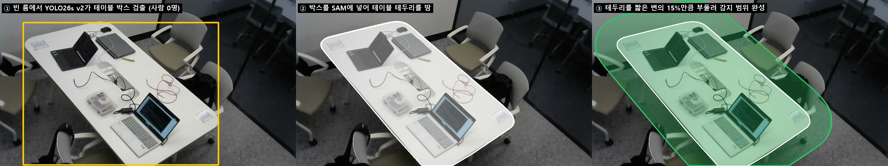
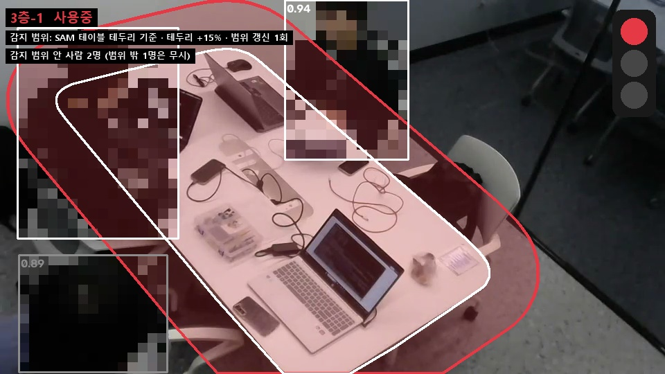
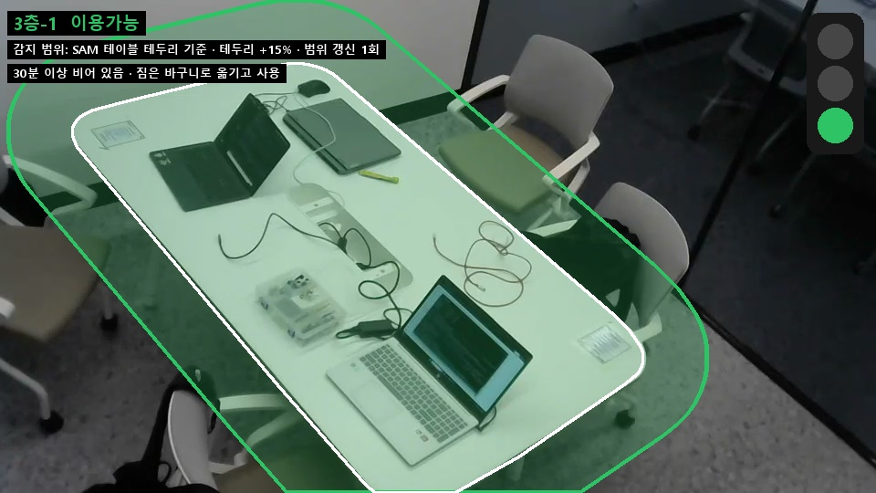
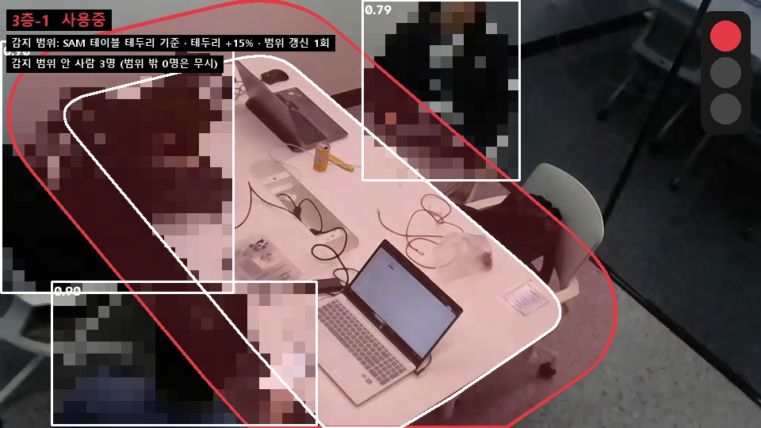

# SAM 감지 범위 데모

감지 영역을 손으로 그리지 않고, **YOLO26s v2가 찾은 테이블 박스를 SAM에 넣어 테이블 테두리를 딴 뒤 15% 부풀려** 감지 범위로 쓰는 방식의 시험 데모입니다. 판정 방식과 결정 근거는 [BASE_MODEL README 9절](../../README.md#9-sam으로-감지-범위-자동으로-정하기-대안)에 있습니다.

> 팀 판정 본체(`server.py`, `zone.py`)는 바꾸지 않았습니다. 이 폴더는 따로 돌아가는 시험 코드입니다.

| 파일 | 내용 |
|---|---|
| `run_sam.py` | 실행 코드 (화면 표시, 신호등, 상태가 바뀔 때 화면 저장) |
| `sam_zone.py` | 1단계 감지 범위 정하기(SAM) + 2단계 재석 판정 + 테이블 이동 감지 |
| `room_logic.py` | 30분 3색 판정 |
| `예시/` | 1차.mp4로 실행한 화면 (사람 모자이크) |

## 예시 화면 (1차.mp4, 30분을 30초로 줄인 시연)



| 공부 중 → 🔴 | 모두 나감 → 🟡 |
|---|---|
|  |  |
| **30분(시연 30초) 뒤 → 🟢** | **다시 앉음(엎드린 사람 포함) → 🔴** |
|  |  |

흰 선은 SAM 테이블 테두리, 색 영역은 부풀린 감지 범위(신호등 색), 흰 박스는 재석으로 센 사람, 회색 박스는 범위 밖이라 무시한 사람입니다.

## 실행

이 폴더에서 실행합니다. SAM 가중치(`sam2.1_t.pt`, 약 78MB)는 처음 실행할 때 공식 Ultralytics 저장소에서 자동으로 받습니다.

```bash
python run_sam.py --source 1차.mp4 --weights ../../../03_모델/알박기_yolo26s_v2.pt --time-scale 60 --snap 결과
python run_sam.py --source 0 --weights ../../../03_모델/알박기_yolo26s_v2.pt   # 웹캠, 실제 30분 기준
```

| 옵션 | 기본값 | 설명 |
|---|---|---|
| `--grow` | 0.15 | 테두리를 테이블 짧은 변의 몇 배만큼 부풀릴지 |
| `--overlap` | 0.15 | 사람 박스 중 감지 범위와 겹쳐야 재석으로 보는 비율 |
| `--time-scale` | 1 | 시연용 시간 압축 (60이면 30분 → 30초) |
| `--start`, `--duration` | 0 | 영상 시작 위치와 처리 길이(초) |
| `--snap` | 없음 | 상태가 바뀔 때 화면을 저장할 폴더 |

- 사람 신뢰도 기준은 0.35로, 팀 server.py의 0.30과 다릅니다.
- 결과 영상 저장(`--save`)은 경로에 한글이 있으면 실패할 수 있습니다.
