# BASE_MODEL · 모델 고르기부터 파인튜닝, 데모까지

스터디룸 알박기 감지에 쓸 **기본 모델**을 정한 과정과, 그 모델로 만든 **관리자 대시보드 데모**를 정리했습니다. 작성 황예성, 2026-10-18~21.

## 한눈에 보기

1. **사전학습 YOLO 16종을 실제 룸 영상으로 비교했습니다.** 사람은 모두 잘 잡았지만, 테이블과 엎드린 사람을 둘 다 잘 잡는 모델은 없었습니다.
2. **우리 영상으로 파인튜닝했습니다.** (파인튜닝 = 이미 학습된 모델을 우리 데이터로 조금 더 학습시키는 것) 최종 모델 **YOLO26s v2**는 학습에 쓰지 않은 영상에서 테이블 2% → 100%, 엎드린 사람 92.9% → 100%가 됐습니다.
3. **이 모델로 관리자 대시보드 데모를 만들었습니다.** 14개 룸의 하루를 가상으로 돌리고, 시스템 도입 전과 후를 비교합니다. → [DEMO](DEMO)
4. **감지 영역을 SAM으로 자동으로 정하는 방법을 시험했습니다.** 테이블 테두리를 따서 15% 부풀리고, 사람 박스의 10% 이상이 걸치면 재석으로 봅니다. → [9절](#9-sam으로-감지-범위-자동으로-정하기-대안), [DEMO/SAM감지범위](DEMO/SAM감지범위)

모델 파일은 [../03_모델/알박기_yolo26s_v2.pt](../03_모델)에 있습니다.

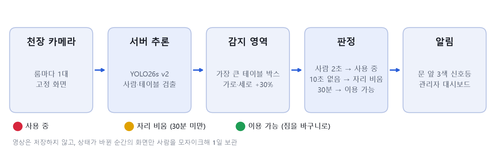

## 1. 사전학습 모델 16종 비교

- **시험 영상**: 라즈베리파이 웹캠으로 찍은 실제 스터디룸 영상 18초(3명 공부 중)에서 36장, 1차.mp4 마지막 7초(책상에 엎드린 사람) 84장
- **비교한 모델**: 크기별 11종(v8, 11, 12, 26)과 구조가 다른 5종(v5u, v9, v10, RT-DETR, YOLO-World). 모두 같은 조건(입력 크기 960)으로 돌렸습니다.
- **채점**: 화면에 실제로 있는 것(사람 3, 노트북 3, 휴대폰 2, 마우스 1, 가방 1, 테이블 1)을 직접 세어 정답으로 쓰고, 엎드린 사람은 판정 기준값 0.35 이상으로 잡은 비율을 셌습니다.

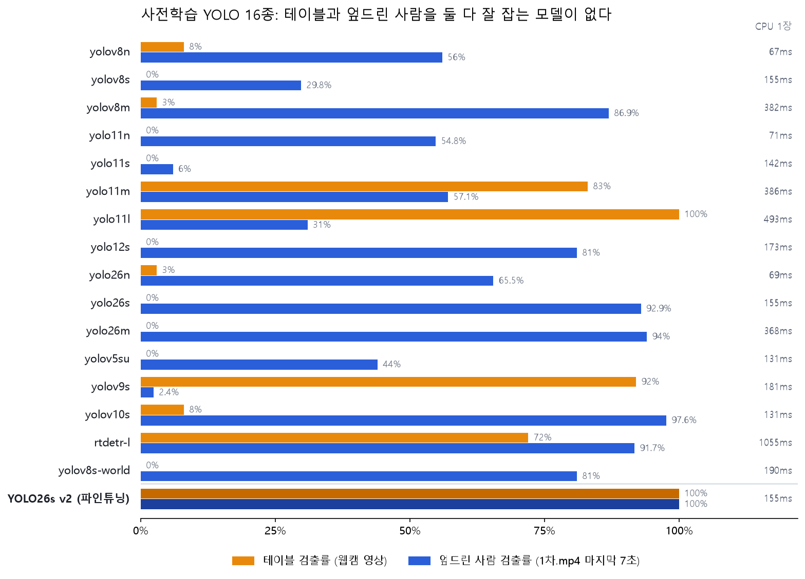

- 테이블을 잘 잡는 모델(yolo11l 100%, yolov9s 92%)은 엎드린 사람을 못 잡고(31%, 2.4%), 엎드린 사람을 잘 잡는 모델(yolov10s 97.6%, yolo26s 92.9%)은 테이블을 못 잡았습니다.
- rtdetr-l은 둘 다 어느 정도 잡았지만(72%, 91.7%) CPU에서 1장에 1초가 넘게 걸렸습니다.
- 그래서 사전학습 모델 중에서 고르는 대신 **우리 영상으로 파인튜닝**하기로 했습니다.

16종이 같은 장면을 어떻게 잡았는지 (사람은 모자이크, 주황 박스가 테이블):

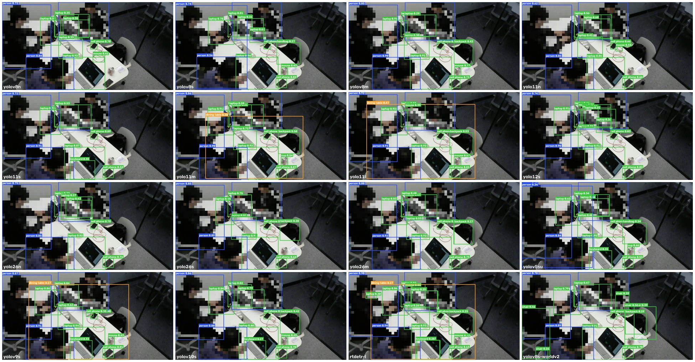

## 2. 학습 데이터 만들기

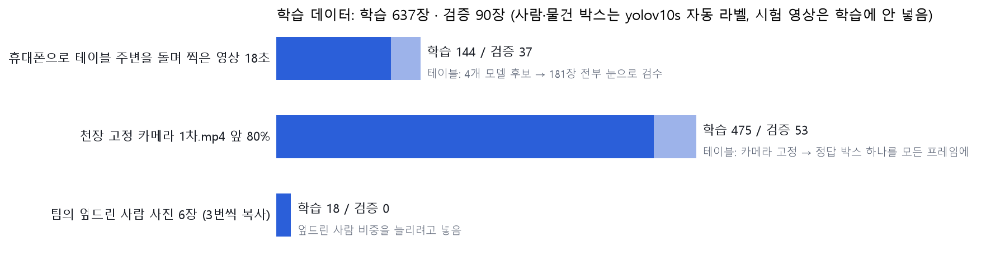

- **테이블 정답 박스**: 테이블을 잘 잡던 모델 4개(yolo11l, yolo11m, yolov9s, rtdetr-l)로 후보를 만든 뒤, 휴대폰 영상 181장을 **전부 눈으로 검수**하고 틀린 박스는 손으로 고쳤습니다. 테이블은 물건이나 사람에 가려진 부분까지 포함해 전체를 그렸습니다.
- **사람·물건 박스**: 엎드린 사람과 물건을 가장 잘 잡은 yolov10s로 자동 라벨링했습니다.
- **클래스 번호**: COCO 그대로(0 사람, 60 테이블) 둬서 기존 코드에 파일만 바꿔 끼우면 됩니다.
- **시험 영상은 학습에 넣지 않았습니다.** (1차.mp4 뒤 20%, 웹캠 영상)

테이블 라벨 검수 화면 (빨간 박스가 정답 후보):

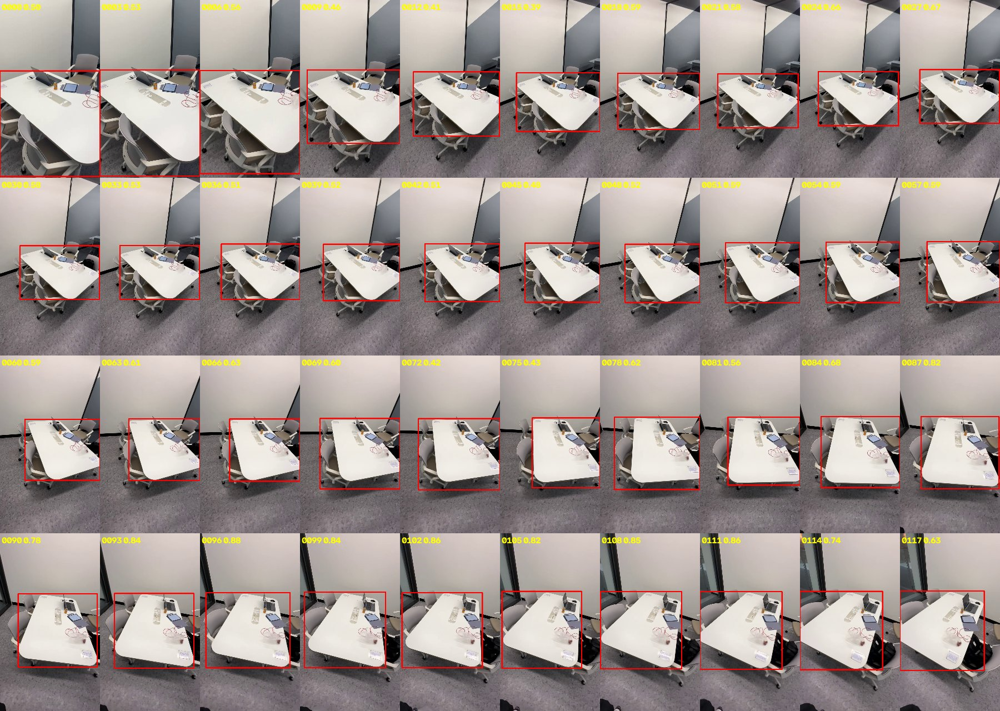

## 3. 파인튜닝: 한 번 실패하고 v2로

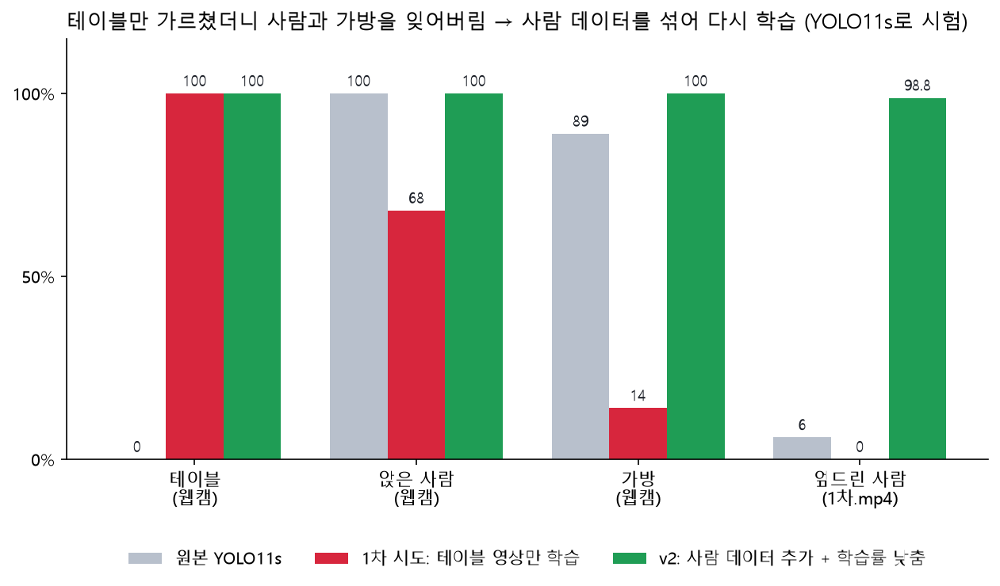

- **1차 시도**: 테이블 영상만으로 학습했더니 테이블은 100%가 됐지만, 원래 잘 잡던 **사람과 가방을 잊어버렸습니다.** (사람 100% → 68%, 가방 89% → 14%)
- **v2**: 1차.mp4 프레임(사람 있음)과 엎드린 사람 사진을 섞고, 학습률을 낮춰(AdamW, lr0 0.001) 다시 학습했습니다. 25에포크, 입력 크기 960, 노트북 RTX 5060에서 약 18분 걸렸습니다.
- 같은 데이터로 YOLO11s, YOLO26s, YOLO26m, YOLO26l을 모두 학습했습니다. (m·l은 코랩 A100)

## 4. 결과: 원본 vs 파인튜닝

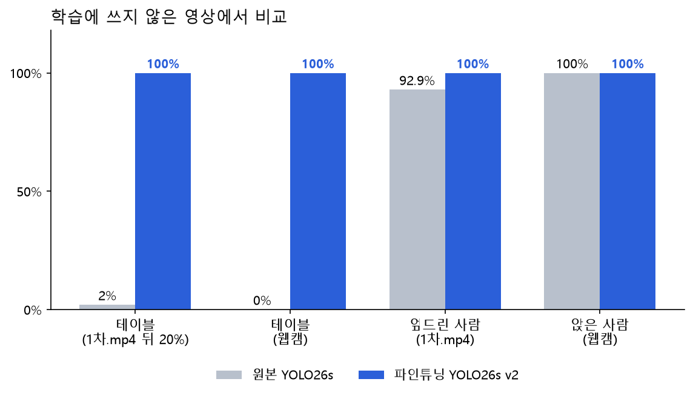

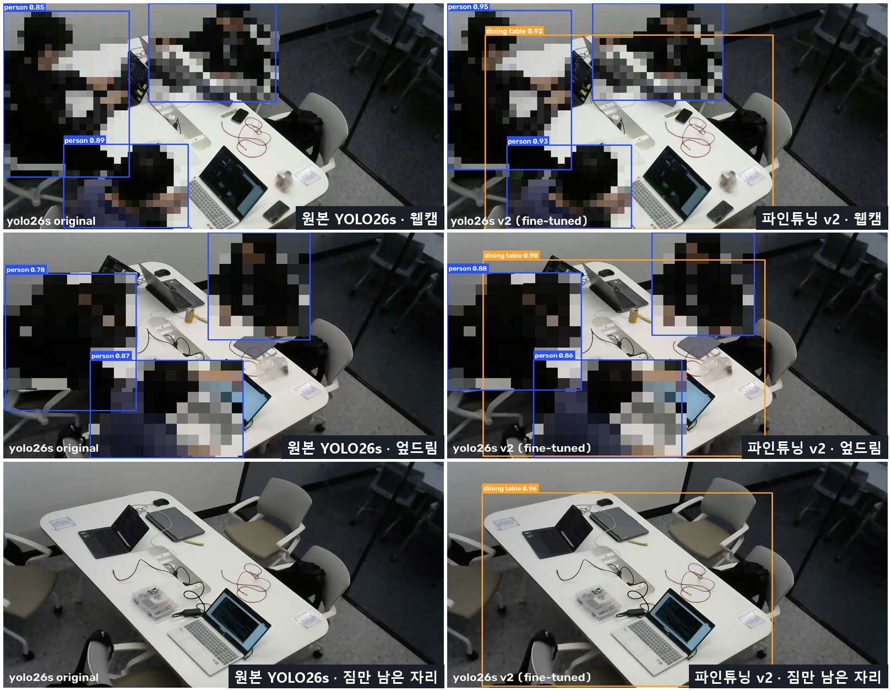

- 원본 YOLO26s는 테이블을 전혀 못 잡았고, v2는 사람이 있을 때와 짐만 남은 자리 모두 테이블을 0.9 이상으로 잡습니다.
- 학습 곡선은 [images/07_학습곡선.png](images/07_학습곡선.png)에 있습니다.

## 5. 크기 고르기: 가장 가벼운 s

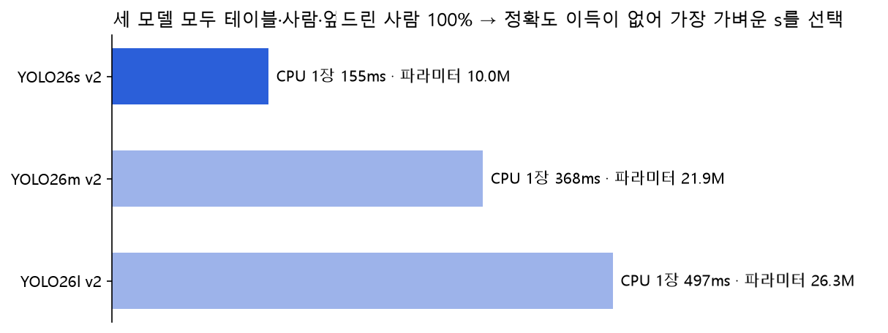

- 파인튜닝 후 s, m, l 모두 테이블·사람·엎드린 사람이 100%였습니다. m·l은 정확도 이득 없이 2.5~3.5배 느려서 **YOLO26s v2**를 골랐습니다.
- 카메라 영상을 서버로 모아 한 번에 추론하는 방식이면, YOLO26s v2는 GPU에서 1장에 29ms(약 34장/초)입니다. 14개 룸을 2초마다 판정하는 데 필요한 초당 7장의 약 5배입니다. (노트북 RTX 5060 기준 계산이고, 여러 카메라를 동시에 받아 보지는 않았습니다)

## 6. 팀 server.py에 넣어 확인

팀 판정 코드에 모델만 바꿔 넣고, CLAUDE.md의 검증 명령 그대로 1차.mp4를 돌렸습니다.

```bash
python server.py 1차.mp4 --zone zone_1차.json --interval 2 --log log.csv --model ../03_모델/알박기_yolo26s_v2
```

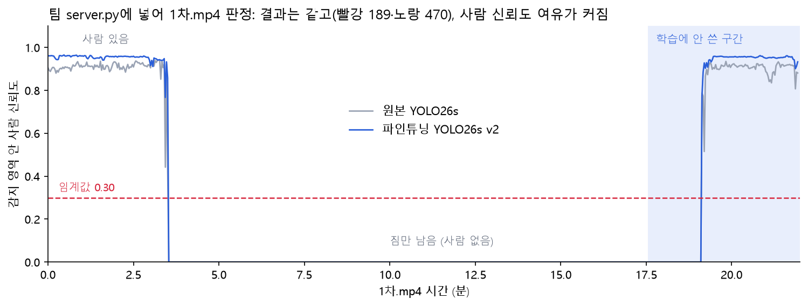

| 모델 | 빨강 | 노랑 | 사람 있을 때 최저 신뢰도 | 학습에 안 쓴 구간 최저 / 평균 |
|---|---|---|---|---|
| 원본 YOLO26s | 189 | 470 | 0.43 | 0.52 / 0.90 |
| 파인튜닝 YOLO26s v2 | 189 | 470 | 0.77 | 0.78 / 0.95 |

- 판정 결과는 같고, 사람 신뢰도가 임계값 0.30보다 훨씬 위에 있어 여유가 커졌습니다.
- 1차.mp4 앞 80%(0:00~17:34)는 학습에 썼기 때문에, 학습에 쓰지 않은 구간(파란 배경)만 따로 봐야 공정합니다.
- 2026-10-20, RTX 5060 Laptop(`--device 0`)에서 돌린 결과입니다. CLAUDE.md의 맥북 결과(빨강 188, 노랑 471)와 1장 차이는 3:30 프레임 값이 장치마다 다르게 나와서 생겼습니다.

## 7. DEMO: 관리자 대시보드

[DEMO](DEMO) 폴더의 `index.html`을 더블클릭하면 바로 열립니다. 자세한 설명은 [DEMO/README.md](DEMO/README.md)에 있습니다.

| 도입 전 18:30 (아무도 짐을 안 치움) | 도입 후 18:30 (초록불 → 짐 치우고 사용) |
|---|---|
|  |  |

- 1차.mp4를 YOLO26s v2로 1초마다 판정한 결과를 장면별로 이어 붙여, 14개 룸의 14:00~23:00을 가상으로 운영합니다.
- 현장 관찰대로 오후는 수업 때문에 활성화율 50% 안팎, 저녁 식사 시간(17:00~19:30)은 40% 미만, 저녁 8시 이후는 9할 이상입니다.
- **도입 전/도입 후 스위치**로 같은 날을 비교합니다. 저녁 식사 시간 활성화율이 22% → 50%, 30분 넘게 짐만 있는 룸이 6.4개 → 0.6개로 줄어듭니다(추천 시나리오 기준).


## 8. 꼭 알아 둘 점

- **팀의 엎드린 사람 사진 6장은 v2 학습에 들어갔습니다.** 그래서 CLAUDE.md의 "26s를 사진 6장으로 확인" 항목은 v2로는 확인할 수 없고, 새 사진이나 실제 촬영으로 확인해야 합니다.
- **가방은 거의 못 잡습니다**(웹캠 0%). server.py는 사람만 쓰므로 판정에는 영향이 없지만, PRFAQ의 짐 검출에는 쓰면 안 됩니다.
- 시험 영상은 실제 고정 카메라 화면이지만 **룸은 1곳**입니다. 다른 룸에 설치하면 그 카메라 화면으로 먼저 확인해야 합니다.
- 엎드린 사람 시험은 **1명, 7초 분량**입니다. 후드나 모자, 얼굴을 카메라 쪽으로 둔 자세, 조명 변화는 아직 보지 않았습니다.
- 사람·물건 라벨은 yolov10s 자동 라벨이라 그 모델의 실수도 일부 배웠을 수 있습니다.
- 학습 데이터(영상 프레임)에는 팀원 얼굴이 나와서 올리지 않았습니다. 이 폴더의 사진은 모두 사람을 모자이크했습니다.

## 9. SAM으로 감지 범위 자동으로 정하기 (대안)

지금 팀 코드는 `zone.py`로 감지 영역을 **손으로 그린 다각형**으로 정하고, 사람 박스 중심이 그 안에 있는지로 판정합니다. 파인튜닝으로 YOLO26s v2가 테이블을 잡게 됐으므로, 이 영역을 **자동으로** 정하는 방법을 시험했습니다. 팀 코드는 바꾸지 않았고, 시험 코드는 [DEMO/SAM감지범위](DEMO/SAM감지범위)에 따로 있습니다. (2026-10-20)

### 왜 SAM인가
YOLO는 테이블을 사각형 박스로만 줍니다. 천장에서 비스듬히 보면 테이블이 사다리꼴이라, 박스에 바닥·통로·유리벽 너머까지 들어갑니다. SAM(Segment Anything)은 박스를 주면 **추가 학습 없이** 테이블 모양 그대로 테두리를 땁니다.


1. 빈 룸에서 YOLO26s v2가 테이블 박스를 찾고
2. 그 박스를 SAM(`sam2.1_t`)에 넣어 테이블 테두리를 딴 뒤
3. 테이블 짧은 변의 15%만큼 바깥으로 부풀려 감지 범위로 씁니다.

### 처리 흐름

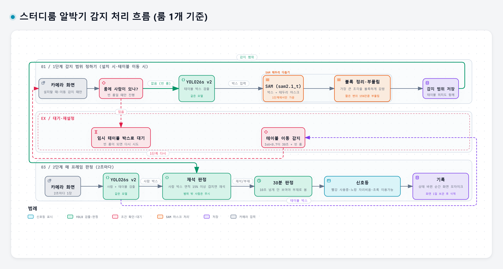

- **1단계(감지 범위 정하기)는 설치할 때와 테이블 위치가 바뀌었을 때만** 합니다. 사람이 앉아 있으면 SAM 테두리가 사람에 가려 조각나므로, 그동안은 테이블 박스를 임시로 쓰다가 빈 룸이 되는 순간 정합니다. 매 프레임 테이블도 같이 검출해서, 저장된 위치와 IoU 0.7 미만인 상태가 30초 이어지고 룸에 사람이 없으면 다시 정합니다.
- **2단계(매 프레임)**는 화면 전체에서 사람을 찾은 뒤, 사람 박스 면적의 10% 이상이 감지 범위에 걸치면 재석으로 봅니다. 영역만 잘라서 찾으면 의자에 앉아 몸이 범위 밖으로 나온 사람이 잘리기 때문입니다.
- 모델은 YOLO26s v2 하나로 두 단계를 다 하고, SAM은 1단계에서만 가끔 씁니다.

### 겹침 기준 10%를 고른 이유

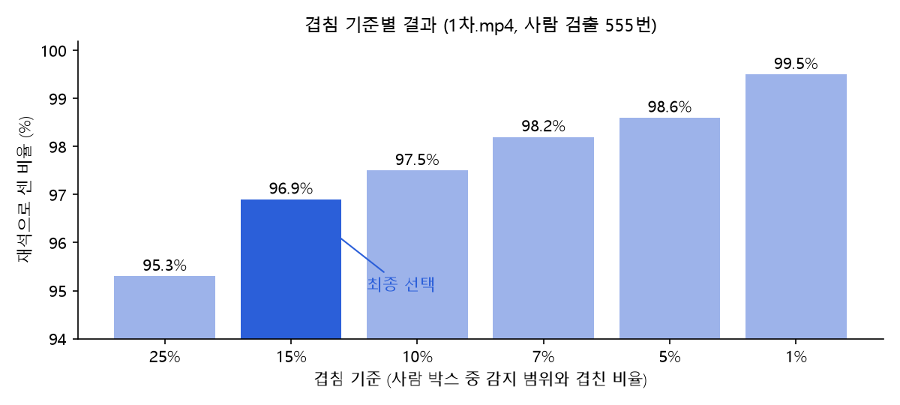

> 그래프의 선택 표시(15%)는 처음 정한 기준입니다. 최종 기준은 아래 표처럼 10%입니다 (2026-10-23 변경).

| 겹침 기준 | 사람별로 재석으로 센 비율 (1차.mp4, 555번) | 사람이 있는데 룸을 비었다고 본 순간 (1초 단위 378초) |
|---|---|---|
| 25% | 95.3% | 1초 |
| 15% | 96.9% | 1초 (마지막 사람이 나가는 순간) |
| **10%** | **97.5%** | **0초** |
| 1% | 99.5% | 0초 |

- 감지 범위를 더 부풀리면 옆 룸이나 통로까지 들어오므로, 부풀리기는 키우지 않고 겹침 기준으로 조절했습니다.
- 30분 규칙이라 공부하는 사람은 한 번만 테이블 근처로 와도 타이머가 처음으로 돌아갑니다. 그래서 사람 한 명씩보다 **룸 판정**이 중요한데, 처음 정한 15%에서는 퇴실 순간 1초 룸 판정이 틀렸고, 10%에서는 틀린 순간이 없었습니다. 그래서 1%처럼 너무 낮추지 않는 선에서 10%로 정했습니다.
- 1%까지 낮추면 감지 범위에 살짝 닿기만 해도 재석이 되어, 짐만 있는 빈 룸 앞 통로에 누가 서 있으면 부재 타이머가 계속 처음으로 돌아갑니다.
- 겹침이 10% 미만이었던 14번은 유리벽 쪽에 서 있는 사람 6번, 화면 모서리에 몸이 잘린 학생 5번, 출입 중인 사람 3번이었습니다.

### 아직 확인하지 않은 것
- 빈 룸 앞 통로나 유리벽 밖을 사람이 지나가는 장면에서 10% 기준이 그 사람을 거르는지
- 다른 룸 카메라에서 SAM 테두리가 깔끔하게 나오는지 (흰 테이블의 조명 반사, 물건이 많이 올라간 경우)
- 팀 server.py의 판정 방식(박스 중심이 다각형 안, 임계값 0.30)과 같은 영상으로 나란히 비교

## 폴더 구성

| 경로 | 내용 |
|---|---|
| `README.md` | 이 문서 |
| `images/` | 이 문서에 쓴 그림 (사람은 모자이크) |
| `DEMO/` | 관리자 대시보드 데모 (바로 실행 가능) |
| `DEMO/SAM감지범위/` | SAM 감지 범위 시험 코드와 예시 화면 (사람 모자이크) |
| `../03_모델/알박기_yolo26s_v2.pt` | 최종 모델 파일 (20MB) |
