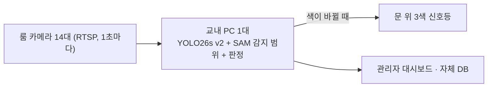

# 오픈스페이스 알박기 감지 시스템 PR/FAQ (최종) · ~~빈방 알리미~~

한양대학교 ERICA 융합교육관 스터디룸에서 짐만 두고 30분 넘게 비운 룸을 카메라로 찾아, 문 위 신호등 색으로 알려 주는 프로젝트의 PR/FAQ입니다.

> **표시 방법**: 처음 기획(2026-10-13~15)을 최종 결과(10/22 발표)에 맞춰 고쳤습니다.
> - ~~취소선~~ = 처음 기획에서 **뺀 것**
> - **[추가]** = 프로젝트를 하면서 **새로 넣은 것**
> - **[변경]** ~~이전~~ → 최종 = **바꾼 것**
>
> 팀 저장소 [10_Project/통합본/PRFAQ.md](https://github.com/gosu1/ERICA_X_MODULABS_CV/blob/main/10_Project/통합본/PRFAQ.md)와 같은 내용입니다. 처음 기획 원문은 팀 저장소의 Git 기록(10/13 커밋)에서 볼 수 있습니다. 같은 폴더의 PDF(문제분석지, PR, FAQ)는 처음 쓴 그대로 두었습니다.

## 바뀐 것 한눈에 보기

| 항목 | 처음 기획 | 최종 | 바꾼 이유 |
|---|---|---|---|
| 이름 | 빈방 알리미 | 오픈스페이스 알박기 감지 시스템 | 빈 방 찾기보다 '짐만 두고 비운 방'이 핵심 문제 |
| 표시 | ON AIR 네온사인 켜짐/꺼짐 | 문 위 3색 신호등 (빨강·노랑·초록) | '잠시 비움'과 '이용 가능'을 구분해야 함 |
| 알림 | 헤이영 알림, 행사 배너 | 삭제 · 관리자 대시보드, 1층 현황판(고도화) | 헤이영 연동 가능 여부 불확실, 범위 축소 |
| 기준 시간 | 60분 (가설) | 30분 | 학교에 이미 있는 30분 자리 비움 교칙을 그대로 씀 |
| 빈 책상 | 사람 없고 짐 없으면 5분 뒤 이용 가능 | 사람도 짐도 10초 넘게 없으면 바로 초록 | 기다릴 이유가 없음 |
| 모델 | 사전학습 YOLO11n부터 | YOLO26s 파인튜닝(v2) | 사전학습 16종 중 테이블과 엎드린 사람을 둘 다 잡는 모델이 없음 |
| 감지 영역 | 관리자가 다각형(ROI)을 손으로 지정 | SAM 테이블 테두리 +15%, 자동 | 손으로 그리지 않고, 사각형 박스가 통로를 덮는 문제 해결 |
| 카메라 | 방 모서리에서 30~45도 | 천장에 고정해 책상이 잘 보이게 | 실제 룸에서 테이블을 정면으로 보기 좋음 |
| 처리 장치 | 층별 미니 PC(CPU), MQTT·ESP32 | 교내 PC 1대(GPU, 최소 GTX 1060급) | 실측: CPU 1장 135ms로 부족, 라즈베리파이 2,832ms |
| 비용 | 미정 | 초기 207만 원, 룸당 월 1.5만 원 구독 | 학교(B2B)가 내는 금액으로 계산 |

---

## Press Release

### 1. 제목

**[변경]** ~~한양대 ERICA '빈방 알리미' 출시: 방 앞의 ON AIR 불이 꺼져 있으면 들어가도 됩니다~~
→ **한양대 ERICA 스터디룸 알박기 감지 시스템: 문 위 신호등이 초록이면 짐을 바구니로 옮기고 써도 됩니다**

### 2. 부제

**[변경]** 융합교육관 스터디룸을 쓰는 학생은 문 위 신호등 색만 보고 지금 쓸 수 있는 룸을 찾고, 학교는 순찰 없이 룸 상태와 이용 통계를 봅니다. ~~헤이영으로 알리는 학교 행사의 참여도까지 높일 수 있습니다.~~

### 3. 문제점

시험 기간이 되면 ERICA 오픈스페이스에서는 빈 방을 찾기가 어렵습니다. 막상 가 보면 짐만 놓여 있고 사람은 몇 시간째 돌아오지 않는 방도 많습니다. **[추가]** 저녁 시간대에는 14개 룸 중 절반 이상이 짐만 남은 채 비어 있었습니다(팀 직접 관찰).

**[추가]** 학교에는 이미 "30분 넘게 비운 룸은 짐을 바구니에 옮기고 써도 된다"는 교칙이 있습니다. 그런데 방금 온 학생은 짐 주인이 언제 나갔는지 알 수 없어서, 괜히 짐을 옮겼다가 다툼이 날까 봐 결국 그냥 돌아섭니다. 관리자는 모든 방을 순찰할 인력이 부족합니다.

~~학교는 헤이영으로 행사와 공지 알림을 자주 보냅니다. 하지만 알림이 많다 보니 학생들이 그냥 넘기는 경우가 많아서, 실제 참여로 잘 이어지지 않습니다.~~

### 4. 솔루션

룸마다 천장에 단 카메라로 감지 범위 안에 사람이 있는지 판단하고, **[변경]** 문 위 신호등 색을 바꿉니다.

| 신호등 | 상태 | 학생 행동 |
|---|---|---|
| 🔴 빨강 | 사람이 있음 | 사용 중 |
| 🟡 노랑 | 사람이 없고 30분 미만, 짐이 남아 있음 | 짐에 손대지 않음 |
| 🟢 초록 | 사람이 30분 넘게 없음 | 짐을 룸 앞 회색 바구니로 옮기고 사용 |
| 🟢 초록 | **[추가]** 사람도 짐도 없는 빈 책상 | 바로 사용 |

~~사람이 있으면 방문 앞의 ON AIR 네온사인이 켜지고, 방이 비면 꺼집니다. 짐만 두고 사람이 60분 넘게 돌아오지 않아도 네온사인이 꺼지고 '이용 가능'으로 바뀝니다. 헤이영에서 빈 방 알림을 신청한 학생에게는 "3층 OO룸이 비었습니다" 같은 알림이 갑니다.~~

**[변경]** 관리자 대시보드에서는 14개 룸 상태, 부재 기록, 활성화율과 도입 전/후 비교를 봅니다. 이 시스템은 사람이 누구인지 식별하지 않고, 영상을 저장하지 않으며, 방의 상태만 기록합니다.

### 5. 내부 관계자의 말

> "학생들에게 필요한 정보는 누가 방에 있는지가 아닙니다. 지금 들어갈 수 있는 방이 어디인지입니다. 그래서 처음부터 사람을 식별하지 않고 영상도 남기지 않도록 설계했습니다. ~~복도에서는 불빛만 보고, 멀리서는 헤이영 알림만 보고~~ **[변경]** 복도에서 문 위 색만 보고 빈 방을 찾을 수 있게 하는 것이 저희의 목표입니다."

### 6. 이용 방법

학생은 다른 앱을 설치하거나 무언가를 입력할 필요가 없습니다. **[변경]** 복도에서 문 위 신호등이 초록인 룸에 들어가면 됩니다. ~~멀리 있을 때는 헤이영의 [빈방 알리미] 메뉴에서 원하는 층을 고르고 '빈 방 나면 알려 주기'를 누르면 됩니다.~~ **[추가]** 고도화 단계에서는 1층 현황판으로 층을 돌지 않고 빈 룸을 확인합니다.

**[변경]** 학교는 룸마다 카메라와 신호등을 설치하면 됩니다. ~~관리자 화면에서 촬영 영역을 한 번 지정하면~~ 감지 범위는 AI(SAM)가 테이블 모양대로 자동으로 잡고, 담당자는 확인만 합니다.

### 7. 고객의 말

> "예전에는 짐만 있는 방은 주인이 곧 올까 봐 들어가지도 못했어요. 지금은 문 위가 초록이면 짐을 바구니로 옮기고 바로 써요."
>
> (인공지능학과 김OO 학생)

> **[변경]** "알박기 민원이 들어오면 예전엔 확인할 방법이 없었는데, 이제는 그 룸이 몇 시부터 비어 있었는지 기록으로 바로 봐요." ~~"빈 방 알림은 … 예전보다 행사 신청이 늘었어요."~~
>
> (한양대학교 ERICA 운영 담당 이OO)

### 8. 마무리

**[변경]** ~~빈방 알리미는 중간고사를 앞둔 2027년 4월 5일부터 운영을 시작합니다. 지금 헤이영에서 [빈방 알리미] 메뉴를 열고 빈 방 알림을 신청해 보세요.~~
→ 학교 협조(카메라 설치, 운영 승인, 개인정보 검토)를 받은 뒤 실제 룸에서 7일간 데이터를 모으고, 현장 데이터로 다시 학습해 시험에 합격하면 융합교육관 14개 룸에 적용합니다. 다른 건물에서도 룸 단위로 도입할 수 있습니다.

---

## FAQ

### 내부 동료가 궁금해할 질문

#### Q1. 어떤 모델과 클래스를 쓰나요?

**[변경]** ~~COCO로 사전학습된 Ultralytics YOLO(예: YOLO11n, YOLO11s)를 씁니다. 가장 작은 n 모델로 시작하고, 정확도가 부족하면 s 모델로 올립니다.~~
→ **YOLO26s를 우리 룸 영상으로 파인튜닝한 v2**를 씁니다. 사전학습 모델 16종을 같은 조건으로 비교했지만 테이블과 엎드린 사람을 둘 다 잡는 모델이 없어서, 학습 데이터 727장(학습 637 + 검증 90)을 직접 만들어 학습했습니다. 학습에 안 쓴 영상에서 테이블 2% → 100%, 엎드린 사람 92.9% → 100%가 됐습니다. n은 엎드린 사람 65.5%로 부족했고, m·l은 정확도는 같은데 느렸습니다. YOLO26은 NMS 후처리가 없어 저사양 장비에도 유리합니다.

| 용도 | COCO 클래스 (ID) |
|---|---|
| 사람 | person (0) |
| **[변경]** 테이블 | dining table (60) · ~~제외 클래스~~ → 감지 범위를 만드는 데 사용 |
| 짐 | backpack (24), umbrella (25), handbag (26), suitcase (28), bottle (39), cup (41), laptop (63), mouse (64), keyboard (66), cell phone (67), book (73) |

~~키보드나 모니터처럼 방에 원래 있는 비품은 빈 방을 몇 분 찍어 위치를 등록해 두고, 겹치는 검출은 짐으로 세지 않습니다.~~

Ultralytics YOLO는 AGPL-3.0 라이선스라서 수업 프로젝트에는 문제가 없습니다.

#### Q2. 방 상태는 어떤 흐름으로 판단하나요?

1. 카메라(RTSP)에서 **[변경]** ~~5초마다~~ → 1초마다 프레임을 1장씩 가져옵니다.
2. YOLO로 검출합니다. 입력 크기는 **[변경]** ~~640~~ → 960, 사람 신뢰도 기준은 0.35입니다.
3. **[변경]** ~~방 영역(ROI) 다각형으로 걸러냅니다.~~ → **감지 범위**: 설치할 때 빈 룸에서 찾은 테이블 박스를 SAM에 넣어 테이블 테두리를 따고, 짧은 변의 15%만큼 부풀립니다. 사람 박스가 이 범위와 일정 비율(10%) 이상 겹치면 재석입니다. 범위를 더 넓히면 유리벽 너머 옆방 사람까지 잡혀서, 범위 대신 겹침 기준을 낮췄습니다.
4. 사람이 2초 연속 보여야 재석, 10초 연속 안 보여야 부재로 봅니다.
5. 상태가 바뀔 때만 신호등과 관리자 화면에 보냅니다.

| 상태 | 판단 조건 | 신호등 |
|---|---|---|
| 사용 중 | 감지 범위 안에 사람이 2초 연속 보임 | 🔴 |
| 자리 비움 | 사람이 10초 넘게 없고, 30분 미만 | 🟡 |
| 이용 가능 | 사람이 30분 넘게 없음 | 🟢 |
| **[추가]** 빈 책상 | 사람도 짐도 10초 넘게 없음 | 🟢 (바로) |

~~OCCUPIED: 최근 30초(6프레임) 중 4프레임 이상 / AWAY: 5분 넘게 사람 없음, 60분 미만 / ABANDONED: 60분 이상 / VACANT: 5분 넘게 사람 없음, 짐 없음~~

**[변경]** 기준 시간은 ~~60분 가설~~ → 학교 교칙의 30분입니다.

#### Q3. 짐이 아니라 사람이 없는 시간을 핵심 기준으로 삼는 이유는 무엇인가요?

학생들이 두고 가는 필통, 외투, 이어폰 같은 물건은 대부분 COCO 클래스에 없고, 작은 물건은 잘 찾지 못합니다. 반면 person은 가장 안정적으로 검출됩니다. 그래서 30분이 지났는지는 사람 검출만으로 판단하고, 짐 검출은 **[변경]** 빈 책상(바로 초록)을 가릴 때만 씁니다.

**[추가]** 다만 최종 모델은 가방을 거의 못 잡습니다(웹캠 영상 0%). 가방만 남은 책상이 빈 책상으로 잘못 보이지 않도록 가방류는 신뢰도 기준을 낮춰(0.10) 찾고, 짐이 10초 연속 없어야 빈 책상으로 봅니다.

#### Q4. 어떤 오판이 생길 수 있고, 어떻게 줄이나요?

- **거짓 빈 방**(사람이 있는데 초록): 남의 짐을 치우게 해서 바로 민원이 됩니다. 더 해로운 오류입니다.
- **거짓 사용 중**(빈 방인데 초록이 안 켜짐): 지금 상황과 같으므로 덜 해롭습니다.

| 상황 | 생길 수 있는 오판 | 대응 |
|---|---|---|
| 책상에 엎드려 잠 | 사람을 놓침 | **[변경]** ~~낮은 임계값, 5분 시간 창~~ → 파인튜닝으로 엎드린 사람 100%, 10초 부재 보정 |
| **[추가]** 후드 쓰고 엎드림 | 사람을 놓침 | 합성 사진 실험에서 가장 약한 장면으로 확인 → 시범 수집에서 먼저 모음 |
| 의자에 걸쳐 둔 외투 | 사람으로 잘못 검출 | **[추가]** 합성 사진 실험에서 외투만 걸린 의자는 사람으로 잡지 않음을 확인 |
| 유리벽 너머 사람 | 사람으로 잘못 검출 | **[변경]** ~~ROI에서 제외~~ → SAM 감지 범위 +15%, 겹침 기준 |
| **[추가]** 통로를 지나가는 사람 | 사람으로 잘못 검출 | 사각형 박스 대신 SAM 테이블 테두리 |
| 문을 열고 잠깐 들여다봄 | 상태가 잠깐 바뀜 | **[변경]** 2초 연속 보여야 재석 |
| 재실 센서 때문에 조명이 꺼짐 | 사람을 놓침 | 프레임 평균 밝기가 기준보다 낮으면 '알 수 없음'으로 처리 (계획, 아직 구현 안 함) |

#### Q5. 천장에 단 카메라 영상에서도 사전학습 모델이 잘 동작하나요?

**[변경]** 예상대로 그대로는 잘 동작하지 않았습니다. 사전학습 모델은 책상을 식탁으로만 배워, 천장에서 본 우리 테이블을 거의 찾지 못했습니다(YOLO26s 2%). 그래서 ~~카메라를 모서리에 비스듬히 달고~~ 카메라는 천장에 고정해 책상이 잘 보이게 하고, 우리 룸 영상으로 파인튜닝했습니다.

**[추가]** 시도했다가 바꾼 것:
- 3D 디지털 트윈 검증: 엎드린 사람 48.9%로 실제 사진(6/6)과 달라 중단, 실제 룸 영상 22분으로 검증
- 1차 파인튜닝(테이블 위주): 사람을 잊음(100% → 68%) → 사람 데이터를 넣고 학습률을 낮춘 v2
- Stable Diffusion 합성 데이터: 모델이 이미 잡는 장면이라 학습에서 제외, 약점 찾기에만 사용

#### Q6. 성능은 어떻게 평가하나요?

1. **검출 성능**: 학습에 안 쓴 영상(천장 카메라 영상 뒤 20%, 웹캠 영상)으로 **[변경]** 사람·엎드린 사람 검출률과 테이블 IoU를 잽니다. ~~precision, recall, mAP@0.5~~ 판정은 매 프레임 '사람이 있느냐'로 정해지므로, 장면별 검출 여부가 운영과 바로 이어집니다.
2. **방 상태 판단 성능**: **[변경]** 시범 운영에서 14개 룸을 하루 3번씩 7일, 약 300회 직접 관찰해 판정과 비교합니다.
   - **[추가]** 불합격 기준: 주인이 있는데 초록이 켜진 경우 1건 이상, 또는 빈 룸을 놓친 경우 2% 초과
3. **서비스 지표**: 룸 활성화율(사람이 실제로 있는 룸 수 ÷ 14), 30분 넘게 짐만 있는 룸 수, 초록불 → 다시 사용까지 걸린 시간. ~~빈 방 알림 신청 수와 열람률, 행사 배너 클릭 수~~

#### Q7. 시스템은 어떻게 구성되고, 장비는 무엇이 필요한가요?

~~층별 처리 장치 → MQTT → ESP32 ON AIR 네온사인 / 백엔드 서버 → 헤이영 알림~~

**[변경]** 처리량: 룸 14개 × 1초 1장 = 초당 14장, 1장을 71ms 안에 처리해야 합니다. ~~YOLO11n은 CPU에서도 수십 ms라 GPU 없는 미니 PC로 충분할 것~~ → 실측 결과 CPU만으로는 1장 135ms로 부족했고, GPU(RTX 5060 노트북)는 18.1ms였습니다. 연산 성능 비율로 환산해 **최소 GTX 1060급, 권장 GTX 1070급**(약 50만 원 PC)으로 정했습니다.

**[추가]** 검토 후 제외한 안:
- 기존 CCTV: 한 화면에 여러 룸이 겹치고 스터디룸 안에는 CCTV가 없음
- 룸별 라즈베리파이: 1장 2,832ms, 최고 81.3°C로 1초 간격 판정 불가
- 클라우드 GPU: 월 약 60만 원, 영상이 학교 밖으로 나감

#### Q8. 개인정보 보호는 기술적으로 어떻게 보장하나요?

- 프레임은 메모리 안에서만 다루고, 판정이 끝나면 바로 버립니다. 영상이 교내망 밖으로 나가지 않습니다.
- 얼굴 인식이나 재식별(ReID) 모델을 쓰지 않습니다.
- **[추가]** 신호등 색이 바뀐 순간의 화면만 사람을 모자이크해 오류 검수용으로 1일 보관한 뒤 삭제합니다.
- **[변경]** 기록은 시각, 룸 번호, 신호등 색만 남깁니다. ~~bbox 좌표도 보내지 않습니다.~~
- **[추가]** 발표 자료와 공개 저장소의 실험 이미지는 사람을 모두 모자이크했습니다.

운영 전에 학교 개인정보보호 담당 부서의 검토를 받습니다(설치 목적, 안내판 부착 등 영상정보처리기기 설치 기준).

#### ~~Q9. 헤이영 알림 연동이 실제로 가능한가요?~~

~~아직 확인하지 못했습니다. … 웹 페이지와 브라우저 알림(Web Push)으로 먼저 시작하고, 협의가 끝난 뒤 헤이영 연동을 추가합니다.~~
→ 알림 기능은 최종 범위에서 뺐습니다. 대신 **[추가]** 1층 현황판을 고도화 단계로 둡니다.

#### Q10. 학교가 비용을 내고 이 시스템을 도입해야 하는 이유는 무엇인가요?

- **공간 이용률**: 짐만 남은 방을 다른 학생이 쓸 수 있으므로, 방을 늘리지 않아도 더 많은 학생이 공간을 이용합니다. **[추가]** 가상 운영(실측 판정 + 현장 관찰 기반 출입)에서 저녁 식사 시간 활성화율이 22% → 50%로 예측됐습니다.
- **운영 인력**: 관리자가 모든 방을 순찰하지 않아도 됩니다. **[추가]** 다툼이 생기면 부재 기록으로 몇 시부터 비었는지 확인합니다.
- ~~**헤이영 참여**: 알림 화면에 학교 행사 배너를 보여 줄 수 있습니다.~~

**[추가]** 비용:

| 항목 | 금액 |
|---|---|
| 초기 도입 (룸 14개) | 207만 원 (카메라 64만, PC 50만, 신호등 49만, 전기 공사 30만, 부자재 14만) |
| 구독료 | 룸당 월 1.5만 원 (월 21만 원, 연 252만 원) · 점검, 고장 수리(출장비 제외), 재학습 인건비 포함 |
| 학교 예산 대비 | 연 252만 원 = ERICA 학생지원비 103.6억 원의 0.02% (첫해 0.04%) |

학생은 무료로 쓰고 비용은 학교가 내므로 B2B 모델입니다.

#### Q11. 수업 기간 안에 어디까지 만들었나요?

**[변경]** 계획 대비 실제로 만든 것:

| 계획 | 실제 |
|---|---|
| 웹캠과 노트북으로 YOLO 추론과 상태 머신 | ✅ 실제 룸 천장 카메라 영상 22분으로 판정, 파인튜닝 모델(YOLO26s v2) |
| ~~ESP32와 LED 스트립 ON AIR 표시등~~ | 제외 (신호등은 설계·비용 산정까지) |
| 방 상태를 보여 주는 웹 대시보드 | ✅ 관리자 대시보드 (14개 룸 가상 운영, 통계·KPI, 부재 기록) |
| ~~디스코드·텔레그램 봇 빈 방 알림~~ | 제외 |
| 시나리오 영상으로 평가 | ✅ 학습에 안 쓴 영상으로 검출 평가 |
| **[추가]** | 라즈베리파이 실측, SAM 자동 감지 범위, 생성형 데이터 실험, 비용·서버 사양 산정 |

시연할 때는 기준 시간을 줄여서 보여 줍니다. 여러 방 동시 처리, GTX 1060 실측, 개인정보 검토는 시범 운영 단계에서 진행합니다.

### 외부 고객이 궁금해할 질문

#### Q1. 다른 앱을 설치해야 하나요?

**[변경]** 아니요. 문 위 신호등 색만 보면 됩니다. ~~헤이영의 [빈방 알리미] 메뉴에서 알림 신청과 대시보드를 모두 이용할 수 있습니다.~~

#### ~~Q2. 빈 방 알림이 너무 자주 오지 않나요?~~

~~알림은 학생이 직접 신청했을 때만 옵니다. …~~ (알림 기능 제외)

#### ~~Q3. 알림을 받고 갔는데 이미 다른 사람이 있으면 어떻게 하나요?~~

~~빈 방 알림은 방을 잡아 두는 예약이 아닙니다. …~~ (알림 기능 제외)

#### Q4. 대시보드에 제가 방에 있는 모습이 보이나요?

아니요. **[변경]** 관리자 대시보드에는 룸 상태만 나오고, 확인용 화면은 사람을 모자이크한 스냅샷뿐이며 하루 뒤 지워집니다. 시스템은 방 안에 있는 사람이 누구인지 알지 못합니다.

#### Q5. 화장실에 잠깐 다녀오면 초록불이 켜지나요?

**[변경]** 짐을 두고 나간 지 ~~60분~~ 30분이 지나지 않았다면 노랑이고, 다른 학생은 짐에 손대지 않습니다. 다만 필통이나 이어폰처럼 작은 물건만 두고 나가면 짐으로 알아보지 못해 **[변경]** ~~5분 뒤에 빈 방으로~~ 빈 책상으로 보고 바로 초록이 될 수 있으니, 가방이나 노트북을 두고 가 주세요. 자리를 비운 기록이 개인에게 남거나 벌점이 매겨지는 일은 없습니다.

#### Q6. 30분 넘게 방을 비웠더니 짐이 옮겨져 있어요. 어디서 찾을 수 있나요?

**[변경]** ~~60분 넘게 비어 있던 방의 짐은 관리자가 확인한 뒤 [관리 데스크 보관함]으로 옮깁니다.~~ → 30분 넘게 비어 초록이 된 룸의 짐은 다음 학생이 **룸 앞 회색 바구니**로 옮깁니다. 바구니에서 찾아가시면 됩니다.

#### Q7. 초록불인 방에 들어갔는데 사람이 있으면 어떻게 하나요?

짐만 있다면 바구니로 옮기고 쓰면 됩니다. 사람이 있다면 표시가 잘못된 것입니다. **[변경]** ~~헤이영 '실제와 달라요' 버튼~~ → 관리자에게 알려 주세요. 관리자는 부재 기록과 모자이크 스냅샷으로 확인합니다. **[추가]** 잘못된 초록이 시범 운영에서 한 번이라도 나오면 적용하지 않고 다시 학습합니다.

#### Q8. 우리 학교나 다른 건물에도 도입할 수 있나요?

방마다 카메라와 신호등을 달 수 있는 공간이라면 도입할 수 있습니다. **[변경]** ~~학교 앱으로 알림을 보낼 수 있다면 같은 방식으로 연동합니다.~~ → 룸 단위로 값을 매겨서(룸당 월 1.5만 원), 일부 룸만 먼저 시범 운영하거나 다른 건물로 넓힐 때도 룸 수만 곱하면 됩니다.
